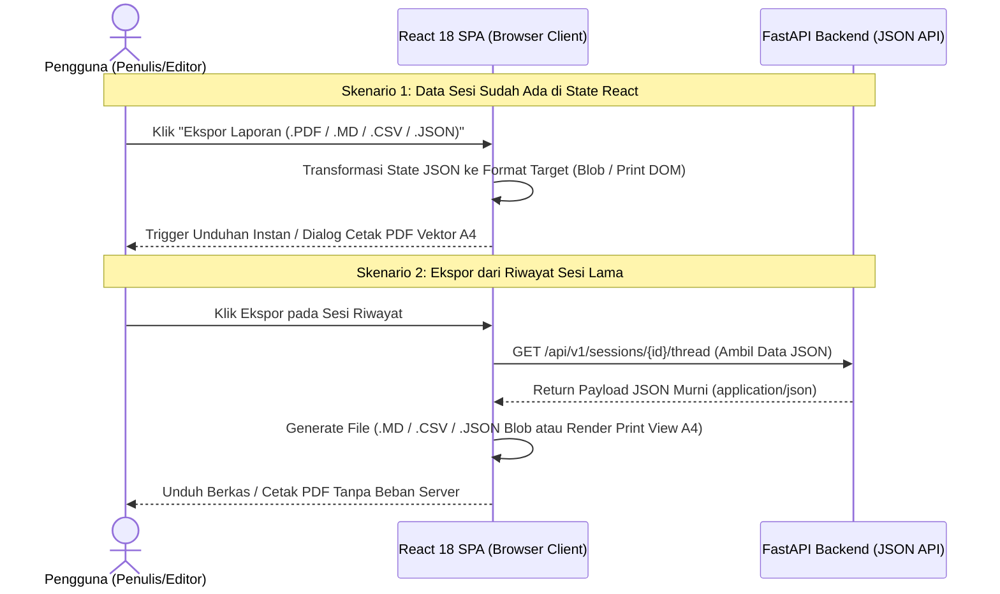

# STANDAR BAKU ARSITEKTUR PEMROSESAN BERKAS & EKSPOR DI FRONTEND (SPA CLIENT-SIDE PROCESSING STANDARD)
**Referensi Utama:** Best Practice Upload & Download File (Eko Kurniawan Khannedy — Programmer Zaman Now)  
**Lingkup Penerapan:** Seluruh Modul Frontend & Backend WASKITA (*Web-Article Semantic & Quality Inspection Tool*)

---

## 1. Filosofi Dasar (Mengapa Pemrosesan Berkas Wajib di Frontend SPA)

Berdasarkan standar arsitektur *Single Page Application* (SPA) modern dari **Eko Kurniawan Khannedy (Programmer Zaman Now)**:
1. **Eliminasi Beban CPU, Memori, dan I/O di Backend:**
   - Pada arsitektur tradisional yang keliru, fitur *Upload* (CSV/TXT/MD/DOCX) maupun *Download/Export* (PDF/Excel/CSV/Markdown/JSON) membebankan proses *parsing*, *rendering*, dan pembuatan berkas di server Backend.
   - Akibatnya, server Backend terpaksa melakukan pekerjaan berat (*blocking I/O*, *headless browser rendering* untuk PDF, atau *background job* + *temporary object storage* S3), yang memboroskan RAM dan membuat *response time* lambat.
2. **Kemampuan Browser Modern yang Sangat Canggih:**
   - Browser modern sudah memiliki Web API bawaan yang sangat cepat (`FileReader`, `Blob`, `URL.createObjectURL`, `TextDecoder`, `DOMParser`, serta mesin cetak vektor `window.print()` dengan `@media print`).
   - Seluruh beban komputasi pembuatan laporan dan pembacaan berkas didistribusikan ke perangkat (browser) masing-masing pengguna (*Zero Server Storage & Zero Server Rendering Overhead*).
3. **Interaksi Instan & Validasi Real-Time:**
   - Saat pengguna mengunggah berkas atau menempel (*paste*) naskah di browser, validasi jumlah kata (< 300 kata), sanitasi elemen media (`[gambar 1]`, `[video 1]`), dan umpan balik kesalahan terjadi secara instan (< 10 milidetik) di sisi klien sebelum satu *byte* pun dikirim ke API Backend.
   - Backend **hanya menerima dan mengirimkan payload JSON murni** (`application/json`) melalui RESTful API.

---

## 2. Arsitektur Alur *Download / Export* di Frontend (100% Client-Side)

### 2.1. Standar Ekspor PDF Eksekutif (`window.print()` + `@media print`)
- **DILARANG** menggunakan *library* berat di Backend (seperti Puppeteer, Playwright, wkhtmltopdf, atau WeasyPrint) untuk merender PDF.
- **DILARANG** merender kanvas *bitmap* buram (`html2canvas` + `jsPDF`) yang membuat teks PDF tidak bisa diseleksi (*non-selectable*) dan pecah saat di-*zoom*.
- **SOLUSI STANDAR PZN:**
  1. Gunakan komponen cetak khusus (`<ExecutiveAuditPrintReport />`) yang hanya tampil saat mode cetak aktif (`@media print`).
  2. Sembunyikan seluruh elemen navigasi aplikasi (`Sidebar`, `Header`, `FloatingComposerDock`, `Toast`, `Modal`) menggunakan aturan CSS `@media print { .no-print { display: none !important; } }`.
  3. Saat tombol **Ekspor PDF** diklik, Frontend memicu `window.print()`, menghasilkan dokumen PDF A4 beresolusi vektor asli (*native vector text*), lengkap dengan Kop Laporan Audit Waskita, Tabel 7 Metrik IR/Stilometri, Matriks Entitas Information Gain ($\Delta_{\text{gain}}$ & $\Delta_{\text{deficit}}$), dan Naskah Beranotasi Stabilo 4-Warna (`-webkit-print-color-adjust: exact; print-color-adjust: exact;`).

### 2.2. Standar Ekspor `.MD`, `.CSV`, dan `.JSON` (`Blob` + `URL.createObjectURL`)
- Seluruh konversi data audit menjadi teks Markdown (`.md`), tabel nilai terpisah koma (`.csv` dengan BOM UTF-8 `\uFEFF` agar langsung rapi saat dibuka di Microsoft Excel), dan objek mentah (`.json`) dilakukan oleh modul utilitas murni di Frontend (`frontend/src/utils/clientExporter.ts`).
- Fungsi pengunduhan membuat objek `Blob` di memori browser, menautkannya ke elemen `<a download="waskita-audit-[slug].ext">` sementara, memicu `.click()`, lalu segera membersihkan memori dengan `URL.revokeObjectURL()`.

---

## 3. Arsitektur Alur *Upload* & *Paste* Naskah di Frontend (Client-Side Parsing & Media Sanitizer)

### 3.1. Sanitasi Otomatis Media Embed & Rich Text (`[gambar N]`, `[video N]`)
Penulis sering menyalin (*copy-paste*) draf langsung dari editor kaya (*rich-text editor*) seperti **WordPress Gutenberg/Classic Editor**, **Google Docs**, **Microsoft Word**, atau hasil *output* AI:
1. **Masalah:** Saat disalin dari WordPress atau halaman web, *clipboard* sering membawa tag HTML ``, gambar *base64 data URI* yang sangat panjang (`data:image/png;base64,iVBOR...`), sintaks gambar Markdown ``, atau kode *embed* video YouTube (`<iframe src="https://www.youtube.com/embed/...">`, `<video>`, `<figure class="wp-block-embed">`).
2. **Standar Sanitasi Klien (`frontend/src/utils/draftSanitizer.ts`):**
   - Tangkap *event* `onPaste` pada `<textarea>` komposer serta saat *parsing* berkas unggahan.
   - Jika *clipboard* memiliki `text/html` dan `text/plain`, lakukan ekstraksi cerdas yang mendeteksi urutan kemunculan elemen media:
     - Setiap elemen gambar (``, Markdown ``, `data:image/...`, atau blok `[caption]...[/caption]` WordPress) **diganti secara berurutan** menjadi token penanda bersih: `[gambar 1]`, `[gambar 2]`, dst.
     - Setiap elemen video/embed (`<iframe ...>`, `<video ...>`, `<embed ...>`, atau tautan blok embed YouTube/Vimeo berdiri sendiri) **diganti secara berurutan** menjadi token penanda bersih: `[video 1]`, `[video 2]`, dst.
   - Hapus tag HTML pembungkus lainnya (seperti `
`, ``, ``, *inline style*) sambil mempertahankan struktur paragraf (`\n\n`) dan subjudul (`#`, `##`, `###`).
   - **Manfaat:** Kolom input pengguna tetap bersih, jumlah kata (*word count*) dan perhitungan VSM TF-IDF / Sastrawi di Backend tidak terkontaminasi oleh sampah URL atau *string base64* sepanjang ribuan karakter, serta penulis tahu persis posisi penempatan `[gambar 1]` dan `[video 1]` saat mengembalikan draf ke editor WordPress mereka.

### 3.2. Pembacaan Berkas Unggahan di Browser (`frontend/src/utils/clientFileParser.ts`)
- Berkas `.txt` dan `.md` dibaca 100% secara lokal di browser menggunakan `File.text()` / `FileReader` (waktu proses < 5 ms, tanpa perlu *request* jaringan ke server).
- Untuk berkas `.docx` (yang merupakan arsip ZIP berisi `word/document.xml`), Frontend mengekstrak teks paragraf secara langsung di klien (atau menggunakan *fallback* ringan) lalu menjalankan fungsi sanitasi `[gambar N]` / `[video N]` sebelum mengisi `<textarea>`.
