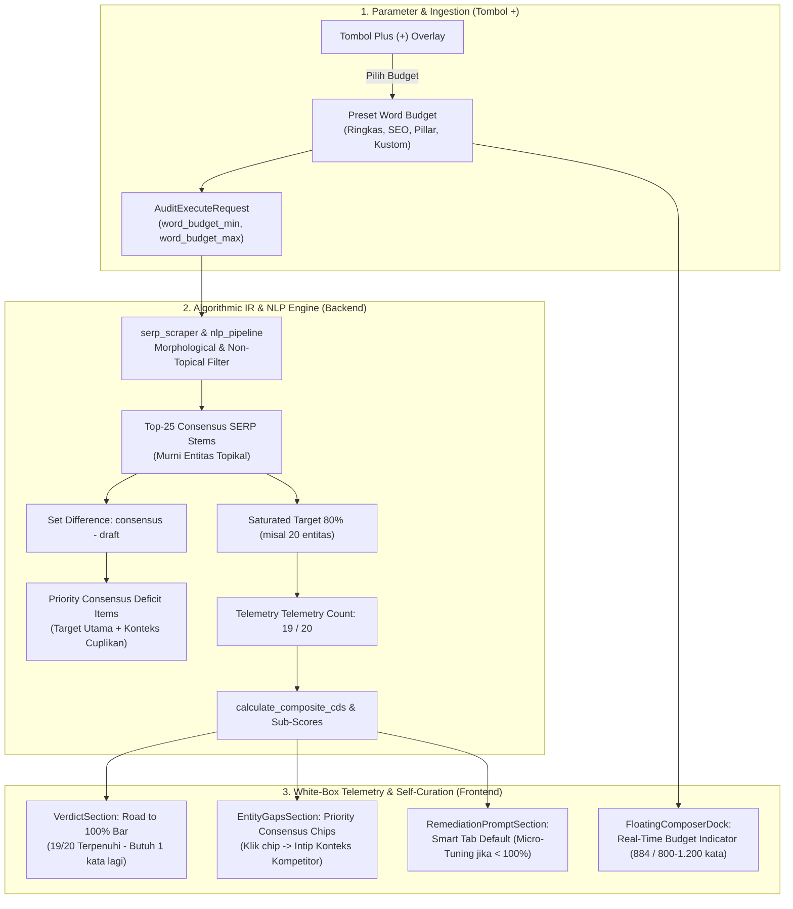

# BLUEPRINT ARSITEKTUR & SPESIFIKASI MASTER SPRINT 4.4
## "White-Box Self-Curation, Consensus-Deficit Synchronization, Telemetry Road to 100%, & Dynamic Word Budget"

> **Status Dokumen:** APPROVED MASTER BLUEPRINT / READY FOR EXECUTION (CHAT 2 & DEVOPS)  
> **Target Rilis:** `v1.5.4-SNAPSHOT.1`  
> **Target Branch:** `feat/issue-94-sprint4-4-whitebox-self-curation-and-dynamic-word-budget`  
> **Komponen Terkait:**  
> - Backend FastAPI (`audit_endpoints.py`, `gatekeeper.py`, `information_gain.py`, `nlp_pipeline.py`, `schemas/audit.py`, `models/audit.py`)  
> - Frontend React (`AuditOptionsOverlay.tsx`, `FloatingComposerDock.tsx`, `RemediationPromptSection.tsx`, `EntityGapsSection.tsx`, `VerdictSection.tsx`, `types/waskita.ts`, `App.tsx`)  
> **Lead Architect / Senior System Analyst:** Tim Arsitektur WASKITA  

---

## 1. LATAR BELAKANG & DIAGNOSTIK FORENSIK (THE ROOT CAUSES)

Berdasarkan investigasi empiris pengujian multi-turn Turn #5 $\to$ Turn #6 (Topik: *"evolusi arsitektur brutalisme"*), sistem berhasil membuktikan presisi deterministik mencapai **skor 100.0% CDS**. Namun, proses investigasi forensik membongkar **4 cacat logika sistemik** yang menghalangi pengguna untuk melakukan kurasi mandiri (*self-curation*) secara transparan:

### 1. Cacat Desinkronisasi "Top-25 Konsensus SERP" vs "Kartu Defisit" (Root Cause 99.1% Trap)
* **Kondisi Kode (`audit_endpoints.py` vs `information_gain.py`):**
  * Di backend, skor $C_{\text{IG}}$ menghitung rasio cakupan draf hanya terhadap **25 stem teratas (`consensus_serp_stems = stem_freqs[:25]`)**.
  * Sementara itu, **Kartu Defisit** di layar mengambil kata dari **seluruh kosakata kandidat SERP (indeks ke-1 sampai ke-200)** yang sudah disaring dari kata kerja non-topikal.
  * **Dampak:** Ketika pengguna di Turn #5 menambahkan 5 kata defisit dari layar (*institusional, sipil, perintis, terbengkalai, prinsip*), kelima kata tersebut berada di peringkat ke-28 s/d ke-45 SERP (bukan Top-25). Akibatnya, kelima kata tersebut lenyap dari kartu defisit, namun penghitung konsensus Top-25 tetap macet di `19/20`, mengunci skor di `99.1%`.
* **Solusi Sistemik (Single Source of Truth):**
  1. Top-25 `consensus_serp_stems` wajib disaring terlebih dahulu dengan `NON_TOPICAL_VERBS_AND_ADJECTIVES`.
  2. Sisa anggota Top-25 Konsensus yang belum ada di draf (`consensus_serp_stems - full_draft_stems`) **WAJIB diposisikan sebagai Prioritas #1 di Kartu Defisit** dengan penanda visual khusus (*Priority Consensus Chip*).
  3. **Jaminan Matematis:** Setiap satu kata defisit prioritas yang ditambahkan oleh pengguna **dijamin 100% menaikkan counter konsensus (misal 19/20 $\to$ 20/20) dan mendongkrak skor CDS secara deterministik!**

### 2. Cacat Deserialisasi Prompt Perfeksionis (`remediation_prompt_perfectionist = None`)
* **Kondisi Kode (`audit_endpoints.py:L195-L197`):**
  Saat sesi audit dimuat dari database (`GET /api/v1/sessions/{id}/thread`), fungsi `generate_overview_and_remediation` berhasil menghasilkan prompt CMS dan Micro-Tuning, namun konstruktor `AuditExecuteResponse` memaksakan:
  ```python
  remediation_prompt_perfectionist=None,  # BUG!
  ```
* **Dampak:** Di frontend `RemediationPromptSection.tsx`, Tab 2 jatuh kembali (*fallback*) ke prompt CMS Tab 1. Pengguna yang membuka riwayat sesi tidak dapat melihat prompt micro-tuning dan terjebak membaca instruksi pembuatan meta tag CMS.
* **Solusi:** Petakan `remediation_prompt_perfectionist=ov_rem.get("remediation_prompt_perfectionist")` dan jadikan Tab Micro-Tuning sebagai default aktif jika skor $\ge 75\%$ namun $< 100\%$.

### 3. Data Sub-Skor & Telemetri White-Box Dihitung tapi Dibuang Sebelum Sampai ke Layar
* **Kondisi Kode (`gatekeeper.py:L397-L402` vs `schemas/audit.py`):**
  * Backend menghitung nilai sub-skor rinci `c_vsm`, `c_ig`, `c_mattr`, dan `c_hko`, serta rasio konsensus `shared_entities_count / saturated_serp_target`. Namun, data ini tidak dimasukkan ke dalam schema Pydantic `MetricResultSchema`.
* **Dampak:** Antarmuka hanya menampilkan total skor komposit `99%` atau `100%`. Penulis mandiri tidak bisa melihat rincian pilar mana yang belum sempurna dan berapa entitas konsensus yang kurang.
* **Solusi:** Ekspos `sub_scores` (`c_vsm`, `c_ig`, `c_mattr`, `c_hko`), `consensus_matched_count` (contoh: `19`), dan `consensus_target_count` (contoh: `20`) ke API response dan render sebagai **Road to 100% Telemetry Bar**.

### 4. Polusi Kata Klitik `-nya` dan Verba Pasif Tanpa Substantif
* **Kondisi Kasus Nyata:** Munculnya kata seperti `+ Kecintaannya`, `+ Menariknya`, `+ Tersebar`, `+ Dikritik` di Kartu Defisit.
* **Akar Masalah:** Unigram berakhiran enklitika `-nya` dan verba pasif `di-/ter-` lolos dari filter stopword standar Sastrawi.
* **Solusi:** Pasang **Morphological Narrative Filter** di `nlp_pipeline.py` untuk memblokir kata transisi naratif tersebut dari pembentukan entitas konsensus dan defisit.

### 5. Kebutuhan Dynamic Word Budget di Tombol Plus (`+`)
* **Kondisi Saat Ini:** Target panjang kata masih dipakemkan secara otomatis di backend ($0.85 \times \text{draft}$ s/d $1.05 \times \text{draft}$). Penulis yang memiliki arahan editorial khusus (misal: draf pilar 1.500 kata atau draf ringkas 600 kata) tidak dapat mengatur batasan kata secara dinamis.
* **Solusi Ergonomis:** Letakkan kontrol **Dynamic Word Budget** di dalam menu **Tombol Plus (`+`)** ([`AuditOptionsOverlay.tsx`](file:///home/saifmpleh/Downloads/Telegram Desktop/proyekmagang/waskitariset/frontend/src/components/AuditOptionsOverlay.tsx)) agar dock composer naskah luar tetap bersih, rapi, dan tidak menumpuk.

---

## 2. ARSITEKTUR TEKNIS & DIAGRAM ALUR



---

## 3. INSTRUKSI IMPLEMENTASI DETAIL

### A. WORKER 2: BACKEND ALGORITHMIC RE-ENGINEERING

#### 1. Morphological Narrative Filter & Pembersihan Stopwords Naratif
**Berkas:** `backend/app/services/nlp_pipeline.py`
* Tambahkan aturan pemfilteran morfologis untuk kata transisi naratif:
  ```python
  # Pola akhiran klitik naratif dan kata sambung ekspositori (Sprint 4.4)
  NARRATIVE_CLITIC_SUFFIXES = ("nya", "kah", "lah", "pun")
  NARRATIVE_PASSIVE_VERB_PREFIXES = ("di", "ter")

  def is_narrative_noise(word: str) -> bool:
      w = word.lower().strip()
      if len(w) <= 3:
          return True
      # Cek kata transisi berakhiran -nya (misal: kecintaannya, menariknya, umumnya, tampaknya, rupanya)
      if w.endswith("nya") and len(w) >= 6:
          root = w[:-3]
          if root in ALL_INDONESIAN_STOPWORDS or root in NON_TOPICAL_VERBS_AND_ADJECTIVES or len(root) <= 3:
              return True
          # Kata-kata ekspositori umum
          if w in {"kecintaannya", "menariknya", "sebenarnya", "khususnya", "akhirnya", "awalnya", "umumnya", "tampaknya", "biasanya", "rupanya", "pastinya"}:
              return True
      # Verba pasif non-substantif
      if w in {"tersebar", "dikritik", "dibangun", "dibuat", "diterapkan", "dikenal", "disebut", "dilihat", "terdapat", "terletak"}:
          return True
      return False
  ```
* Perbarui `extract_candidate_entities`: Jangan masukkan unigram jika `is_narrative_noise(tok)` bernilai `True`.

#### 2. Sinkronisasi Konsensus SERP & Prioritas Defisit (Single Source of Truth)
**Berkas:** `backend/app/services/information_gain.py` & `backend/app/api/v1/endpoints/audit_endpoints.py`
* Di `audit_endpoints.py`:
  Saat menyaring `serp_candidate_stems`, buang `NON_TOPICAL_VERBS_AND_ADJECTIVES` dan `is_narrative_noise`:
  ```python
  serp_candidate_stems = {
      e[0] for ce in competitor_entities_list for e in ce
      if e[0] not in NON_TOPICAL_VERBS_AND_ADJECTIVES and not is_narrative_noise(e[0])
  }
  ```
* Teruskan `consensus_serp_stems` langsung ke `calculate_information_gain`:
  ```python
  entity_gaps = calculate_information_gain(
      draft_entities=draft_entities,
      competitor_entities_list=competitor_entities_list,
      draft_tfidf_weights=vsm_results["draft_tfidf_weights"],
      full_draft_stems=full_draft_stems,
      full_competitor_stems_list=full_comp_stems_list,
      consensus_serp_stems=consensus_serp_stems,
      competitor_docs=competitor_docs,
  )
  ```
* Di `information_gain.py`:
  1. Identifikasi sisa anggota konsensus yang belum ada di naskah:
     `missing_consensus_stems = consensus_serp_stems - complete_draft_stems`
  2. Untuk setiap item defisit, pasang tanda `is_consensus_priority = True` jika `stem in missing_consensus_stems`.
  3. Ekstrak satu kalimat cuplikan nyata dari `competitor_docs` yang memuat kata tersebut dan simpan di `competitor_snippet`.
  4. Urutkan defisit: **Defisit konsensus prioritas wajib berada di paling atas daftar**.

#### 3. Perbaikan Bug Deserialisasi Prompt & Ekspos Sub-Skor White-Box
**Berkas:** `backend/app/api/v1/endpoints/audit_endpoints.py` & `backend/app/schemas/audit.py`
* Perbarui `MetricResultSchema`:
  ```python
  class MetricResultSchema(BaseModel):
      content_differentiation_score: float
      avg_cosine_similarity: float
      max_cosine_similarity: float
      euclidean_distance: float
      ttr_score: float
      mattr_score: float
      hko_percentage: float
      is_redundant: bool
      is_keyword_stuffed: bool
      is_out_of_domain: bool = False
      topic_shift_detected: bool = False
      is_topic_shift: bool = False
      # Sub-skor White-Box & Telemetri Konsensus (Sprint 4.4)
      sub_scores: Dict[str, float] = Field(default_factory=dict)
      consensus_matched_count: int = 0
      consensus_target_count: int = 0
      consensus_total_count: int = 0
  ```
* Di `audit_endpoints.py:L196-L197` (Thread fetch endpoint):
  ```python
  remediation_prompt=ov_rem.get("remediation_prompt") or session.remediation_prompt or "",
  remediation_prompt_cms=ov_rem.get("remediation_prompt_cms") or session.remediation_prompt or "",
  remediation_prompt_perfectionist=ov_rem.get("remediation_prompt_perfectionist"),
  ```
* Di `audit_endpoints.py:L438-L450` (Audit execute endpoint):
  Masukkan `sub_scores`, `consensus_matched_count=len(shared_consensus)`, `consensus_target_count=saturated_target`, `consensus_total_count=len(consensus_serp_stems)` ke `MetricResultSchema` dan respons audit.

#### 4. Integrasi Dynamic Word Budget di Backend
**Berkas:** `backend/app/schemas/audit.py` & `backend/app/services/gatekeeper.py`
* Di `AuditExecuteRequest`:
  Tambahkan field opsional:
  ```python
  word_budget_min: Optional[int] = Field(default=None, ge=300, le=5000)
  word_budget_max: Optional[int] = Field(default=None, ge=400, le=6000)
  ```
* Di `gatekeeper.py` (`generate_overview_and_remediation`):
  Gunakan nilai `word_budget_min` dan `word_budget_max` jika dikirimkan oleh pengguna:
  ```python
  if word_budget_min and word_budget_max and word_budget_max > word_budget_min:
      min_target_words = word_budget_min
      max_target_words = word_budget_max
  ```

---

### B. WORKER 1: FRONTEND WORKSPACE & WHITE-BOX TELEMETRY

#### 1. Kontrol Dynamic Word Budget di Menu Tombol Plus (`+`)
**Berkas:** `frontend/src/components/AuditOptionsOverlay.tsx` & `frontend/src/types/waskita.ts`
* Di `types/waskita.ts`:
  Tambahkan pada `QualityThresholds`:
  ```typescript
  word_budget_min?: number;
  word_budget_max?: number;
  word_budget_mode?: 'adaptive' | 'compact' | 'standard' | 'pillar' | 'custom';
  ```
* Di `AuditOptionsOverlay.tsx`:
  Tepat di bawah seksi *Kueri Target Analisis* dan di atas *Ambang Batas Kualitas*, tambahkan kartu **Target Panjang Naskah (Word Budget)**:
  * Segmented Buttons:
    * `⚡ Adaptif SERP` (Default)
    * `📝 Ringkas (500–800 kata)`
    * `📄 Standar SEO (800–1.200 kata)`
    * `📚 Pillar Riset (1.200–1.800 kata)`
    * `⚙️ Kustom`
  * Input numerik Min dan Max kata yang aktif saat memilih preset atau mode kustom.
  * Tersimpan otomatis di `waskita_custom_thresholds` (`localStorage`).

#### 2. Indikator Budget Responsif di Composer Dock
**Berkas:** `frontend/src/components/composer/FloatingComposerDock.tsx`
* Baca batasan `word_budget_min` dan `word_budget_max` dari `thresholds`:
  * Jika draf $< 300$ kata: `currentWordCount / 300 kata min` (Warna muted/abu-abu).
  * Jika $\ge 300$ kata dan berada di dalam rentang budget:  
    `${currentWordCount} kata (Target: ${min}–${max}) ✓` (Warna hijau emerald `#059669`).
  * Jika draf melebihi batas maksimum budget:  
    `${currentWordCount} kata (Melebihi budget ${max}!) ⚠️` (Warna amber `#B45309`).
* Teruskan `word_budget_min` dan `word_budget_max` ke fungsi `onSubmit`.

#### 3. Telemetri "Road to 100%" & Sub-Score Explainer di Vonis
**Berkas:** `frontend/src/components/audit-block/VerdictSection.tsx`
* Di bawah teks vonis, tampilkan **Bar Telemetri Konsensus Pasar**:
  ```tsx
  {audit.metrics.consensus_target_count > 0 && cdsScore < 100 && (
    <div style={{
      marginTop: '12px',
      padding: '8px 12px',
      borderRadius: '10px',
      background: 'rgba(5, 150, 105, 0.08)',
      border: '1px solid rgba(5, 150, 105, 0.2)',
      display: 'flex',
      alignItems: 'center',
      justifyContent: 'space-between',
      fontSize: '12px',
    }}>
      <span>
        🎯 <strong>Road to 100%:</strong> Cakupan Konsensus Pasar{' '}
        <strong>{audit.metrics.consensus_matched_count} / {audit.metrics.consensus_target_count}</strong> entitas.
        {audit.metrics.consensus_matched_count < audit.metrics.consensus_target_count && (
          <span style={{ color: '#065F46', marginLeft: '4px' }}>
            (Cukup tambahkan {audit.metrics.consensus_target_count - audit.metrics.consensus_matched_count} kata kunci prioritas untuk meraih 100%)
          </span>
        )}
      </span>
    </div>
  )}
  ```
* Tampilkan pil sub-skor White-Box kompak:
  * `VSM (Anti-Jiplak): 35/35`
  * `IG (Topik SERP): 29.1/30`
  * `MATTR (Kekayaan Diksi): 20/20`
  * `HKO (Anti-Spam Judul): 15/15`

#### 4. Interactive Deficit Chips dengan Cuplikan Konteks Kompetitor
**Berkas:** `frontend/src/components/audit-block/EntityGapsSection.tsx`
* Pisahkan entitas defisit menjadi dua kelompok visual:
  1. **Entitas Konsensus Utama (Prioritas Paling Berpengaruh ke Skor 100%):** Diberi ikon 🎯 dan badge border tebal.
  2. **Entitas Kontekstual Tambahan.**
* Sediakan popover/tooltip saat chip diklik:
  * Menampilkan cuplikan kalimat asli kompetitor (`item.competitor_snippet`).
  * Tombol `[📋 Salin Kata]`.
  * Penulis mandiri dapat langsung menyalin kata dan melihat bagaimana kompetitor menggunakannya tanpa perlu membuka AI atau Google!

#### 5. Smart Default Tab & Dual-View di Remediation Section
**Berkas:** `frontend/src/components/audit-block/RemediationPromptSection.tsx`
* Logika Default Tab:
  * Jika `verdict_status === 'Siap Terbit'` dan `score < 100%`: Set `activeTab = 'perfectionist'` (Micro-Tuning menuju 100%).
  * Jika `score >= 100%`: Set `activeTab = 'cms'` (Paket CMS & SEO).
* Sediakan selektor yang kontras dan jelas antara **[Panduan Kurasi Mandiri]** dan **[Prompt Generator AI]**.

---

## 4. RENCANA VERIFIKASI & ACCEPTANCE CRITERIA SPRINT 4.4

1. **Uji Single Source of Truth Defisit:**
   Entitas yang berada di Kartu Defisit prioritas dijamin berasal dari anggota sisa `consensus_serp_stems`. Menambahkan 1 entitas prioritas tersebut ke naskah **wajib langsung menaikkan penghitung `consensus_matched_count`**.
2. **Uji Eliminasi Polusi Naratif:**
   Kata-kata klitik naratif (*kecintaannya, menariknya*) dan verba pasif non-substantif (*tersebar, dikritik*) **dilarang 100% muncul di Kartu Defisit maupun Top-25 Konsensus**.
3. **Uji Deserialisasi Prompt Sesi:**
   Membuka sesi lama dari riwayat sidebar yang berstatus "Siap Terbit" ($< 100\%$) wajib menampilkan Tab 2 (Micro-Tuning) secara utuh tanpa nilai `None` atau error.
4. **Uji Telemetri Road to 100%:**
   Pada draf dengan skor 99%, antarmuka menampilkan telemetri konkret: `19 / 20 entitas terpenuhi (Kurang 1 entitas lagi untuk meraih 100%)`.
5. **Uji Dynamic Word Budget di Tombol Plus (`+`):**
   * Membuka menu `+` memungkinkan pemilihan preset Word Budget (*Ringkas*, *Standar SEO*, *Pillar*, *Kustom*).
   * Nilai budget tercermin secara real-time pada indikator kata di composer dock dan dimasukkan ke dalam prompt remediasi backend.
6. **Uji Non-Regresi 44 Unit Test IR:**
   Seluruh test suite IR backend (`pytest tests/test_ir_engine.py`) dan frontend unit test tetap lulus 100% (*passing*).
