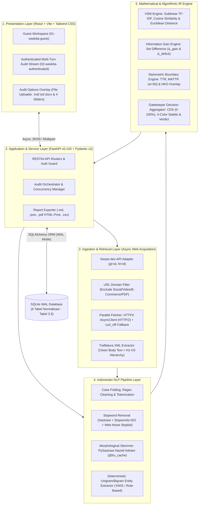
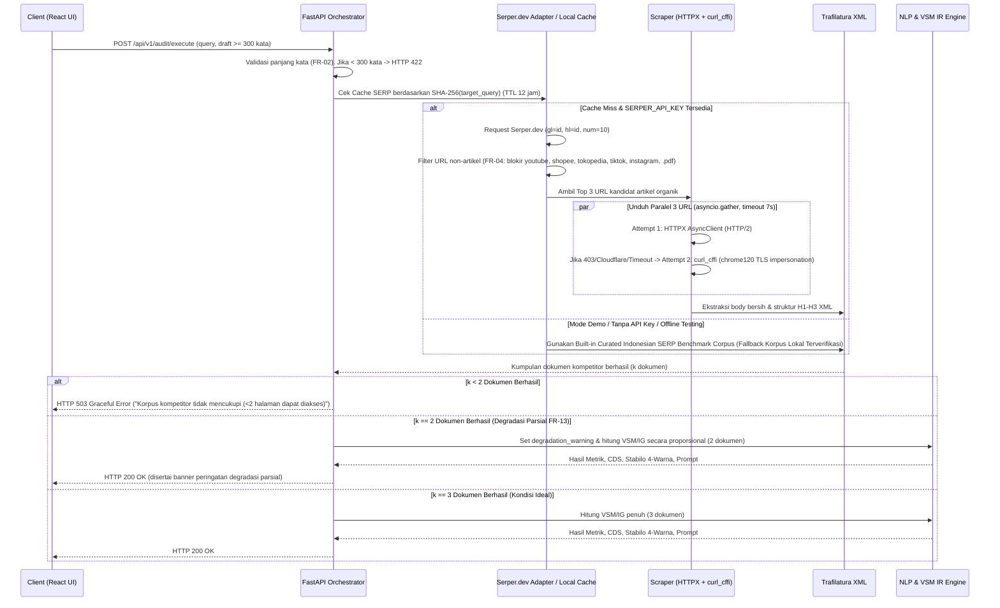

# TECHNICAL BLUEPRINT & INSTRUCTION MANUAL: WASKITA
**(Web-Article Semantic & Quality Inspection Tool for Pre-Publishing Audit)**

> [!IMPORTANT]
> **Dokumen Resmi Handover:** System Analyst & Lead Architect (Chat 1) $\rightarrow$ DevOps & GitHub Dispatcher (Chat 2) & 3 Terminal Workers  
> **Landasan Akademis:** Proposal Tugas Akhir *"Benarkah Draf Artikel Web itu Berkualitas? Rancang Bangun Perangkat Lunak Kurasi Pra-Publikasi Berdasarkan Diferensiasi Semantik Menggunakan Kerangka Kerja DSRM"* — Ahmad Saif Almuflihin (4342301053), TRPL Politeknik Negeri Batam  
> **Landasan Antarmuka:** Katalog Spesifikasi Mokly V4.1 ([design-task.md](file:///home/saifmpleh/Downloads/Telegram%20Desktop/proyekmagang/waskitariset/docs/specs/design-task.md), [01-waskita-guest.mockup.tsx](file:///home/saifmpleh/Downloads/Telegram%20Desktop/proyekmagang/waskitariset/docs/specs/gatekeeper/01-waskita-guest.mockup.tsx), [02-waskita-authenticated.mockup.tsx](file:///home/saifmpleh/Downloads/Telegram%20Desktop/proyekmagang/waskitariset/docs/specs/gatekeeper/02-waskita-authenticated.mockup.tsx))

---

## 1. ARSITEKTUR SISTEM LIMA LAPISAN (5-LAYER MODULAR ARCHITECTURE)

Selaras dengan **Bab 3.4.1 (Gambar 3.2)** Proposal Tugas Akhir, sistem WASKITA dirancang sebagai instrumen evaluasi pra-publikasi terbuka (*white-box* dan deterministik) yang terdiri dari 5 lapisan modular terisolasi:



---

## 2. FORMULASI MATEMATIS & ALGORITMA INTI (WHITE-BOX ENGINE)

> [!NOTE]
> Seluruh perhitungan di bawah ini wajib bersifat **100% deterministik (NFR-03)** dan diselesaikan dengan waktu komputasi matematis murni $T_{\text{math}} < 100\text{ ms}$ menggunakan `scipy.sparse` dan `numpy`.

### 2.1 Pembobotan TF-IDF & Kemiripan Ruang Vektor (Bab 2.2.2 — Persamaan 2.1 s/d 2.3)
Korpus komparasi pada setiap sesi audit terdiri atas $N = 1 + k$ dokumen ($1$ draf uji $d_{\text{draft}}$ dan $k \in \{2, 3\}$ artikel kompetitor Top 3 Google SERP $D_{\text{SERP}} = \{d_1, \dots, d_k\}$):

1. **Sublinear TF-IDF Weighting (`TfidfVectorizer(sublinear_tf=True, ngram_range=(1, 2))`):**
   $$\text{TF-IDF}(t, d, D) = \left(1 + \ln \text{TF}(t, d)\right) \times \left(\ln\left(\frac{1 + N}{1 + \text{DF}(t)}\right) + 1\right)$$
2. **Cosine Similarity (Persamaan 2.2):**
   Diukur antara vektor draf $\mathbf{A}$ terhadap masing-masing vektor kompetitor $\mathbf{B}_j$ ($j \in \{1, \dots, k\}$):
   $$\text{CosineSim}(\mathbf{A}, \mathbf{B}_j) = \frac{\mathbf{A} \cdot \mathbf{B}_j}{\|\mathbf{A}\| \times \|\mathbf{B}_j\|}$$
   - `avg_cosine_similarity`: $\overline{S}_{\cos} = \frac{1}{k}\sum_{j=1}^{k} \text{CosineSim}(\mathbf{A}, \mathbf{B}_j)$
   - `max_cosine_similarity`: $S_{\cos,\max} = \max_{j} \text{CosineSim}(\mathbf{A}, \mathbf{B}_j)$
3. **Euclidean Distance pada Vektor Ternormalisasi L2 (Persamaan 2.3):**
   $$d(\mathbf{A}, \mathbf{B}_j) = \sqrt{\sum_{i=1}^{V} (A_i - B_{j,i})^2}$$

### 2.2 Ekstraksi Information Gain & Celah Topik (Bab 2.2.3 — Persamaan 2.4 & 2.5)
Berdasarkan paten Google LLC (Cărbune & Anders, 2022), himpunan entitas informasional (unigram dan bigram bermakna setelah penyaringan *stopwords* dan ambang TF-IDF minimum) dipetakan menjadi:
- $E_{\text{draft}}$: Himpunan entitas pada draf artikel pengguna (disimpan dalam pasangan `term_string` bentuk dasar/stem dan `term_surface_form` bentuk asli di naskah).
- $E_{\text{SERP}}$: Himpunan entitas gabungan dari artikel kompetitor Top 3 SERP beserta jumlah konsensus dokumen `competitor_consensus_count` $\in \{1, 2, 3\}$.
- **Kebaruan Informasi ($\Delta_{\text{gain}}$ — Persamaan 2.4):**
  $$\Delta_{\text{gain}} = E_{\text{draft}} \setminus E_{\text{SERP}}$$
  Diurutkan menurun berdasarkan bobot `tfidf_weight` pada draf (diambil Top 5–10 entitas unik).
- **Defisit Celah Konten ($\Delta_{\text{deficit}}$ — Persamaan 2.5):**
  $$\Delta_{\text{deficit}} = \{ e \in E_{\text{SERP}} \setminus E_{\text{draft}} \mid \text{consensus}(e) \ge 2 \text{ atau } \text{tfidf}(e) \ge P_{75} \}$$
  Mengutamakan entitas yang muncul di minimal 2 artikel kompetitor tetapi absen di draf pengguna.

### 2.3 Stilometri Leksikal: TTR, MATTR, dan HKO (Bab 2.2.5 & FR-09)
1. **Type-Token Ratio Klasik (`ttr_score`):**
   $$\text{TTR} = \frac{|V_{\text{draft}}|}{W_{\text{draft}}}$$
   di mana $|V_{\text{draft}}|$ adalah cacah kata unik dan $W_{\text{draft}}$ adalah total token kata bersih.
2. **Moving-Average Type-Token Ratio (`mattr_score`, jendela $L = 50$ kata):**
   Untuk menghilangkan bias panjang dokumen, dihitung rata-rata TTR pada jendela geser sepanjang $L = 50$ token:
   $$\text{MATTR}_{50} = \frac{1}{W_{\text{draft}} - L + 1} \sum_{i=1}^{W_{\text{draft}} - L + 1} \frac{|\text{UniqueTokens}(w_i, \dots, w_{i+L-1})|}{L}$$
3. **Heading-Keyword Overlap (`hko_percentage`):**
   Mengukur proporsi sub-judul (`H1`, `H2`, `H3` atau baris heading Markdown `#`, `##`, `###`) yang memuat token kata kunci target ($K_{\text{query}}$):
   $$\text{HKO}(\%) = \left( \frac{\text{Jumlah Heading yang Memuat Minimal 1 Kata Kunci Utama } K_{\text{query}}}{\max(1, \text{Total Heading pada Draf})} \right) \times 100\%$$

### 2.4 Rumus Komposit Content Differentiation Score (CDS 0–100%) & Keputusan Gatekeeper (FR-10)
Nilai **Content Differentiation Score (`content_differentiation_score`)** dihitung pada skala $0\text{–}100$ dari 4 komponen ternormalisasi:
1. **Skor Diferensiasi Vektor ($C_{\text{VSM}}$, bobot $35\%$):**
   Optimal ketika kemiripan kosinus berada pada rentang relevansi topik ($0.20 \le S_{\cos,\max} \le \tau_{\cos}$, dengan default $\tau_{\cos} = 0.60$). Jika $S_{\cos,\max} > \tau_{\cos}$ (indikasi duplikasi/redundansi), skor terkena penalti linier:
   $$C_{\text{VSM}} = \text{clip}\left(100 \times \left(1 - \max\left(0, \frac{S_{\cos,\max} - 0.25}{0.75}\right)\right), 0, 100\right)$$
2. **Skor Cakupan & Kebaruan Entitas ($C_{\text{IG}}$, bobot $30\%$):**
   $$C_{\text{IG}} = \text{clip}\left(100 \times \left(0.6 \cdot \frac{|E_{\text{SERP}} \cap E_{\text{draft}}|}{\max(1, |E_{\text{SERP}}|)} + 0.4 \cdot \min\left(1.0, \frac{|\Delta_{\text{gain}}|}{5}\right)\right), 0, 100\right)$$
3. **Skor Kekayaan Leksikal MATTR ($C_{\text{MATTR}}$, bobot $20\%$):**
   $$C_{\text{MATTR}} = \text{clip}\left(100 \times \min\left(1.0, \frac{\text{MATTR}_{50}}{\tau_{\text{mattr}}}\right), 0, 100\right) \quad (\text{default } \tau_{\text{mattr}} = 0.55)$$
4. **Skor Kendali Anti-Spam Heading HKO ($C_{\text{HKO}}$, bobot $15\%$):**
   Jika $\text{HKO} \le \tau_{\text{hko}}$ (default $\tau_{\text{hko}} = 40\%$), $C_{\text{HKO}} = 100$. Jika melebihi $\tau_{\text{hko}}$:
   $$C_{\text{HKO}} = \text{clip}\left(100 \times \left(1 - \frac{\text{HKO} - \tau_{\text{hko}}}{100 - \tau_{\text{hko}}}\right), 0, 100\right)$$

$$\text{CDS} = \text{round}\left(0.35 \cdot C_{\text{VSM}} + 0.30 \cdot C_{\text{IG}} + 0.20 \cdot C_{\text{MATTR}} + 0.15 \cdot C_{\text{HKO}}, 1\right)$$

- **Bendera Diagnostik (`METRIC_RESULTS`):**
  - `is_redundant = (max_cosine_similarity > threshold_cosine)`
  - `is_keyword_stuffed = (hko_percentage > threshold_hko) or (mattr_score < threshold_mattr)`
- **Aturan Vonis (`verdict_status`):**
  - Jika $\text{CDS} \ge \tau_{\text{cds}}$ (default $75\%$) **DAN** `not is_redundant` **DAN** `not is_keyword_stuffed` $\rightarrow$ **`"Siap Terbit"`** (atau `"Layak Terbit"`).
  - Selain itu $\rightarrow$ **`"Perlu Revisi"`**.

### 2.5 Algoritma Anotasi Stabilo 4-Warna Per-Kalimat/Paragraf (FR-11 & Tabel 3.6)
> [!IMPORTANT]
> **KESEPAKATAN RESMI WARNA STABILO (SELARAS PROPOSAL TA TABEL 3.6):**  
> Backend (`Worker 1`) dan Frontend (`Worker 2`) wajib menggunakan kontrak nilai string `color` dan makna semantik berikut (100% konsisten dengan dokumen skripsi):
> - `"yellow"` $\rightarrow$ Klise / Generik / Repetisi HKO
> - `"red"` $\rightarrow$ Redundansi VSM (Kemiripan semantik terlalu tinggi dengan kompetitor)
> - `"blue"` $\rightarrow$ Saran Celah Topik Defisit ($\Delta_{\text{deficit}}$ penting yang belum dicakup draf)
> - `"green"` $\rightarrow$ Orisinalitas Kuat / Nilai Tambah Unik ($\Delta_{\text{gain}}$)
> *Catatan untuk Worker 2:* Teks legenda stabilo di komponen UI Mokly wajib disesuaikan agar menampilkan label di atas, menggantikan teks placeholder lama di mockup.

Setiap kalimat/paragraf pada draf dipecah dan dievaluasi untuk menghasilkan array `annotated_spans` dengan 4 kategori warna stabilo:
- **`yellow` (`Kuning: Klise/Generik / Repetisi HKO`):** Kalimat dengan $\text{TTR}_{\text{lokal}} < 0.50$, mengandung frasa pembuka AI generik/klise (*"di era digital saat ini"*, *"banyak orang menyukai"*, *"tidak dapat dipungkiri"*), atau sub-judul yang mengalami *keyword stuffing* HKO.
- **`red` (`Merah: Redundansi VSM`):** Kalimat yang memiliki kemiripan kosinus lokal $\ge 0.65$ terhadap kalimat di korpus kompetitor Top 3 SERP (risiko duplikasi konten).
- **`blue` (`Biru: Saran Celah Topik Defisit`):** Tag injeksi diagnostik atau rekomendasi kalimat yang memuat entitas wajib $\Delta_{\text{deficit}}$ yang terlewatkan oleh penulis.
- **`green` (`Hijau: Orisinalitas Kuat`):** Kalimat yang memuat entitas kebaruan unik ($\Delta_{\text{gain}}$) dengan variasi leksikal tinggi.

---

## 3. SKEMA BASIS DATA RELASIONAL (SQLITE WAL — TABEL 3.5 PROPOSAL TA)

Database menggunakan **SQLite** dengan konfigurasi wajib pada koneksi SQLAlchemy (`backend/app/core/database.py`):
- `PRAGMA journal_mode=WAL;`
- `PRAGMA synchronous=NORMAL;`
- `PRAGMA busy_timeout=5000;`
- `PRAGMA foreign_keys=ON;`

### Pemetaan 6 Tabel Utama (100% Patuh Tabel 3.5 Proposal TA + Atribut UI Mokly)

| No | Nama Tabel | Primary Key & Foreign Key | Kolom Lengkap & Tipe Data (SQLAlchemy) |
| :--- | :--- | :--- | :--- |
| **1** | `USERS` | **PK:** `user_id` (Integer, AutoIncrement) | `user_id` (PK), `username` (String 64, Unique), `email` (String 120, Unique), `password_hash` (String 255), `role` (String 20: `'author'` \| `'editor'` \| `'admin'`, default `'author'`), `plan_tier` (String 30, default `'Personal Plan'`), `created_at` (DateTime) |
| **2** | `AUDIT_SESSIONS` | **PK:** `session_id` (String 36 UUID)<br>**FK:** `user_id` $\rightarrow$ `USERS.user_id` (Nullable untuk Guest)<br>**FK:** `parent_session_id` $\rightarrow$ `AUDIT_SESSIONS.session_id` (Nullable untuk Multi-Turn Revision) | `session_id` (PK), `user_id` (FK, Nullable), `parent_session_id` (FK, Nullable), `turn_number` (Integer, default 1), `target_query` (String 255, Index), `draft_title` (String 255), `draft_content` (Text), `draft_word_count` (Integer), `audit_timestamp` (DateTime, Index), `verdict_status` (String 32: `'Siap Terbit'` \| `'Perlu Revisi'`), `is_pinned` (Boolean, default False), `degradation_warning` (Text, Nullable), `annotated_spans_json` (Text JSON), `remediation_prompt` (Text), `thresholds_json` (Text JSON) |
| **3** | `METRIC_RESULTS` | **PK:** `metric_id` (Integer, AutoIncrement)<br>**FK:** `session_id` $\rightarrow$ `AUDIT_SESSIONS.session_id` (Unique) | `metric_id` (PK), `session_id` (FK Unique), `avg_cosine_similarity` (Float), `max_cosine_similarity` (Float), `euclidean_distance` (Float), `ttr_score` (Float), `mattr_score` (Float), `hko_percentage` (Float), `content_differentiation_score` (Float), `is_redundant` (Boolean), `is_keyword_stuffed` (Boolean) |
| **4** | `COMPETITOR_SNAPSHOTS` | **PK:** `snapshot_id` (Integer, AutoIncrement)<br>**FK:** `session_id` $\rightarrow$ `AUDIT_SESSIONS.session_id` | `snapshot_id` (PK), `session_id` (FK), `query_hash` (String 64 SHA-256, Index), `search_engine` (String 50, default `'Google Indonesia'`), `serp_locale` (String 16, default `'id-ID'`), `total_retrieved` (Integer), `snapshot_time` (DateTime) |
| **5** | `COMPETITOR_DOCUMENTS` | **PK:** `document_id` (Integer, AutoIncrement)<br>**FK:** `snapshot_id` $\rightarrow$ `COMPETITOR_SNAPSHOTS.snapshot_id` | `document_id` (PK), `snapshot_id` (FK), `rank_position` (Integer: 1, 2, 3), `source_url` (Text), `domain_name` (String 120), `page_title` (String 500), `snippet_text` (Text), `clean_text` (Text), `word_count` (Integer), `cosine_similarity` (Float), `main_text_hash` (String 64 SHA-256), `heading_structure` (Text JSON H1–H3), `fetch_status` (String 32: `'success'` \| `'fallback_curl_cffi'` \| `'failed'`), `http_status_code` (Integer) |
| **6** | `ENTITY_GAPS` | **PK:** `gap_id` (Integer, AutoIncrement)<br>**FK:** `session_id` $\rightarrow$ `AUDIT_SESSIONS.session_id` | `gap_id` (PK), `session_id` (FK), `entity_type` (String 16: `'deficit'` \| `'gain'`), `term_string` (String 120), `term_surface_form` (String 120), `tfidf_weight` (Float), `competitor_consensus_count` (Integer) |

---

## 4. KONTRAK REST API (FASTAPI + PYDANTIC V2)

### Daftar Endpoint Utama (`backend/app/api/v1/`)

| Method & Path | Fungsi & Use Case | Auth / Role |
| :--- | :--- | :--- |
| `POST /api/v1/auth/register` | Registrasi pengguna baru (`author` / `editor` / `admin`) | Public |
| `POST /api/v1/auth/login` | Login & penerbitan JWT Bearer Token | Public |
| `GET /api/v1/auth/me` | Profil pengguna aktif & kuota sesi | Bearer Token |
| `POST /api/v1/audit/extract-file` | Ekstraksi teks draf dari unggahan berkas `.md`, `.txt`, `.docx` (Tabel 3.6) | Guest / Auth |
| `POST /api/v1/audit/execute` | **Eksekusi Utama Audit Kualitas Transparan (UC-03, FR-01 s/d FR-13)**; mendukung `parent_session_id` untuk revisi berulang (*multi-turn*) | Guest (maks 2x) / Auth |
| `GET /api/v1/sessions` | Daftar riwayat sesi audit pengguna (mendukung filter pencarian & `is_pinned`) | Auth (`author`/`editor`/`admin`) |
| `GET /api/v1/sessions/{session_id}` | Mengambil detail lengkap sesi beserta seluruh *multi-turn audit stream* | Guest / Auth |
| `PATCH /api/v1/sessions/{session_id}` | Mengubah judul (`draft_title`) atau status pin (`is_pinned`) — sesuai menu 7 aksi Header | Auth |
| `DELETE /api/v1/sessions/{session_id}` | Menghapus riwayat sesi analisis | Auth |
| `GET /api/v1/sessions/{session_id}/export` | Ekspor laporan dalam format `format=md\|json\|pdf_html\|csv` (UC-05) | Auth |
| `GET /api/v1/admin/thresholds` & `PUT` | Konfigurasi parameter ambang batas global (UC-06) | `admin` / `editor` |

### Contoh Kontrak JSON `POST /api/v1/audit/execute`

#### Request Body (`AuditExecuteRequest`):
```json
{
  "target_query": "resep kopi tubruk tradisional",
  "draft_title": "Resep Kopi Tubruk Tradisional & Takaran Pas",
  "draft_content": "Kopi tubruk adalah minuman khas Indonesia yang dibuat dengan cara menyeduh bubuk kopi secara langsung tanpa disaring... (minimal 300 kata)",
  "parent_session_id": null,
  "use_cached_serp": true,
  "thresholds": {
    "max_cosine_similarity": 0.60,
    "min_mattr": 0.55,
    "max_hko_percentage": 40.0,
    "min_cds_score": 75.0
  }
}
```

#### Response Body (`AuditExecuteResponse` — HTTP 200 OK):
```json
{
  "session_id": "8f14e45f-ceea-467f-a8f1-44c09e08b912",
  "parent_session_id": null,
  "turn_number": 1,
  "target_query": "resep kopi tubruk tradisional",
  "draft_title": "Resep Kopi Tubruk Tradisional & Takaran Pas",
  "draft_word_count": 412,
  "audit_timestamp": "2026-10-22T10:15:00+07:00",
  "verdict_status": "Perlu Revisi",
  "degradation_warning": null,
  "thresholds": {
    "max_cosine_similarity": 0.60,
    "min_mattr": 0.55,
    "max_hko_percentage": 40.0,
    "min_cds_score": 75.0
  },
  "metrics": {
    "content_differentiation_score": 70.0,
    "avg_cosine_similarity": 0.44,
    "max_cosine_similarity": 0.48,
    "euclidean_distance": 1.02,
    "ttr_score": 0.53,
    "mattr_score": 0.61,
    "hko_percentage": 25.0,
    "is_redundant": false,
    "is_keyword_stuffed": false
  },
  "entity_gaps": {
    "deficit": [
      {
        "term_string": "takaran suhu 90c",
        "term_surface_form": "Takaran Suhu 90°C",
        "tfidf_weight": 0.84,
        "competitor_consensus_count": 3
      },
      {
        "term_string": "rasio seduh 1 15",
        "term_surface_form": "Rasio Seduh 1:15",
        "tfidf_weight": 0.79,
        "competitor_consensus_count": 2
      }
    ],
    "gain": [
      {
        "term_string": "robusta dampit",
        "term_surface_form": "Robusta Dampit",
        "tfidf_weight": 0.91,
        "competitor_consensus_count": 0
      }
    ]
  },
  "annotated_spans": [
    {
      "text": "Kopi tubruk adalah minuman khas Indonesia yang dibuat dengan cara menyeduh bubuk kopi secara langsung tanpa disaring.",
      "color": null,
      "label": null
    },
    {
      "text": "Banyak orang menyukai kopi tubruk karena aromanya yang pekat dan cara pembuatannya yang sangat mudah sekali.",
      "color": "yellow",
      "label": "Klise/Generik"
    },
    {
      "text": "[Defisit: Belum mencantumkan rekomendasi suhu air optimal dan rasio gramasi kopi terhadap mililiter air].",
      "color": "blue",
      "label": "Saran Celah Defisit"
    },
    {
      "text": "Cara membuat kopi tubruk tanpa ampas naik ke permukaan dan langkah mudah menyeduhnya...",
      "color": "red",
      "label": "Redundansi VSM Tinggi"
    },
    {
      "text": "Penggunaan biji Robusta Dampit memberikan aksen earthy cokelat yang tegas, apalagi jika dipadukan gula aren cair alami.",
      "color": "green",
      "label": "Orisinalitas Kuat"
    }
  ],
  "overview_bullets": [
    "Perbaiki struktur sub-judul agar tidak menjiplak gaya artikel kompetitor.",
    "Sertakan panduan suhu air presisi (90°C - 94°C) dan rasio 1:15 untuk menutup gap defisit."
  ],
  "remediation_prompt": "Tolong tulis ulang paragraf pembuka artikel kopi tubruk ini agar lebih tajam dan kaya gaya stilometri.\nWajib sertakan poin penting berikut:\n1. Suhu seduh air ideal (90-94°C) dan rasio bubuk:air (1:15).\n2. Tekankan keunikan profil rasa Robusta Dampit dengan gula aren alami.\n3. Hindari kalimat klise 'banyak orang menyukai kopi tubruk'.",
  "serp_competitors": [
    {
      "rank_position": 1,
      "page_title": "Cara Membuat Kopi Tubruk yang Enak dan Pas Mantap",
      "source_url": "https://www.kompas.com/food/read/...",
      "domain_name": "kompas.com/food",
      "snippet_text": "Kunci kopi tubruk nikmat ada pada kesegaran gilingan dan air mendidih yang didiamkan sebentar...",
      "word_count": 820,
      "cosine_similarity": 0.48,
      "fetch_status": "success"
    }
  ]
}
```

---

## 5. ALUR GRACEFUL DEGRADATION & OFFLINE FALLBACK (FR-13 & NFR-06)



---

## 6. PEMBAGIAN PORSI SPESIALIS WORKER & INSTRUCTION MANUAL (STEP-BY-STEP)

Agar eksekusi oleh **Chat 2 (DevOps)** dan **3 Worker** berjalan tanpa konflik merge (*Zero Merge Conflict*), pekerjaan dibagi berdasarkan direktori dan file yang terisolasi:

### 🛠️ PORSI WORKER 1: CORE BACKEND, DATABASE, NLP & IR ENGINE (`proyekmagang/worker-1`)
**Fokus:** Seluruh kode di dalam `backend/app/` (Database, Scraper, NLP Pipeline, VSM Math, FastAPI Routers).  
**Dilarang menyentuh:** Folder `frontend/` dan `backend/tests/`.

> [!WARNING]
> **ANTI EVENT-LOOP BLOCKING (BATASAN OPERASI ASYNC THREADING):**
> Hanya **3 operasi komputasi CPU berat** ini yang WAJIB dibungkus dengan `await asyncio.to_thread(...)` atau `from starlette.concurrency import run_in_threadpool`:
> 1. Ekstraksi teks web oleh `trafilatura.extract()` (parsing DOM XML berat).
> 2. Pipa normalisasi dan stemming korpus penuh oleh `PySastrawi`.
> 3. Pembentukan matriks `TfidfVectorizer.fit_transform()` dan kalkulasi `cosine_similarity`.
> Dilarang membungkus operasi string ringan atau serialisasi JSON sederhana dengan `to_thread` agar tidak menimbulkan overhead perpindahan thread (*context switching*) yang tidak perlu!

#### Langkah Kerja Kaku (Instruction Manual Worker 1):
1. **`backend/requirements.txt` & `.env.example`:**
   - Pastikan pustaka terdefinisi lengkap: `fastapi>=0.115.0`, `uvicorn[standard]`, `pydantic>=2.7.0`, `pydantic-settings`, `sqlalchemy>=2.0.0`, `httpx[http2]`, `curl_cffi`, `trafilatura`, `lxml`, `PySastrawi`, `scikit-learn`, `numpy`, `scipy`, `python-multipart`, `python-docx`, `pyjwt`, `passlib[bcrypt]`.
   - Tambahkan feature flags di `.env.example`: `FEATURE_CURL_CFFI_FALLBACK=true`, `FEATURE_SERP_CACHE=true`, `FEATURE_OFFLINE_CORPUS_FALLBACK=true`, `SERPER_API_KEY=`.
2. **`backend/app/core/config.py` & `backend/app/core/database.py`:**
   - Buat koneksi SQLAlchemy SQLite (`sqlite:///./waskita.db`) dengan event listener `@event.listens_for(Engine, "connect")` yang mengeksekusi `PRAGMA journal_mode=WAL; PRAGMA synchronous=NORMAL; PRAGMA busy_timeout=5000; PRAGMA foreign_keys=ON;`.
3. **`backend/app/models/entities.py`:**
   - Implementasikan ke-6 model ORM sesuai **Tabel 3.5 Proposal TA**: `User`, `AuditSession`, `MetricResult`, `CompetitorSnapshot`, `CompetitorDocument`, `EntityGap`.
   - Kolom `cosine_similarity = Column(Float, nullable=True)` pada `CompetitorDocument` telah disetujui untuk disimpan di SQLite guna efisiensi dasbor perbandingan kompetitor.
4. **`backend/app/schemas/audit.py`:**
   - Implementasikan skema Pydantic v2 (`AuditExecuteRequest`, `ThresholdConfig`, `MetricResultSchema`, `EntityGapItem`, `AnnotatedSpan`, `SerpCompetitorItem`, `AuditExecuteResponse`, `SessionListItem`).
   - Buat validator Pydantic pada `AuditExecuteRequest` untuk memvalidasi jumlah kata `draft_content` $\ge 300$ kata (FR-02); kembalikan pesan Bahasa Indonesia baku sesuai NFR-10 jika kurang dari 300 kata.
   - Pastikan skema `AnnotatedSpan` mengunci 4 nilai string `color` sesuai Proposal TA Tabel 3.6: `"yellow"`, `"red"`, `"blue"`, `"green"`.
5. **`backend/app/services/serp_scraper.py`:**
   - Implementasikan `SerperAdapter` (`POST https://google.serper.dev/search` dengan `gl="id"`, `hl="id"`, `num=10`).
   - Implementasikan fungsi `is_valid_article_url(url)` (FR-04) untuk mengeliminasi domain `youtube.com`, `youtu.be`, `tiktok.com`, `instagram.com`, `facebook.com`, `twitter.com`, `x.com`, `shopee.co.id`, `tokopedia.com`, `bukalapak.com`, `lazada.co.id`, `blibli.com`, dan ekstensi `.pdf`/`.doc`.
   - Implementasikan `fetch_competitor_page(url)`: coba `httpx.AsyncClient(http2=True, timeout=7.0)` terlebih dahulu; jika status $\ge 400$ atau *timeout* dan `FEATURE_CURL_CFFI_FALLBACK=true`, lakukan fallback dengan `curl_cffi.requests.AsyncSession(impersonate="chrome120")`.
   - Ekstraksi teks bersih dan daftar heading `H1`, `H2`, `H3` menggunakan `trafilatura.extract(...)` yang dibungkus `asyncio.to_thread` + `lxml.etree`, serta hitung `hashlib.sha256(clean_text.encode()).hexdigest()`.
   - Sediakan *Built-in Indonesian Fallback Corpus* (minimal 3 topik populer + generator korpus sintetis deterministik berbasis kueri) jika `SERPER_API_KEY` kosong agar demonstrasi sistem (Tahap 4 DSRM) dan pengujian otomatis tetap berjalan 100% tanpa ketergantungan jaringan luar.
6. **`backend/app/services/nlp_pipeline.py`:**
   - Implementasikan fungsi `stem_word(word: str) -> str` dengan dekorator `@functools.lru_cache(maxsize=100_000)` menggunakan `Sastrawi.Stemmer.StemmerFactory`.
   - Gabungkan daftar *stopwords* Bahasa Indonesia dari Sastrawi + daftar kata tugas/derau web (`"baca"`, `"juga"`, `"halaman"`, `"berikut"`, `"klik"`, `"komentar"`, `"iklan"`, `"copyright"`).
   - Implementasikan fungsi `preprocess_text(text: str)` (dibungkus `asyncio.to_thread` saat memproses teks panjang) dan `extract_candidate_entities(text: str, top_n: int = 25)` yang mengekstraksi unigram & bigram informasional beserta pemetaan `term_string` $\rightarrow$ `term_surface_form`.
7. **`backend/app/services/ir_engine.py`:**
   - Implementasikan kalkulasi VSM (`TfidfVectorizer(sublinear_tf=True, ngram_range=(1, 2))`), `cosine_similarity`, dan `euclidean_distances` (Persamaan 2.1–2.3) yang dieksekusi via `run_in_threadpool`.
   - Implementasikan `calculate_information_gain(draft_entities, competitor_entities_list)` untuk menghasilkan himpunan $\Delta_{\text{gain}}$ dan $\Delta_{\text{deficit}}$ beserta `competitor_consensus_count` (Persamaan 2.4–2.5).
   - Implementasikan `calculate_stylometry(draft_text, headings, target_query)` untuk menghitung `ttr_score`, `mattr_score` (window $L=50$), dan `hko_percentage`.
   - Implementasikan `aggregate_gatekeeper_decision(...)` yang menghitung `content_differentiation_score` (0–100%), `verdict_status` (`"Siap Terbit"` vs `"Perlu Revisi"`), `annotated_spans` (4 warna stabilo resmi: `yellow`, `red`, `blue`, `green`), `overview_bullets`, dan `remediation_prompt`.
8. **`backend/app/api/routers.py` & `backend/app/main.py`:**
   - Daftarkan seluruh endpoint (`/api/v1/auth/*`, `/api/v1/audit/execute`, `/api/v1/audit/extract-file`, `/api/v1/sessions/*`, `/api/v1/admin/thresholds`, `/health`), aktifkan CORS Middleware untuk frontend, dan buat tabel SQLite otomatis saat `lifespan` startup via `Base.metadata.create_all(bind=engine)` beserta *seed data* awal (akun demo `author`, `editor`, `admin` dan 2 riwayat sesi contoh seperti pada mockup Mokly).

---

### 🎨 PORSI WORKER 2: FRONTEND REACT/VITE & INTEGRASI MOKLY (`proyekmagang/worker-2`)
**Fokus:** Seluruh kode di dalam `frontend/` mengacu 100% pada spesifikasi visual `docs/specs/design-task.md` dan komponen di `docs/specs/gatekeeper/`.  
**Dilarang menyentuh:** Folder `backend/`.

> [!CAUTION]
> **DILARANG MEMBUAT ULANG DESAIN DARI NOL (ANTI-OVERENGINEERING):**
> File spesifikasi visual dan komponen hidup sudah 100% lengkap di `docs/specs/gatekeeper/` (`01-waskita-guest.mockup.tsx`, `02-waskita-authenticated.mockup.tsx`, `auth-audit-views.tsx`, `auth-sidebar-header.tsx`, `guest-workspace.tsx`, `guest-sidebar.tsx`, `shared-ui.tsx`).
> **TUGAS WORKER 2 HANYALAH:** Melakukan copy/refactor langsung file-file komponen tersebut ke dalam `frontend/src/components/`, mengintegrasikan Tailwind/CSS tokens, dan mengganti *static mock state* (seperti radio inputs & dummy data) menjadi *React dynamic state* yang terhubung ke `waskitaClient.ts`. Dilarang menulis ulang markup atau mengarang layout baru yang merusak estetika Mokly!

#### Langkah Kerja Kaku (Instruction Manual Worker 2):
1. **Inisialisasi `frontend/` (React 18 + TypeScript + Vite):**
   - Siapkan struktur `frontend/src/` yang mengadopsi CSS Variables Dual-Theme (`Light Mode` Warm Cream `#F7F4EB` & `Dark Mode` `#0B1120` dengan logo `#F7F4EB` dan kartu analisis `#D4E5F2` / `#131C2E`) persis seperti pada [design-task.md](file:///home/saifmpleh/Downloads/Telegram%20Desktop/proyekmagang/waskitariset/docs/specs/design-task.md) dan [shared-ui.tsx](file:///home/saifmpleh/Downloads/Telegram%20Desktop/proyekmagang/waskitariset/docs/specs/gatekeeper/partials/shared-ui.tsx).
2. **Integrasi State & API Client (`frontend/src/api/waskitaClient.ts`):**
   - Hubungkan UI Mode Tamu (`GuestScreen`) dan Mode Member (`AuthenticatedScreen`) ke endpoint FastAPI (`POST /api/v1/audit/execute`, `POST /api/v1/audit/extract-file`, `GET /api/v1/sessions`, `PATCH /api/v1/sessions/{id}`, `DELETE /api/v1/sessions/{id}`, `GET /api/v1/sessions/{id}/export`).
   - Sesuaikan teks legenda stabilo di komponen [auth-audit-views.tsx](file:///home/saifmpleh/Downloads/Telegram%20Desktop/proyekmagang/waskitariset/docs/specs/gatekeeper/partials/auth-audit-views.tsx#L406-L421) agar menampilkan label resmi Proposal TA:
     - Kuning (`#FEF08A`): Klise / Generik / Repetisi HKO
     - Merah (`#FECACA`): Redundansi VSM (Kemiripan Kosinus Tinggi)
     - Biru (`#BFDBFE`): Saran Celah Topik Defisit ($\Delta_{\text{deficit}}$)
     - Hijau (`#BBF7D0`): Orisinalitas Kuat ($\Delta_{\text{gain}}$)
3. **Standar Kualitas Anti-Rage Click & Humanist UI (Aturan 7 AGENTS.md):**
   - Saat tombol kirim panah kanan (`→`) diklik, tombol wajib otomatis *disabled* (`opacity-50 pointer-events-none`) dan menampilkan **Live Stepper Indicator** 5 tahap (*1. Validasi Draf $\rightarrow$ 2. Akuisisi Top 3 SERP $\rightarrow$ 3. Ekstraksi & NLP Sastrawi $\rightarrow$ 4. Komputasi VSM & Information Gain $\rightarrow$ 5. Menyusun Diagnostik White-Box*) beserta fallback timeout.
   - **Dilarang keras menggunakan `alert()` atau `confirm()` bawaan browser!** Gunakan Toast Notification kustom dan Modal Konfirmasi bergaya Warm Sand / Soft Ice Blue khas Waskita.
4. **Fitur Interaktif Lengkap Sesuai Mockup Mokly:**
   - **4 Range Sliders & File Uploader (`.md`, `.txt`, `.docx`)** di dalam *Bottom Sheet / Popover* (`AuditOptionsOverlay`).
   - **Multi-Turn Audit Stream:** Memungkinkan pengguna mengirim revisi draf di sesi yang sama (`parent_session_id`) dan melihat peningkatan skor CDS secara berurutan (misal dari `70% Perlu Revisi` menjadi `85% Siap Terbit`).
   - **7 Aksi Menu Header (`AuthHeader`):** Salin Ringkasan Hasil, Unduh Laporan (`.md` / `.json` / Cetak PDF Ringkasan Eksekutif / `.csv`), Salin Teks Artikel, Share Analisis, Pin Analisis, Ganti Judul (Rename), dan Hapus Riwayat.

---

### 🛡️ PORSI WORKER 3: QA, UNIT TESTING, CONFUSION MATRIX & LOAD TESTING (`proyekmagang/worker-3`)
**Fokus:** Seluruh kode pengujian di dalam `backend/tests/` dan skrip evaluasi kinerja/akurasi sesuai **Bab 2.4 & Bab 3.5 Proposal TA**.  
**Dilarang menyentuh:** Logika produksi di `backend/app/` atau `frontend/` kecuali untuk perbaikan bug validasi/security pada tahap QA.

> [!IMPORTANT]
> **KEWAJIBAN DATASET FIXTURE DETERMINISTIK 30 DRAF (ANTI-RANDOM GENERATOR):**
> Dilarang menggunakan generator teks acak prosedural yang menghasilkan teks berbeda-beda setiap kali dijalankan!
> Sesuai metodologi DSRM (Bab 2.4.1 & Bab 3.1.2 Proposal TA), pengujian akurasi sistem wajib menggunakan **Dataset Fixture Deterministik** berupa file statis `backend/tests/fixtures/dataset_30_drafts.json`:
> - Memuat 30 draf artikel informasional nyata berbahasa Indonesia (panjang 350–800 kata per draf).
> - 15 draf berlabel acuan pakar (*ground truth*) `"Layak Terbit"`: gaya bahasa bervariasi, MATTR $L=50$ nyata $> 0.55$, struktur heading teratur HKO $\le 40\%$.
> - 15 draf berlabel acuan pakar `"Perlu Revisi"`: artikel AI mentah tanpa kurasi yang mengalami repetisi leksikal MATTR $< 0.50$, saturasi HKO $> 40\%$, atau duplikasi semantik tinggi.
> - Data fixture ini harus dapat diekspor menjadi lampiran dokumen Tugas Akhir Anda (*reproducible science*).
> - Pengujian akurasi `evaluate_accuracy.py` wajib mengeksekusi pipeline Worker 1 secara jujur (*end-to-end*) tanpa *mocking* fungsi matematis!

#### Langkah Kerja Kaku (Instruction Manual Worker 3):
1. **Unit Tests Matematis & Determinisme (`backend/tests/test_ir_engine.py`):**
   - Uji determinisme `TfidfVectorizer`, `cosine_similarity`, dan `euclidean_distance` (memastikan input yang sama selalu menghasilkan skor identik hingga 4 desimal — NFR-03).
   - Uji perhitungan `MATTR` ($L=50$), `TTR`, dan `HKO` pada teks repetitif vs teks kaya kosakata.
   - Uji operasi selisih himpunan $\Delta_{\text{gain}} = E_{\text{draft}} \setminus E_{\text{SERP}}$ dan $\Delta_{\text{deficit}} = E_{\text{SERP}} \setminus E_{\text{draft}}$.
2. **Testing Graceful Degradation & Anti-XSS (`backend/tests/test_api_resilience.py`):**
   - Uji skenario **FR-02**: Draf $< 300$ kata wajib ditolak dengan HTTP 422 dan pesan Bahasa Indonesia baku.
   - Uji skenario **FR-13**: Mock kegagalan 1 dari 3 URL kompetitor (HTTP 403/Timeout) $\rightarrow$ pastikan audit tetap berhasil (HTTP 200) dengan `degradation_warning` terisi. Mock kegagalan 2 dari 3 URL (hanya 1 dokumen berhasil) $\rightarrow$ pastikan transaksi dibatalkan secara aman (HTTP 503) tanpa *crash*.
   - Uji keamanan input (**Anti-XSS**): Pastikan tag `<script>alert(1)</script>` atau injeksi HTML berbahaya pada `draft_content` dan `target_query` disanitasi secara bersih.
3. **Evaluator Akurasi Confusion Matrix 30 Draf Uji (`backend/tests/evaluate_accuracy.py` — Bab 2.4.1 & 3.5.1):**
   - Jalankan 30 draf dari `dataset_30_drafts.json` ke dalam pipeline IR Engine untuk membandingkan `verdict_status` sistem terhadap `ground_truth_label`.
   - Hitung dan cetak tabel **Confusion Matrix (TP, TN, FP, FN)** beserta metrik ilmiah: **Precision (Persamaan 2.6)**, **Recall (Persamaan 2.7)**, dan **F1-Score (Persamaan 2.8)**.
4. **Skrip Uji Beban & Latensi Peladen (`backend/tests/locustfile.py` — Bab 2.4.2 & NFR-01, NFR-02, NFR-05):**
   - Buat skrip `Locust` untuk mensimulasikan 10–20 *concurrent virtual users* (*spawn rate* 2 users/detik) dan verifikasi utilitas pemeriksaan memori RAM (`psutil` / `/proc/self/status`) tetap berada di bawah batas $1.5\text{–}2.0\text{ GB}$ serta bebas dari `sqlite3.OperationalError: database is locked`.

---

## 7. KLAUSUL ANTI-OVERENGINEERING, BATAS ABSTRAKSI & INTEGRITAS KODE (STRICT RULES)

Untuk memastikan kode tetap ramping, efisien, dan tidak boros token/memori, seluruh worker WAJIB mematuhi batas rekayasa berikut:
1. **Zero-Unused Abstractions:** Dilarang membuat abstraksi berlapis kosong seperti `GenericRepository<T>`, `AbstractFactoryManager`, atau interface kosong yang hanya memiliki satu implementasi konkret. Gunakan struktur modul service langsung yang bersih dan mudah dilacak.
2. **Zero-Heavy Migration Tooling:** Mengingat arsitektur database adalah SQLite WAL lokal terpadu (NFR-04), inisialisasi tabel cukup menggunakan `Base.metadata.create_all(bind=engine)` pada saat startup FastAPI. Dilarang memasang framework migrasi rumit (Alembic) kecuali diinstruksikan kemudian oleh arsitek.
3. **Zero-Heavy External Daemons:** Dilarang memasang Redis daemon, RabbitMQ, Celery, atau dockerized cluster yang rakus RAM. Seluruh caching dan concurrency diselesaikan di level *In-Memory LRU Cache* Python dan *SQLite WAL mode* demi menjaga konstrain RAM fisik $\le 1.5 - 2.0\text{ GB}$ (NFR-05).
4. **Defensive Coding Guarantee:** Setiap pemanggilan properti objek JSON atau relasi opsional wajib menggunakan `.get()` dengan fallback atau pengecekan null defensif (`?? ''`) agar server tidak pernah mengalami unhandled 500 error akibat data kosong.
