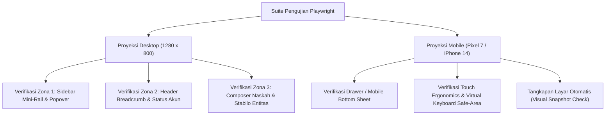

# Arsitektur Telemetri Riset, Dashboard Admin, Keamanan, dan Strategi Pengujian E2E WASKITA

Dokumen ini mendokumentasikan perencanaan teknis pra-deploy WASKITA, mencakup:
1. Strategi Pengujian Antarmuka (*Cross-Device E2E Testing*).
2. Arsitektur Telemetri & Analitik Perilaku Pengguna (*Research Behavioral Analytics*).
3. Pengamanan Sistem (*Security & Rate Limiting*) berbasis pustaka standar industri.
4. Evaluasi komparatif alat otomasi pengujian (Playwright vs Alternatif).

---

## 1. Strategi Pengujian UI Cross-Device (Mobile & Desktop)

Sebelum sistem di-deploy ke lingkungan produksi, antarmuka WASKITA wajib melewati pengujian otomatis *cross-device* untuk menjamin konsistensi tata letak (responsive layout), ketiadaan elemen yang terpotong (*overflow*), dan kestabilan alur kerja multi-turn.

### Alat Pilihan Utama: **Playwright**
* **Lisensi:** 100% Open Source (Apache 2.0, Microsoft & Komunitas).
* **Fitur Utama yang Dimanfaatkan:**
  * **Visual Regression Testing (`expect(page).toHaveScreenshot()`):** Membandingkan tangkapan layar piksel per piksel secara otomatis antara desktop (1280x800) dan mobile emulasi (Pixel 7 / iPhone 14).
  * **Auto-Waiting:** Tidak memerlukan `sleep` manual; Playwright otomatis menunggu elemen DOM siap diinteraksi.
  * **Network Interception:** Memvalidasi aliran respons streaming audit SSE dan pemanggilan API backend.



---

## 2. Telemetri Riset & Dashboard Admin (User Behavioral Analytics)

Untuk kebutuhan analisis ilmiah pada **Bab 4 / Bab 5 Skripsi** (evaluasi penerimaan sistem dan perilaku pengguna), sistem telemetri mengumpulkan data interaksi pengguna tanpa melanggar privasi teks artikel.

### Prinsip Implementasi: *Don't Reinvent the Wheel*
Alih-alih membangun dashboard admin dari nol, sistem memanfaatkan pustaka/layanan yang siap pakai:

1. **PostHog (Rekomendasi Utama untuk Riset):**
   * **Autocapture:** Otomatis mencatat setiap klik tombol, perubahan input, dan navigasi tanpa perlu menulis *event tracking* manual satu per satu.
   * **Session Replay:** Menyediakan rekaman video sesi pengguna saat berinteraksi dengan Waskita. Menjadi bukti kualitatif berharga di sidang skripsi untuk melihat di bagian mana pengguna kebingungan atau paling sering bolak-balik merevisi draf.
   * **Heatmap & Funnel:** Mengukur tingkat adopsi fitur (misal: rasio pengguna yang menyalin *remediation prompt* dibanding yang hanya membaca *verdict*).
   * **Lisensi / Paket:** Open-source & Cloud Free Tier (1 juta event/bulan gratis).

2. **Umami Analytics (Alternatif Ringan / Self-Hosted):**
   * Fokus pada privasi murni, tanpa *cookie banner*, dan sangat ringan jika ingin di-host mandiri bersama SQLite.

### Skema Data Telemetri Internal (Backend Table: `USER_RESEARCH_TELEMETRY`)

| Atribut Data | Tipe | Tujuan Analisis Ilmiah |
| :--- | :--- | :--- |
| `session_id` | UUID / String | Memisahkan analisis per pengguna anonim / akun demo. |
| `event_category` | Enum | `UI_CLICK`, `AUDIT_ACTION`, `REMEDIATION_COPIED`. |
| `event_target` | String | Mengidentifikasi tombol spesifik (misal: `btn_copy_remediation`, `tab_serp_competitors`). |
| `target_query` | String | Pemetaan klaster topik yang diuji pengguna di lapangan. |
| `audit_verdict` | String | Rasio `Siap Terbit` vs `Perlu Revisi` di kalangan pengguna nyata. |
| `veto_violation` | String | Mengidentifikasi jenis cacat artikel yang paling sering dilakukan penulis (Copas, Repetitif, atau Hoaks). |
| `turn_count` | Integer | Rata-rata perulangan revisi draf yang dibutuhkan hingga artikel lolos standar E-E-A-T. |

---

## 3. Pengamanan Sistem (Security & Rate Limiting)

Untuk menjaga kuota API eksternal (Google Serper, AI LLM) agar tidak disalahgunakan atau terkena serangan *denial-of-service* (DoS):

### Lapisan 1: Cloudflare WAF & Rate Limiting (Infrastruktur)
* Memanfaatkan konfigurasi pada Cloudflare Tunnel:
  * **Rate Limiting:** Membatasi maksimum 15–20 audit per menit per alamat IP publik.
  * **Geo-Restriction:** Membatasi akses prioritas hanya untuk wilayah Indonesia (`ID`) guna menghindari *scraping bot* global.

### Lapisan 2: FastAPI Native Security (Aplikasi)
Mengadopsi pustaka open-source Python standar industri:
* **`slowapi`:** Middleware rate limiter berbasis *Token Bucket Algorithm*. Dipasang langsung dengan dekorator:
  ```python
  @router.post("/audit/execute")
  @limiter.limit("5/minute")
  async def execute_audit(...):
      pass
  ```
* **`secure` & `CORSMiddleware`:** Memasang header keamanan standar OWASP (*X-Content-Type-Options*, *X-Frame-Options*, *Content-Security-Policy*).

---

## 4. Evaluasi Komparatif Framework Testing E2E

| Parameter Evaluasi | **Playwright** (Pilihan Utama) | **Cypress** | **WebdriverIO** | **Puppeteer** |
| :--- | :---: | :---: | :---: | :---: |
| **Lisensi** | Open Source (Apache 2.0) | Open Source (MIT) | Open Source (MIT - OpenJS) | Open Source (Apache 2.0) |
| **Independensi Vendor** | Dikelola Microsoft & Komunitas | Dikontrol Perusahaan Cypress.io | Murni Yayasan Komunitas OpenJS | Dikelola Google |
| **Kecepatan Inferensi** | Sangat Cepat (WebSocket/CDP) | Sedang (In-Browser Runtime) | Cepat (WebDriver/CDP) | Sangat Cepat (CDP Native) |
| **Emulasi Mobile** | Akurat (User-Agent, Viewport, Touch) | Terbatas (Resize Viewport saja) | Mendukung HP Fisik Asli (Appium) | Akurat (Chromium Mobile) |
| **Multi-Tab / Multi-Page** | Didukung Penuh & Alami | Sulit / Terbatas | Didukung | Didukung |
| **Visual Comparison Bawaan** | Tersedia (`toHaveScreenshot`) | Memerlukan plugin 3rd party | Memerlukan plugin | Manual (Harus rakit sendiri) |

### Kesimpulan Pemilihan Alat:
**Playwright** tetap menjadi alat paling rasional dan efisien untuk Waskita karena sifatnya yang *zero-config out-of-the-box*, memiliki fitur perbandingan tangkapan layar otomatis untuk menguji tampilan mobile vs desktop, dan berlisensi open source bebas royalti.
