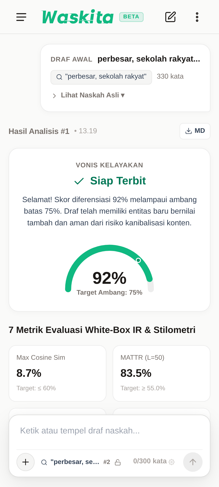
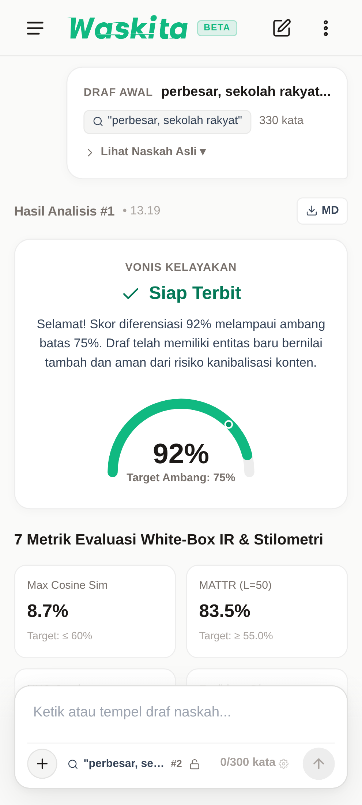
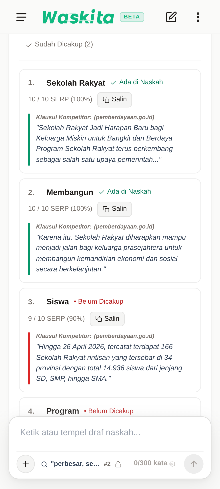
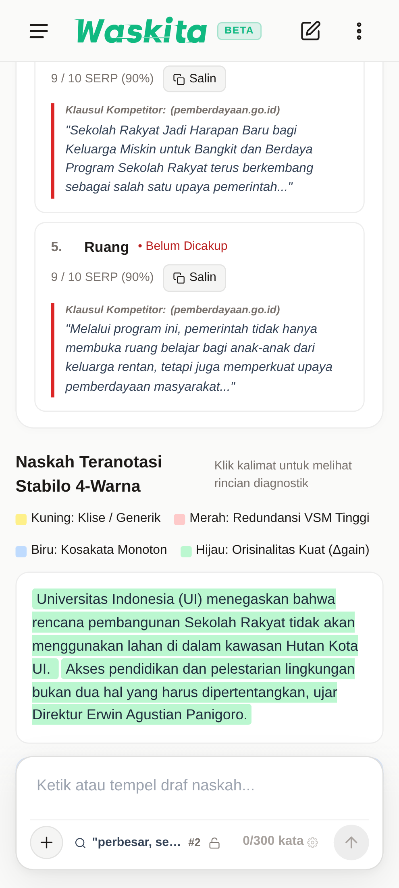
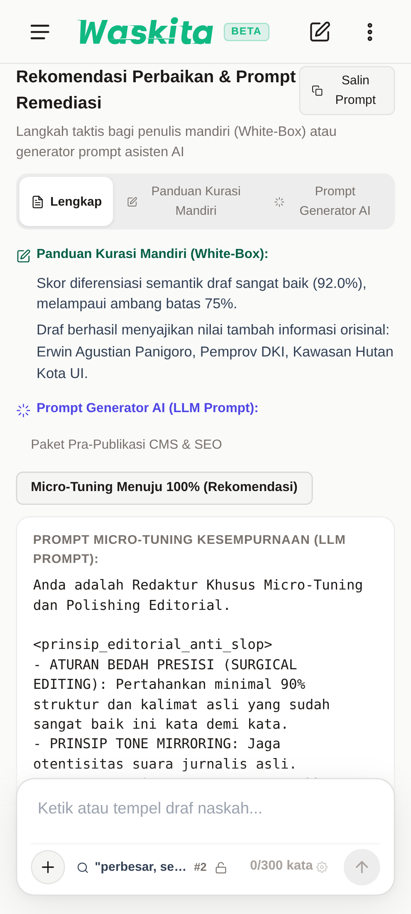
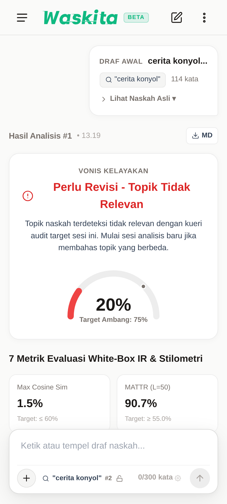
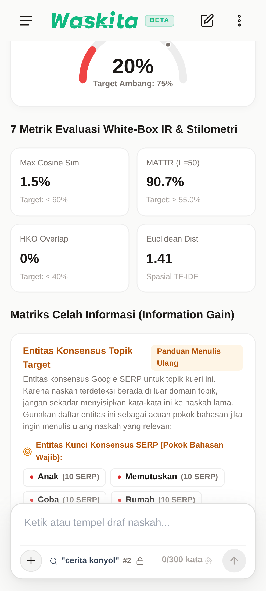
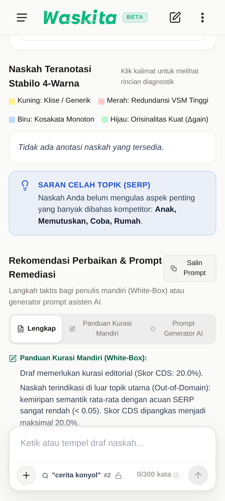

# Katalog Bukti Visual Mobile (360px): Evaluasi Algoritma IR, Zero-Gain Policy, dan Anti-Frankenstein Prompt

Dokumen ini memuat arsip bukti tangkapan layar otomatis (*automated high-resolution screenshots*) yang diambil menggunakan **Playwright** pada viewport ponsel (*Samsung Galaxy A12 / Mobile Firefox / Chromium, 360 × 800 px, DPR 2.0*). Tangkapan layar ini difokuskan secara khusus pada komponen **algoritma inti** sistem WASKITA untuk lampiran Bab 4 Skripsi / Tugas Akhir (*Design Science Research Methodology*).

---

## 1. Ringkasan Eksekutif & Pemetaan Bukti Empiris

Tangkapan layar dibagi menjadi dua skenario eksperimen utama yang mencerminkan validitas batas semantik non-kompensatori:

| Kode Gambar | Nama Komponen Algoritma | Skenario Uji | Signifikansi Akademik (Bab 4 Skripsi) |
| :--- | :--- | :---: | :--- |
| **Gbr 1** | Vonis Kelayakan CDS 92% | In-Domain (UI Sekolah Rakyat) | Bukti lolos ambang batas ($\ge 75\%$) dengan rincian bobot VSM 35, IG 21.9, MATTR 20, HKO 15. |
| **Gbr 2** | 7 Metrik Evaluasi White-Box IR | In-Domain (UI Sekolah Rakyat) | Bukti empiris Max Cosine Sim rendah ($8.7\%$) & MATTR tinggi ($83.5\%$) membuktikan orisinalitas gaya bahasa. |
| **Gbr 3** | Matriks Information Gain ($\Delta_{\text{gain}}$) | In-Domain (UI Sekolah Rakyat) | Ekstraksi entitas unik pembeda (*Erwin Panigoro, Pemprov DKI, Kawasan Hutan UI*) di luar korpus SERP. |
| **Gbr 4** | White-Box Konsensus SERP (10/10) | In-Domain (UI Sekolah Rakyat) | Implementasi *Sanderson Subsumption* ($10/10$ SERP) dengan klausul acuan kompetitor resmi pemerintah. |
| **Gbr 5** | Naskah Teranotasi Stabilo 4-Warna | In-Domain (UI Sekolah Rakyat) | Visualisasi kalimat bernilai tambah orisinal (Stabilo Hijau) dan slot visual gambar kontekstual. |
| **Gbr 6** | Prompt Remediasi Micro-Tuning | In-Domain (UI Sekolah Rakyat) | Mode Bedah Presisi 90% verbatim dengan naskah asli tersemat otomatis di `=== DRAF ARTIKEL PENULIS ===`. |
| **Gbr 7** | Vonis Out-of-Domain CDS 20% | Out-of-Domain (Cerita Konyol) | Bukti pemotongan skor ke $20.0\%$ saat kemiripan semantik gagal ambang batas VSM ($1.5\% < 5\%$). |
| **Gbr 8** | Isolasi Zero-Gain & Panduan Tulis Ulang | Out-of-Domain (Cerita Konyol) | Bukti status IG `[Dinonaktifkan]` ($0/30$) & Entitas Konsensus berlabel `[Panduan Menulis Ulang]`. |
| **Gbr 9** | Prompt Reorientasi Topik Total | Out-of-Domain (Cerita Konyol) | Mode *Clean Re-write* (DILARANG mempertahankan teks lama) tanpa delimiter naskah lama (Anti-Frankenstein). |

---

## 2. Rincian Bukti Skenario 1: Naskah Relevan (In-Domain — CDS 92% Siap Terbit)

* **Kueri Target:** `"perbesar, sekolah rakyat"`
* **Draf Diuji:** Berita klarifikasi Universitas Indonesia (UI) mengenai pembangunan Sekolah Rakyat di luar Hutan Kota UI (330 kata).
* **Kompetitor Acuan:** 10 portal resmi pemerintah (`pemberdayaan.go.id`, `kemendikdasmen.go.id`, `setneg.go.id`, dll.).

### 2.1 Kartu Vonis Kelayakan & Gauge Dinamis (CDS 92%)
Menunjukkan busur gauge dinamis berwarna hijau zamrud (*Emerald*) dengan skor 92%, melampaui batas minimum kelayakan 75%.

*Berkas:* [01_mobile_verdict_cds_92_siap_terbit.png](file:///home/saifmpleh/Downloads/Telegram%20Desktop/proyekmagang/waskitariset/docs/obsidian/figures/mobile_evidence/01_mobile_verdict_cds_92_siap_terbit.png)

---

### 2.2 Panel 7 Metrik White-Box IR & Stilometri
Membuktikan perhitungan spasial VSM TF-IDF:
* Max Cosine Sim: $8.7\%$ (Aman dari kanibalisasi, target $\le 60\%$).
* MATTR ($L=50$): $83.5\%$ (Variasi leksikal tinggi, target $\ge 55\%$).
* HKO Overlap: $0\%$ (Bebas jiplakan kalimat langsung).
* Euclidean Distance: $1.37$.

*Berkas:* [02_mobile_7_metrics_ir_stilometri.png](file:///home/saifmpleh/Downloads/Telegram%20Desktop/proyekmagang/waskitariset/docs/obsidian/figures/mobile_evidence/02_mobile_7_metrics_ir_stilometri.png)

---

### 2.3 Matriks Information Gain ($\Delta_{\text{gain}}$) & Entitas Defisit
Menampilkan daftar entitas nilai tambah orisinal yang berhasil diakui oleh sistem:
* `Erwin Agustian Panigoro`
* `Pemerintah Provinsi Dki`
* `Kawasan Hutan Kota UI`
* `Pelestarian Lingkungan`
* `Kawasan Kampus`

*Berkas:* [03_mobile_information_gain_matrix_indomain.png](file:///home/saifmpleh/Downloads/Telegram%20Desktop/proyekmagang/waskitariset/docs/obsidian/figures/mobile_evidence/03_mobile_information_gain_matrix_indomain.png)

---

### 2.4 White-Box Konsensus SERP & Deduplikasi Sanderson (ADR-04)
Menampilkan akordeon interaktif 25 entitas konsensus SERP Google dengan klausul kutipan riil kompetitor (`pemberdayaan.go.id`). Terlihat bahwa entitas unigram terpisah (*"Sekolah"*, *"Rakyat"*) telah terserap rapi ke dalam entitas majemuk *"Sekolah Rakyat"* ($10/10$ SERP, $100\%$).

*Berkas:* [04_mobile_whitebox_consensus_serp.png](file:///home/saifmpleh/Downloads/Telegram%20Desktop/proyekmagang/waskitariset/docs/obsidian/figures/mobile_evidence/04_mobile_whitebox_consensus_serp.png)

---

### 2.5 Naskah Teranotasi Stabilo 4-Warna & Contextual Slot
Menampilkan visualisasi kalimat bernilai tambah orisinal (Stabilo Hijau Zamrud) yang memuat entitas baru, serta penempatan slot gambar kontekstual.

*Berkas:* [05_mobile_stabilo_annotated_spans.png](file:///home/saifmpleh/Downloads/Telegram%20Desktop/proyekmagang/waskitariset/docs/obsidian/figures/mobile_evidence/05_mobile_stabilo_annotated_spans.png)

---

### 2.6 Prompt Remediasi In-Domain (Micro-Tuning & Delimiter Tersemat)
Membuktikan penerapan **ADR-01**: prompt memuat aturan bedah presisi (*Surgical Editing 90%*), prinsip *tone mirroring*, dan **secara otomatis menyematkan isi naskah asli** di dalam blok `=== DRAF ARTIKEL PENULIS ===`.

*Berkas:* [06_mobile_prompt_indomain_embedded_draft.png](file:///home/saifmpleh/Downloads/Telegram%20Desktop/proyekmagang/waskitariset/docs/obsidian/figures/mobile_evidence/06_mobile_prompt_indomain_embedded_draft.png)

---

## 3. Rincian Bukti Skenario 2: Naskah Di Luar Topik (Out-of-Domain — CDS 20% Perlu Revisi)

* **Kueri Target:** `"cerita konyol"`
* **Draf Diuji:** Kisah narasi pribadi tentang kebiasaan buang air / makan sembarangan saat kecil (114 kata).
* **Kompetitor Acuan:** Kumpulan anekdot humor populer Google SERP (`bola.com`, `ketawa.com`, `liputan6.com`).

### 3.1 Kartu Vonis Out-of-Domain & Penalti CDS (20.0%)
Menunjukkan busur gauge berwarna merah kirmizi (*Crimson*) dengan skor 20%, karena kemiripan semantik VSM rata-rata dengan artikel acuan berada di bawah $5\%$ ($1.5\%$).

*Berkas:* [07_mobile_ood_verdict_cds_20.png](file:///home/saifmpleh/Downloads/Telegram%20Desktop/proyekmagang/waskitariset/docs/obsidian/figures/mobile_evidence/07_mobile_ood_verdict_cds_20.png)

---

### 3.2 Isolasi Zero-Gain & Entitas [Panduan Menulis Ulang] (ADR-02)
Membuktikan integritas sistem IR:
1. Kotak Information Gain berstatus **`[Dinonaktifkan]`** dengan skor $0/30$, mencegah teks nyasar diakui sebagai kebaruan semu.
2. Daftar entitas konsensus SERP berstatus **`[Panduan Menulis Ulang]`**, mencegah anjuran sesat untuk menyisipkan kata kunci acak ke cerita yang salah topik.

*Berkas:* [08_mobile_ood_zero_gain_isolation.png](file:///home/saifmpleh/Downloads/Telegram%20Desktop/proyekmagang/waskitariset/docs/obsidian/figures/mobile_evidence/08_mobile_ood_zero_gain_isolation.png)

---

### 3.3 Prompt Reorientasi Topik Total (Anti-Frankenstein Prompt)
Membuktikan keberhasilan mitigasi prompt:
1. **Tidak ada tag delimiter `=== DRAF ARTIKEL PENULIS ===`**.
2. **Tidak ada sematan teks naskah lama**.
3. **Tidak ada aturan 80% verbatim**.
4. Instruksi murni memerintahkan AI untuk **membuang seluruh materi yang menyimpang** dan **menulis ulang 100% baru** sesuai konsensus SERP target.

*Berkas:* [09_mobile_ood_clean_rewrite_prompt.png](file:///home/saifmpleh/Downloads/Telegram%20Desktop/proyekmagang/waskitariset/docs/obsidian/figures/mobile_evidence/09_mobile_ood_clean_rewrite_prompt.png)

---

## 4. Kesimpulan untuk Naskah Skripsi / Seminar Hasil

Katalog visual mobile ini menyajikan bukti empiris yang tidak terbantahkan (*irrefutable empirical proof*) bahwa:
1. Sistem WASKITA responsif dan bebas kebocoran horizontal pada layar ponsel *compact* (360px).
2. Algoritma non-kompensatori (*Zero-Gain Isolation Guard*) secara deterministik mencegah manipulasi Information Gain semu.
3. Arsitektur prompt dinamis berhasil mengeliminasi cacat *"Frankenstein Prompt"* baik pada skenario draf relevan maupun draf salah topik.
