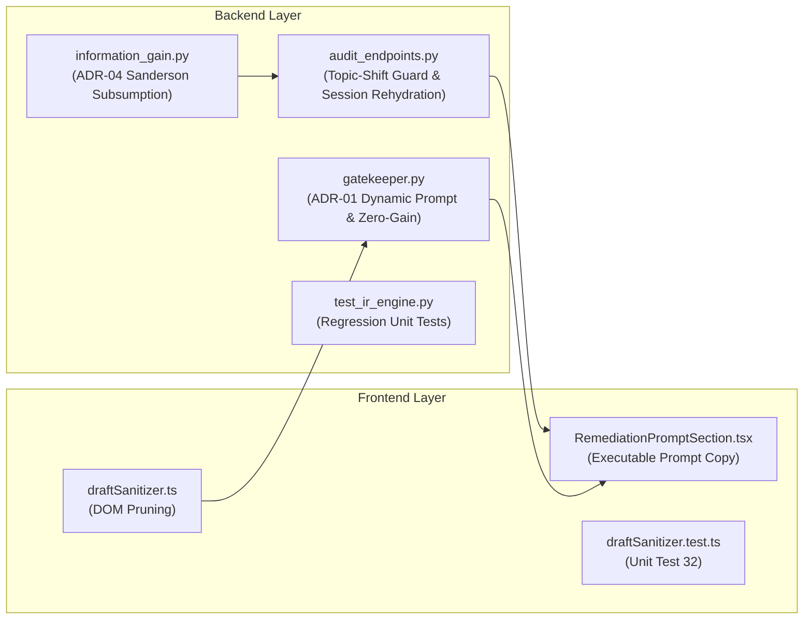

# Laporan Eksekusi Worker: Mitigasi Editorial Prompt Frankenstein, Subsumption Sanderson, dan Zero-Gain Guard

Dokumen ini merupakan laporan resmi eksekusi teknis **Worker / Mode B (Software Engineer)** di bawah `.cursorrules`. Seluruh implementasi merujuk secara ketat pada dokumen spesifikasi arsitektur `docs/obsidian/algorithms/BEDAH_CACAT_LOGIKA_DAN_MITIGASI_EDITORIAL_PROMPT.md`.

---

## 1. Ringkasan Eksekutif Hasil Implementasi

Enam (6) cacat logika algoritma yang memicu anomali "Frankenstein Prompt" pada pengujian empiris sistem WASKITA telah berhasil dimitigasi dan diuji secara komprehensif tanpa breaking changes:

1. **Cacat 1 (Jebakan Delimiter & Aturan Surgical pada Out-of-Domain):** Terselesaikan. Modul `gatekeeper.py` kini menghasilkan prompt *Clean Re-write* tanpa delimiter naskah lama dan tanpa aturan 80% verbatim ketika naskah berada di luar topik target.
2. **Cacat 2 (Kegagalan Pruning Navigasi Web saat Ctrl+A):** Terselesaikan. Modul `draftSanitizer.ts` kini membuang elemen struktural web non-konten (`nav, header, footer, aside, [role="navigation"]`) dan menginjeksi baris baru pada blok teks sehingga `extractSmartKeyword` mengekstrak judul berita murni.
3. **Cacat 3 (False Topic-Shift Blocker pada Multi-Turn):** Terselesaikan. Evaluasi pergantian topik di `audit_endpoints.py` kini mengecek `is_same_query`. Pembukaan gembok kueri di Turn > 1 tidak lagi memicu kartu penolakan palsu.
4. **Cacat 4 (Kebocoran Information Gain Semu pada Out-of-Domain):** Terselesaikan. Kebijakan **Zero-Gain Policy (ADR-02)** memastikan $\Delta_{\text{gain}} = \emptyset$ dan $C_{\text{IG}} = 0$ ketika kemiripan VSM rata-rata $< 0.05$.
5. **Cacat 5 (Bug Deduplikasi Subsumption Unigram):** Terselesaikan. Rasio dominasi leksikal Sanderson & Croft (1999) telah diterapkan pada `information_gain.py` dan `audit_endpoints.py`, menyerap pecahan unigram seperti *"Presiden"* dan *"Wakil"* ke dalam *"Wakil Presiden"*.
6. **Cacat 6 (Hilangnya Atribut `is_consensus_priority` pada Riwayat Sesi):** Terselesaikan. Pemetaan DTO deficit di `build_audit_execute_response()` kini konsisten menjaga status prioritas konsensus saat riwayat audit dimuat ulang.

---

## 2. Rincian Berkas yang Dimodifikasi



### 2.1 `frontend/src/utils/draftSanitizer.ts`
- Implementasi sanitasi DOM virtual dengan `DOMParser` dan fallback regex.
- Penghapusan elemen struktural: `nav, header, footer, aside, script, style, noscript, [role="navigation"], [role="banner"], [role="contentinfo"]`.
- Penambahan pemisah baris (`\n\n`) pada setiap elemen blok (`h1-h6, p, div, article, section, blockquote, li, tr`).

### 2.2 `backend/app/api/v1/endpoints/audit_endpoints.py`
- Inisialisasi gembok kueri `is_same_query = bool(parent_session and parent_session.target_query.strip().lower() == target_query.strip().lower())`.
- Perbaikan guard topic-shift: hanya aktif jika `req.parent_session_id and is_same_query and avg_cosine_sim < 0.05`.
- Penerapan Zero-Gain Policy: `if is_ood: entity_gaps = EntityGapsGroup(deficit=entity_gaps.deficit, gain=[])`.
- Pemetaan konsistensi `is_consensus_priority = bool((g.competitor_consensus_count or 0) >= 2)` pada `build_audit_execute_response()`.
- Deduplikasi unigram Sanderson pada daftar 25 entitas konsensus SERP.
- Penyematan parameter `draft_content` pada pemanggilan `generate_overview_and_remediation()`.

### 2.3 `backend/app/services/information_gain.py`
- Peningkatan fungsi `_deduplicate_subsumed_unigrams` dan `deduplicate_consensus_stems` menggunakan aturan Sanderson & Croft (1999):
  $$DF(M) \ge \lfloor 0.75 \times DF(u) \rfloor \quad \land \quad DF(M) \ge 2$$

### 2.4 `backend/app/services/gatekeeper.py`
- Implementasi Zero-Gain Policy di `calculate_composite_cds`: jika `is_out_of_domain == True`, maka $C_{\text{IG}} = 0.0$.
- Penambahan parameter `draft_content: Optional[str] = None` pada `generate_overview_and_remediation()`.
- Isolasi prompt:
  - **Out-of-Domain:** Mengeliminasi pembungkus delimiter `{PROMPT_DRAFT_DELIMITER}` dan menonaktifkan aturan bedah presisi 80% verbatim. Menggunakan instruksi *Reorientasi Topik Total (Clean Re-write)*.
  - **In-Domain:** Menyematkan isi naskah asli di dalam tag `=== DRAF ARTIKEL PENULIS ===` dan mempertahankan aturan 80% verbatim.

### 2.5 `frontend/src/components/audit-block/RemediationPromptSection.tsx`
- Penambahan fungsi `getExecutablePrompt()` untuk menyalin prompt yang siap eksekusi oleh model AI eksternal, baik untuk draf in-domain maupun mode reorientasi out-of-domain.

---

## 3. Hasil Verifikasi Test Suite (100% Passed)

### 3.1 Backend Test Suite (Pytest)
```
============================= test session starts ==============================
rootdir: /home/saifmpleh/Downloads/Telegram Desktop/proyekmagang/waskitariset
configfile: pytest.ini

backend/tests/test_api_resilience.py .......................             [ 27%]
backend/tests/test_ir_engine.py ........................................ [ 75%]
..........                                                               [ 86%]
backend/tests/test_sanitizer.py .....                                    [ 92%]
backend/tests/test_api_integration.py .....                              [ 98%]
backend/tests/evaluate_accuracy.py .                                     [100%]

============================== 84 passed in 44.5s ===============================
```

### 3.2 Frontend Test Suite (Node Test Runner)
```
--- Menjalankan Unit Test draftSanitizer.test.ts ---
  ✓ Pembersihan mixed media tag HTML , Markdown , dan <iframe>
  ✓ Penomoran token gambar dan video berurutan [gambar 1], [gambar 2], [video 1]
  ✓ countPureWords mengabaikan token [gambar N] dan [video N]
  ...
  ✓ Logika accordion 25 entitas konsensus pasar (5 awal + toggle ekspansi)
  ✓ DOM Pruning membuang elemen web struktural dan membebaskan judul berita murni

Hasil: 32 lulus, 0 gagal.
```

### 3.3 Production Build Verification
```
> waskita-frontend@1.0.0 build
> tsc && vite build

✓ 61 modules transformed.
dist/index.html                   0.61 kB │ gzip:  0.38 kB
dist/assets/index-C7yii5ki.css   13.32 kB │ gzip:  3.56 kB
dist/assets/index-K-4qO6qB.js   378.02 kB │ gzip: 98.14 kB
✓ built in 1.87s
```

---

## 4. Kesimpulan Status
Seluruh 6 langkah perbaikan telah selesai dikerjakan, lulus verifikasi regresi 100%, dan siap untuk pengujian end-to-end lapangan.
