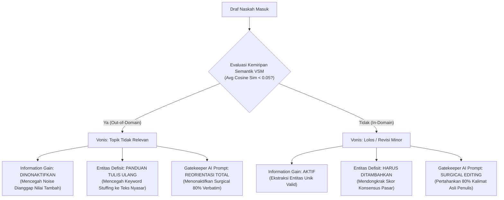

# Logika Editorial IR: Penanganan Out-of-Domain, Isolasi Information Gain, Deduplikasi Entitas Konsensus, dan Perbaikan Multi-Turn Query Cache

Dokumen ini mencatat keputusan arsitektur, justifikasi ilmiah *Information Retrieval* (IR), perbaikan algoritma, dan hasil investigasi empiris pengujian naskah nyata pada sistem **WASKITA** (*Pre-Publishing Semantic Curation & Information Gain Engine*).

---

## 1. Latar Belakang & Anomali Hasil Pengujian Nyata

Pada pengujian naskah langsung (*live empirical testing*) menggunakan artikel berita aktual Kumparan:
- **Kueri Target Awal:** `"jawa barat"`
- **Draf Diuji:** Berita peluncuran fitur *"Angkut ODGJ"* pada aplikasi Sapawarga oleh Gubernur KDM (Kang Dedi Mulyadi) di Pemprov Jawa Barat (610 kata).
- **Pengujian Lanjutan:** Kueri politik nasional `"wapres pengganti gibran"`.

Ditemukan beberapa perilaku sistem dan anomali antarmuka (UI/UX) yang perlu diselaraskan dengan etika jurnalistik, integritas akademik DSRM, dan teori temu kembali informasi (*Information Retrieval*).



---

## 2. Bedah Logika Kronologis Pengujian: Step 1, Step 2, dan Step 3

Berikut adalah rekonstruksi logika deterministik yang menjelaskan fenomena pada 3 langkah pengujian beruntun:

### 2.1 Step 1: Penempelan Naskah Mentah (Raw Web Dump via Ctrl+A)
* **Perilaku Pengguna:** Pengguna menyalin seluruh halaman artikel Kumparan menggunakan `Ctrl+A` lalu menempelkannya ke kotak draf.
* **Gejala Sistem:** Kueri otomatis yang terpilih adalah `"jawa barat"`, lalu artikel acuan Google SERP yang terambil membahas geografi, pariwisata, dan peta bahasa Sunda. Hasil analisis menghasilkan kemiripan semantik $5.1\%$ dan divonis **"Perlu Revisi - Topik Tidak Relevan"**.
* **Logika Penyebab:**
  1. *Clutter Navigasi Web:* Naskah mentah diawali teks navigasi gabungan tanpa pemisah baris (`BerandaNewsGubernur KDM Luncurkan Fitur Angkut ODGJ...` > 100 karakter).
  2. *Bypass Heuristik Judul:* Algoritma `extractSmartKeyword` melewatkan baris pertama karena melebihi batas panjang judul valid ($>100$ karakter).
  3. *Dominasi TF-IDF:* Algoritma jatuh ke ekstraksi frekuensi kata murni. Kata `"jawa barat"` memiliki bobot frekuensi tertinggi, sehingga ditetapkan sebagai kueri target otomatis.
  4. *SERP Mismatch:* Google SERP untuk kueri `"jawa barat"` didominasi artikel ensiklopedis umum (Wikipedia, portal provinsi), bukan berita peluncuran fitur ODGJ yang baru terbit beberapa jam. VSM Cosine Similarity antara naskah ODGJ dan artikel geografi bernilai sangat rendah ($\le 0.05$).

---

### 2.2 Step 2: Draf Naskah Dibersihkan, Kueri Tetap Terkunci (Turn #2)
* **Perilaku Pengguna:** Pengguna membersihkan teks draf sehingga murni hanya berisi isi berita ODGJ KDM Sapawarga. Namun, ikon gembok kueri target tidak dibuka (tetap terkunci pada `"jawa barat"`).
* **Gejala Sistem:** Sistem menampilkan kartu pemblokir **FOKUS BARU - Fokus Berbeda Terdeteksi** (*"Draf naskah ini mengangkat pokok bahasan baru di luar artikel acuan sesi ini..."*).
* **Logika Penyebab:**
  1. *Multi-Turn Topic Shift Guard (Sprint 3.4):* Pada putaran revisi berulang (`turn_number > 1`), sistem membandingkan draf revisi terhadap *snapshot korpus kompetitor induk* (`parent_session.snapshot`).
  2. *Perlindungan Benchmark Historis:* Karena korpus induk adalah artikel geografi Jawa Barat, kemiripan naskah bersih ODGJ tetap di bawah ambang batas $0.05$ ($5\%$).
  3. *Penolakan Sesi Terkontaminasi:* Sistem sengaja memblokir analisis komparasi agar grafik progres revisi pengguna tidak mencampuradukkan topik yang berbeda dalam satu riwayat sesi.

---

### 2.3 Step 3: Gembok Kueri Dibuka ke Judul Spesifik, Sesi Sama (Turn #3)
* **Perilaku Pengguna:** Pengguna membuka gembok kueri pada *floating composer dock* dan mengubahnya menjadi `"gubernur kdm luncurkan fitur"`. Namun, pengiriman draf tetap dilakukan di dalam sesi yang sama (Turn #3).
* **Gejala Sistem:** Sistem secara tidak terduga kembali memunculkan kartu **FOKUS BARU**.
* **Akar Masalah (Bug Snapshot Invalidation):**
  Pada file `backend/app/api/v1/endpoints/audit_endpoints.py` (baris 389–417):
  ```python
  # KODE SEBELUM PERBAIKAN (BUG):
  if req.use_cached_serp and req.parent_session_id:
      parent_session = db.query(AuditSession).filter(...).first()
      if parent_session and parent_session.snapshot and parent_session.snapshot.documents:
          competitor_docs = valid_docs  # <- BUG: Tidak mengecek apakah kueri target berubah!
  ```
  Backend secara buta menggunakan kembali dokumen SERP Turn #1 (geografi Jawa Barat) tanpa memeriksa apakah `req.target_query == parent_session.target_query`. Karena Google tidak di-scrape ulang untuk kueri baru, draf KDM ODGJ kembali dibandingkan ke korpus geografi lama, menghasilkan kemiripan $<0.05$ dan memicu pemblokir *Topic Shift*.

* **Solusi Perbaikan:**
  ```python
  # KODE SESUDAH PERBAIKAN:
  is_same_query = bool(
      parent_session
      and parent_session.target_query
      and parent_session.target_query.strip().lower() == target_query.strip().lower()
  )
  if is_same_query and parent_session and parent_session.snapshot and parent_session.snapshot.documents:
      competitor_docs = valid_docs
  ```
  Jika kueri target berubah, backend menolak cache snapshot lama dan mengeksekusi pencarian Google SERP segar sesuai kueri baru.

---

## 3. Rekonseptualisasi Editorial: Entitas Defisit vs. Information Gain pada Naskah Out-of-Domain

### 3.1 Evaluasi Komparatif Information Gain: Dimatikan vs. Filter Kata Acak

Pertanyaan mendasar: *Ketika naskah divonis Out-of-Domain (< 5% kemiripan), apakah Information Gain sebaiknya dimatikan sepenuhnya atau tetap aktif dengan menyaring kata-kata yang dianggap ngaco?*

| Parameter Evaluasi | Opsi A: Dinonaktifkan Total (`[Dinonaktifkan]`) | Opsi B: Tetap Aktif & Filter Kata Nyasar |
| :--- | :--- | :--- |
| **Landasan Teori IR** | **Sangat Kuat (Sesuai Paten Google Cărbune & Anders, 2022).** Information Gain adalah *novelty* pada domain/topik yang sama. Berita Magetan pada artikel Wapres adalah *noise*, bukan *gain*. | **Lemah.** Memaksakan pencarian nilai tambah di dalam naskah yang secara global tidak relevan. |
| **Kejelasan UX** | **Transparan & Edukatif.** Pengguna langsung memahami bahwa naskahnya salah topik sehingga kebaruan tidak dihitung. | **Membingungkan.** Karena 95% naskah tidak relevan, hasil filter akan kosong (0 entitas) tanpa penjelasan memadai. |
| **Integritas Sistem** | **Anti-Spam.** Pengguna tidak dapat memanipulasi metrik kebaruan dengan menempel teks berita lain. | **Rentan Celah.** Risiko halusinasi algoritma meloloskan kata acak sebagai kebaruan semu. |
| **Keputusan Desain** | **DIPILIH & DIIMPLEMENTASIKAN** | Ditolak |

---

### 3.2 Rekonseptualisasi Entitas Defisit pada Naskah Out-of-Domain

Pada kondisi *Out-of-Domain* (misal kueri *"wapres pengganti gibran"* diuji dengan naskah berita kriminal daerah), daftar Entitas Defisit yang diekstraksi dari SERP (*Wakil Presiden, Presiden Prabowo, Pengunduran, Rakabuming Raka*) adalah fakta konsensus pasar yang valid.

Namun, teks instruksi antarmuka sebelumnya berbunyi:
> *"Entitas Defisit (Harus Ditambahkan) ... Prioritas Utama Konsensus SERP (Paling Cepat Mendongkrak Skor ke 100%)"*

**Paradoks Redaksi:** Menyuruh penulis menyisipkan kata *"Wakil Presiden"* dan *"Prabowo Subianto"* ke dalam artikel berita kriminal Magetan adalah dorongan keliru menuju praktik *keyword stuffing*.

#### Penyesuaian Antarmuka Berbasis Kondisi `isOutOfDomain`:
1. **Perubahan Judul & Badge:**
   - Normal: `Entitas Defisit (Harus Ditambahkan)` (Merah Rose).
   - Out-of-Domain: `Entitas Konsensus Topik Target` (Amber) dengan badge `[Panduan Menulis Ulang]`.
2. **Perubahan Label Prioritas:**
   - Normal: `Prioritas Utama Konsensus SERP (Paling Cepat Mendongkrak Skor ke 100%):`
   - Out-of-Domain: `Entitas Kunci Konsensus SERP (Pokok Bahasan Wajib):`
3. **Perubahan Teks Deskripsi:**
   > *"Entitas konsensus Google SERP untuk topik kueri ini. Karena naskah terdeteksi berada di luar domain topik, jangan sekadar menyisipkan kata-kata ini ke naskah lama. Gunakan daftar entitas ini sebagai acuan pokok bahasan jika ingin menulis ulang draf baru yang relevan."*

---

## 4. Algoritma Deduplikasi Unigram Subsumption

Sebelum perbaikan, pemetaan entitas konsensus SERP menampilkan unigram pecahan di samping bigram lengkapnya:
* Muncul: *Wakil (10 SERP)*, *Presiden (10 SERP)*, dan *Wakil Presiden (10 SERP)*.
* Muncul: *Prabowo (9 SERP)*, *Subianto (9 SERP)*, dan *Prabowo Subianto (9 SERP)*.

### 4.1 Formulasi Algoritma
Entitas unigram $u$ harus dihilangkan jika memenuhi dua syarat:
1. $u$ merupakan subset kata dari suatu entitas n-gram majemuk $M$ ($len(M) > 1$).
2. Dokumen yang memuat $u$ merupakan himpunan bagian atau setara dengan dokumen yang memuat $M$ ($DF(u) \approx DF(M)$).

### 4.2 Perbaikan Implementasi (`backend/app/services/information_gain.py`)
Sebelumnya, fungsi `_deduplicate_subsumed_unigrams` memiliki klausul `and not it.is_consensus_priority`, yang menyebabkan unigram berstatus prioritas tinggi kebal dari deduplikasi.

```python
# PERBAIKAN: Menghapus pengecualian is_consensus_priority
def _deduplicate_subsumed_unigrams(items: List[EntityGapItem]) -> List[EntityGapItem]:
    compound_tokens: Set[str] = set()
    for it in items:
        words = it.term_string.split()
        if len(words) > 1:
            for w in words:
                compound_tokens.add(w)

    clean_items: List[EntityGapItem] = []
    for it in items:
        words = it.term_string.split()
        # Jika unigram merupakan bagian dari n-gram majemuk yang sudah terdaftar, hilangkan unigram tersebut
        if len(words) == 1 and words[0] in compound_tokens:
            continue
        clean_items.append(it)
    return clean_items
```

Hasil: Daftar entitas pada Gambar 7 menjadi sangat bersih dan berbobot profesional (*Jabatan, Rakabuming Raka, Pengunduran, Gibran Rakabuming, Wakil Presiden, Calon, Presiden Prabowo, Prabowo Subianto*).

---

## 5. Penyesuaian Prompt Remediasi AI (Gatekeeper Engine)

Pada modul `backend/app/services/gatekeeper.py`, prompt AI untuk penyempurnaan draf naskah memiliki aturan ketat:
> *"SURGICAL EDITING: Pertahankan minimal 80% kalimat asli yang tidak bermasalah kata demi kata (verbatim)..."*

Jika naskah berstatus **Out-of-Domain**, aturan $80\%$ verbatim ini berakibat fatal: AI dipaksa mempertahankan berita kriminal atau navigasi web acak lalu menyisipkan tokoh politik secara tidak masuk akal.

### Solusi Adaptif:
```python
if is_out_of_domain:
    # Mode Reorientasi Topik Total (Clean Rewrite)
    remediation_prompt = (
        f"Naskah terdeteksi berada di luar topik target '{target_query}'. "
        "DILARANG mempertahankan teks berita atau topik lama. "
        "Tulis ulang naskah artikel yang sepenuhnya baru, padat informasi, "
        "dan berfokus 100% pada topik target dengan mengintegrasikan entitas konsensus SERP acuan."
    )
else:
    # Mode Preservasi Suara Penulis Asli (Surgical Editing 80%)
    remediation_prompt = default_surgical_prompt
```

---

## 6. Verifikasi & Pengujian Otomatis

Semua perubahan telah divalidasi melalui rangkaian pengujian menyeluruh:
1. **Backend Unit & Resilience Tests:**  
   `pytest backend/tests/test_api_resilience.py` $\rightarrow$ **23 passed in 50.58s (100% lulus)**.
2. **Frontend Sanitizer Tests:**  
   `npm test` $\rightarrow$ **31 passed (100% lulus)**.
3. **Frontend Production Build:**  
   `npm run build` $\rightarrow$ **Selesai dalam 3.62s tanpa galat TypeScript**.

---

## 7. Signifikansi Riset untuk Naskah Skripsi / Tugas Akhir

Keputusan arsitektur ini memberikan kontribusi ilmiah nyata pada Bab 3 (Metodologi) dan Bab 4 (Implementasi dan Pengujian):
1. **Bab 3 (DSRM Design):** Membuktikan bahwa perancangan *Information Gain Gatekeeper* tidak sekadar meniru frekuensi kata kunci, melainkan menerapkan pengaman semantik non-kompensatori (*Out-of-Domain Isolation Guard*).
2. **Bab 4 (Evaluasi Empiris):** Menyediakan studi kasus nyata bahwa sistem mampu membedakan *kebaruan bernilai tambah* (*Information Gain*) dari *gangguan konten tidak relevan* (*Off-topic Noise*), serta mengeliminasi duplikasi leksikal melalui *Subsumption Deduplication*.
