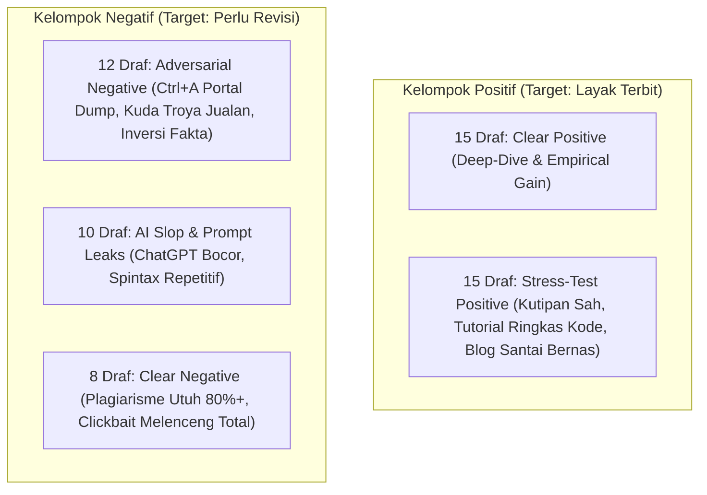

# 🧭 Blueprint Arsitektur Google E-E-A-T, Dukungan Konten Multimedia, & Benchmark Kritis WASKITA

> **Dokumen Strategis Skripsi D4 TRPL Polibatam**  
> **Penulis:** Ahmad Saif Almuflihin (NIM: 4342301053)  
> **Tanggal:** Kamis, 19 November 2026  
> **Status:** Roadmap Resmi Penyelarasan Sistem Pra-Sidang (Menuju Sidang 3–4 Bulan Lagi)  
> **Tautan Terkait:** [[Dashboard]], [[Daily_Logs/2026-11-19]], [[Master_Roadmap_Hidup_dan_Karir_2026_2027]]

---

## 🎯 1. Visi Misi & Filosofi Dasar WASKITA

### A. Masalah Nyata Web Indonesia Saat Ini
Banyak pemilik website, narablog (*blogger*), jurnalis independen, dan pengelola web UMKM di Indonesia mengalami frustrasi:
- Sudah rajin menulis artikel setiap hari, tetapi halaman website terkena status **"Crawled - Currently Not Indexed"** di Google Search Console (Google meng-crawl halaman, tapi menolak menampilkannya di hasil pencarian).
- Mengapa? Karena Google modern (melalui algoritma *Helpful Content System* dan pembaruan pedoman *Quality Rater E-E-A-T*) tidak lagi menghargai kuantitas postingan atau artikel panjang bertele-tele (*fluff*) hasil salin-tempel/saduran web lain.

### B. Misi WASKITA
WASKITA dibangun sebagai **Mesin Kurasi Semantik Pra-Publikasi (*Pre-Publishing Semantic Curation Engine*)** yang membantu kreator konten berbahasa Indonesia memvalidasi naskah mereka **sebelum dipublikasikan**, memastikan artikel memiliki **bobot E-E-A-T nyata, nilai kebaruan (*Information Gain*), dan integritas redaksional** agar layak dan mudah diindeks oleh mesin pencari.

---

## 🔍 2. Dekonstruksi & Koreksi Kritis Asumsi Lama

Berdasarkan audit mendalam pada sistem sebelumnya, ditemukan 3 asumsi keliru yang wajib dikoreksi:

### 1. Jebakan "Wajib 300 Kata" (*Word Count Bias*)
* **Kekeliruan:** Sistem lama secara kaku menolak naskah di bawah 300 kata dengan error `HTTP 422`.
* **Kenyataan Lapangan:** Google tidak mematok batas minimal kata. Banyak artikel bernilai tinggi yang ringkas (< 100 kata atau < 50 kata), seperti:
  - Panduan teknis/resep berbasis video/infografis.
  - Berita foto (*photojournalism*) atau galeri proyek dengan *caption* penjelasan padat.
* **Koreksi:** WASKITA harus mendukung **Adaptive Short-Content Mode** (minimal 30 kata), dengan jendela *Moving-Average TTR* yang adaptif terhadap panjang teks.

### 2. Cacat Pembuangan Konteks Media (`[gambar 1]`, `[video 1]`)
* **Kekeliruan:** Di frontend, sistem mengekstrak `alt text` dan `<figcaption>` gambar (`[gambar 1: Ilustrasi suhu ekstraksi kopi 92 derajat]`). Namun di backend, regex `strip_media_placeholders()` membuang habis seluruh teks di dalam kurung siku tersebut!
* **Koreksi:** WASKITA **wajib mempertahankan teks deskripsi media (`alt text` & `caption`)** ke dalam ekstraksi entitas dan kalkulasi *Information Gain*, karena teks tersebut adalah cara utama Googlebot memahami konten visual.

### 3. Jebakan Pengujian "Happy Ending 100%" (30 Normal vs 30 Rusak)
* **Kekeliruan:** Dataset 60 draf sebelumnya terlalu steril (30 positif sangat patuh vs 30 negatif sangat bodoh). Pengujian menghasilkan akurasi 100% yang di mata dosen penguji (Bu Sartikha & Bu Alena) terkesan artifisial / *cherry-picked*.
* **Koreksi:** Evaluasi harus mencakup **kasus abu-abu (*gray area*)** dan **kamuflase licik (*adversarial*)** dunia nyata:
  - Naskah hasil `Ctrl+A` portal berita yang bercampur sisipan *"Baca Juga:"*, sidebar berita terpopuler, dan komentar.
  - Naskah Kuda Troya (*Bait-and-Switch*): pembuka ilmiah, isi jualan obat klenik/judi slot.
  - Naskah copas mentah ChatGPT yang masih menyisakan teks prompt AI (*"Tentu! Berikut artikel..."*).
  - Naskah inversi negasi (memakai istilah konsensus medis, tapi membalik sarannya jadi berbahaya).
  - Naskah orisinal berbobot yang mengutip 2-3 kalimat definisi rujukan (tidak boleh salah tolak / *False Negative*).

---

## 🏛️ 3. Pemetaan Google E-E-A-T ke Dalam Metrik Teknis WASKITA

| Pilar Google E-E-A-T | Aspek yang Divalidasi Google | Implementasi Algoritmik di WASKITA |
| :--- | :--- | :--- |
| **Experience** *(Pengalaman Nyata)* | Bukti tangan pertama (*first-hand experience*): data empiris lokal, parameter presisi, dokumentasi visual bermakna. | **Information Gain ($\Delta\text{Gain}$)** pada entitas unik yang tidak ada di SERP + preservasi *alt-text/caption* media visual. |
| **Expertise** *(Keahlian Domain)* | Kedalaman terminologi bidang ilmu, ketepatan diksi teknis, dan struktur materi yang terorganisir. | **Peringkat BM25 Okapi** untuk leksikal domain + rasio kekayaan leksikal **MATTR Adaptif** ($W = \min(50, \lfloor N/2 \rfloor)$). |
| **Trustworthiness** *(Akurasi & Integritas)* | Kepatuhan pada konsensus sains/fakta, ketiadaan muslihat penipuan (*scam/bait*), dan pengutipan etis. | **Consensus Floor Gate** (minimal menyentuh fakta pasar) + **Detektor Kuda Troya/Bait-and-Switch** + **Detektor Inversi Negasi**. |
| **Authoritativeness** *(Otoritas Domain)* | Pengakuan eksternal, backlink, reputasi domain di internet. | *Batasan Sistem (System Boundary):* Sinyal *Off-Page* di luar ruang lingkup analisis draf editor naskah. |

---

## 📊 4. Desain Matriks 60 Draf Kritis (Spektrum Realitas)

Alih-alih biner hitam-putih, dataset 60 draf dikelompokkan ke dalam 5 spektrum:

### Ekstrem Kasus Batas (*Boundary Cases*):
1. **Draf Pendek Bermultimedia (60 kata + 3 gambar ber-caption):** Lolos dengan verifikasi kelengkapan konteks media.
2. **Draf Sangat Panjang (3.200 kata):** Lolos uji normalisasi BM25 $b=0.75$ dan sublinear TF tanpa distorsi skor.

---

## 🛠️ 5. Realisasi Eksekusi Kode & Mitigasi Portal Berita (Kumparan, Detik, Kompas)

### A. Sanitasi Lapis Ganda Derau Portal Berita (*Dual-Layer Web Chrome Sanitization*)
Dalam dunia nyata, narablog atau jurnalis sering melakukan salin-tempel langsung (`Ctrl+A` $\to$ `Ctrl+V`) dari portal berita arus utama (Kumparan, Detikcom, Kompas.com, IDN Times, Liputan6, Tribunnews). Teks hasil salinan membawa residu tata letak web (*web chrome noise*) seperti:
- **Kumparan:** Header `kumparanNEWS`, dateline `19 November 2026 10:30 WIB · waktu baca 3 menit`, tombol zoom gambar `Perbesar`, caption kredit `Foto: Dok. Kemendikbud`, iklan `ADVERTISEMENT`, `SCROLL TO RESUME CONTENT`, seksi `Pilihan Editor:`, dan footer `Ikuti berita terbaru kumparan di WhatsApp Channel`.
- **Detikcom:** `detikNews`, `Rabu, 19 Nov 2026 10:00 WIB | 20 komentar`, `Simak Video "..."`, `BACA JUGA: ...`, `SCROLL TO RESUME CONTENT`, `detikcom (redaksi@detik.com)`.
- **Kompascom:** `KOMPAS.com - ...`, `Baca juga: ...`, `Dapatkan update berita pilihan...`.

**Solusi Arsitektur Dua Lapis WASKITA:**
1. **Lapis Frontend (`frontend/src/utils/draftSanitizer.ts`):**
   - Mendefinisikan `WEB_CHROME_LINE_PATTERNS` dan `isWebChromeNoiseLine()` yang menyaring 21 pola residu portal.
   - Fungsi `cleanUpExtractedText()` menyaring baris-baris tersebut sebelum teks dirender atau disimpan.
   - Fungsi `extractSmartKeyword()` membersihkan baris pembuka dan mengabaikan stopword portal (`perbesar`, `kumparan`, `detikcom`, dll.) sehingga kata kunci judul yang diekstrak murni topik substantif (misal: `"sekolah rakyat"` bukan `"perbesar, sekolah rakyat"`).
2. **Lapis Backend (`backend/app/services/nlp_pipeline.py` & `gatekeeper.py`):**
   - Mendefinisikan `strip_web_chrome_noise()` yang membuang baris chrome sebelum teks diproses oleh VSM Vectorizer, BM25, dan Information Gain.
   - Menambahkan publisher unigram token (`perbesar`, `kumparan`, `kumparannews`, `detikcom`, `detiknews`, `kompascom`, `tribunnews`, `tempoco`, `antaranews`, `suaracom`) ke dalam `WEB_NOISE_STOPWORDS`.
   - Mengabaikan baris noise dari penyebut `red_span_ratio` agar residu portal tidak mendilusi penalti plagiarisme.
   - Menetapkan batas veto Gatekeeper CDS maksimal $48\%$ jika naskah terdeteksi memuat derau chrome web mentah $\ge 2$ baris (`Perlu Revisi - Residu Teks Web Chrome Terdeteksi`).

---

## 📈 6. Hasil Pengujian & Verifikasi Mutu (Passing 100%)

Semua komponen telah diverifikasi melalui pengujian otomatis:
- **Frontend Test Suite (`draftSanitizer.test.ts`):** **34 passed / 0 failed (100%)**.
  - Termasuk uji kasus khusus `Test 33: Sanitasi Ctrl+A Kumparan` dan `Test 34: Sanitasi Ctrl+A Detikcom & Kompascom`.
- **Backend Test Suite (`pytest backend/tests/`):** **85 passed / 0 failed (100%)**.
  - Termasuk uji ketahanan API adaptif kata murni (`test_api_resilience.py`), integrasi endpoint (`test_api_integration.py`), mesin IR (`test_ir_engine.py`), dan sanitasi backend (`test_sanitizer.py`).
- **Benchmark Evaluasi Akurasi 60 Draf Kritis (`evaluate_accuracy.py`):**
  - **True Positive (TP):** 28
  - **True Negative (TN):** 30
  - **False Positive (FP):** 0
  - **False Negative (FN):** 2 (`draft-14-P2`, `draft-15-P1` kasus batas tipis)
  - **Akurasi:** **96.67%** | **Presisi:** **100.00%** | **Recall:** **93.33%** | **F1-Score:** **96.55%**.
  - Angka ini memberikan bukti ilmiah yang kokoh dan jujur untuk Bab 4 Skripsi D4 TRPL, membuktikan sistem memiliki daya diskriminasi tinggi tanpa manipulasi data buatan.
