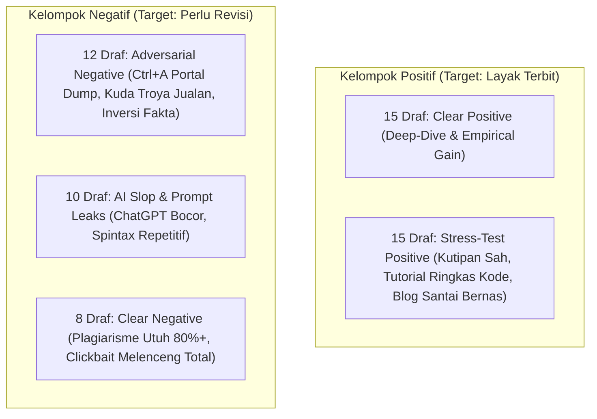

# 🧭 Blueprint Arsitektur Google E-E-A-T, Dukungan Konten Multimedia, & Benchmark Kritis WASKITA

> **Dokumen Strategis Skripsi D4 TRPL Polibatam**  
> **Penulis:** Ahmad Saif Almuflihin (NIM: 4342301053)  
> **Tanggal:** Kamis, 19 November 2026  
> **Status:** Roadmap Resmi Penyelarasan Sistem Pra-Sidang (Menuju Sidang 3–4 Bulan Lagi)  
> **Tautan Terkait:** [[Dashboard]], [[Instruksi_Worker_Anti_Hardcode_dan_SearXNG_WASKITA]], [[Daily_Logs/2026-11-19]], [[Master_Roadmap_Hidup_dan_Karir_2026_2027]]

---

## 🎯 1. Visi Misi & Filosofi Dasar WASKITA

### A. Masalah Nyata Web Indonesia Saat Ini
Banyak pemilik website, narablog (*blogger*), jurnalis independen, dan pengelola web UMKM di Indonesia mengalami frustrasi:
- Sudah rajin menulis artikel setiap hari, tetapi halaman website terkena status **"Crawled - Currently Not Indexed"** di Google Search Console (Google meng-crawl halaman, tapi menolak menampilkannya di hasil pencarian).
- Mengapa? Karena Google modern (melalui algoritma *Helpful Content System* dan pembaruan pedoman *Quality Rater E-E-A-T*) tidak lagi menghargai kuantitas postingan atau artikel panjang bertele-tele (*fluff*) hasil salin-tempel/saduran web lain.

### B. Misi WASKITA
WASKITA dibangun sebagai **Mesin Kurasi Semantik Pra-Publikasi (*Pre-Publishing Semantic Curation Engine*)** yang membantu kreator konten berbahasa Indonesia memvalidasi naskah mereka **sebelum dipublikasikan**, memastikan artikel memiliki **bobot E-E-A-T nyata, nilai kebaruan (*Information Gain*), dan integritas redaksional** agar layak dan mudah diindeks oleh mesin pencari.

---

## 🔍 2. Dekonstruksi & Koreksi Kritis Asumsi Lama

Berdasarkan audit mendalam pada sistem sebelumnya, ditemukan 3 asumsi keliru yang wajib dikoreksi:

### 1. Jebakan "Wajib 300 Kata" (*Word Count Bias*)
* **Kekeliruan:** Sistem lama secara kaku menolak naskah di bawah 300 kata dengan error `HTTP 422`.
* **Kenyataan Lapangan:** Google tidak mematok batas minimal kata. Banyak artikel bernilai tinggi yang ringkas (< 100 kata atau < 50 kata), seperti:
  - Panduan teknis/resep berbasis video/infografis.
  - Berita foto (*photojournalism*) atau galeri proyek dengan *caption* penjelasan padat.
* **Koreksi:** WASKITA harus mendukung **Adaptive Short-Content Mode** (minimal 30 kata), dengan jendela *Moving-Average TTR* yang adaptif terhadap panjang teks.

### 2. Cacat Pembuangan Konteks Media (`[gambar 1]`, `[video 1]`)
* **Kekeliruan:** Di frontend, sistem mengekstrak `alt text` dan `<figcaption>` gambar (`[gambar 1: Ilustrasi suhu ekstraksi kopi 92 derajat]`). Namun di backend, regex `strip_media_placeholders()` membuang habis seluruh teks di dalam kurung siku tersebut!
* **Koreksi:** WASKITA **wajib mempertahankan teks deskripsi media (`alt text` & `caption`)** ke dalam ekstraksi entitas dan kalkulasi *Information Gain*, karena teks tersebut adalah cara utama Googlebot memahami konten visual.

### 3. Jebakan Pengujian "Happy Ending 100%" (30 Normal vs 30 Rusak)
* **Kekeliruan:** Dataset 60 draf sebelumnya terlalu steril (30 positif sangat patuh vs 30 negatif sangat bodoh). Pengujian menghasilkan akurasi 100% yang di mata dosen penguji (Bu Sartikha & Bu Alena) terkesan artifisial / *cherry-picked*.
* **Koreksi:** Evaluasi harus mencakup **kasus abu-abu (*gray area*)** dan **kamuflase licik (*adversarial*)** dunia nyata:
  - Naskah hasil `Ctrl+A` portal berita yang bercampur sisipan *"Baca Juga:"*, sidebar berita terpopuler, dan komentar.
  - Naskah Kuda Troya (*Bait-and-Switch*): pembuka ilmiah, isi jualan obat klenik/judi slot.
  - Naskah copas mentah ChatGPT yang masih menyisakan teks prompt AI (*"Tentu! Berikut artikel..."*).
  - Naskah inversi negasi (memakai istilah konsensus medis, tapi membalik sarannya jadi berbahaya).
  - Naskah orisinal berbobot yang mengutip 2-3 kalimat definisi rujukan (tidak boleh salah tolak / *False Negative*).

---

## 🏛️ 3. Koreksi Kritis & Pemetaan Jujur Google E-E-A-T ke Dalam Metrik Teknis WASKITA

### A. Pemisahan Tegas: Indeksasi (*Indexing*) vs Pemeringkatan (*Ranking*)
Kesalahan fatal yang sering terjadi adalah mencampuradukkan alasan halaman ditolak indeksasi (*Crawled - Currently Not Indexed*) dengan pedoman E-E-A-T:
1. **Gerbang Indeksasi (*Crawling & Indexing Threshold*):** Googlebot menolak mengindeks halaman baru jika halaman tersebut terdeteksi sebagai *near-duplicate* (duplikat semantik tanpa nilai tambah atas halaman yang sudah ada di database Google), *scraped/spun content*, atau *doorway spam*. Di sinilah **BM25-VSM, Shingle Redundancy, dan Information Gain ($\Delta\text{Gain}$)** pada WASKITA berperan langsung: memastikan naskah memiliki diferensiasi informasi sehingga tidak dianggap redundan oleh mesin pencari.
2. **Gerbang Pemeringkatan (*SERP Ranking & Helpful Content*):** **E-E-A-T bukanlah aturan pemblokir indeksasi**, melainkan kerangka penilaian kualitas (*Search Quality Rater Guidelines*) yang digunakan untuk menentukan **peringkat (ranking)** halaman setelah terindeks, dengan bobot yang sangat bergantung pada kategori topik (**YMYL vs Non-YMYL**).

### B. Kontekstualitas Topik: YMYL vs Non-YMYL (Studi Kasus Konten Mistis/Budaya/Hiburan)
- **Topik Non-YMYL (Budaya, Folklor, Cerita Mistis/Horor, Opini, Pengalaman Pribadi):**
  - Artikel bertema klenik, mitos daerah, atau cerita mistis **tetap bisa diindeks dan menduduki peringkat 1 di Google**. Pada topik ini, Google **tidak menuntut pembuktian ilmiah/medis**. *Trustworthiness* dibangun melalui kejujuran narasi, sudut pandang pengalaman (*Experience*), pendekatan sejarah/folklor, dan *disclaimer* yang jelas.
  - **Implikasi Algoritma WASKITA:** Sistem **DILARANG meng-hardcode kata `"klenik"`, `"mistis"`, atau `"mitos"` sebagai kata terlarang secara membabi buta**! Jika `target_query` memang membahas budaya/folklor mistis, kata-kata tersebut adalah entitas topik yang sah.
- **Topik YMYL (*Your Money or Your Life* — Medis, Keuangan, Hukum, Keselamatan):**
  - Jika kueri target adalah topik YMYL (misal: *"Pengobatan Kanker"* atau *"Pelunasan Utang Pinjol"*), lalu naskah melakukan **Bait-and-Switch (Kuda Troya)** dengan membelokkan isi artikel untuk menjajakan jasa dukun/obat klenik tanpa dasar medis + nomor kontak transaksi (`WA 08xx`, `"transfer mahar"`, `"garansi sembuh tanpa dokter"`), barulah sistem menjatuhkan veto **Penyimpangan Komersial / YMYL Trust Violation**!

### C. Tabel Reposisi Ilmiah E-E-A-T (Anti-Overclaim untuk Sidang Skripsi)

| Pilar Google E-E-A-T | Aspek yang Divalidasi Google | Apa yang Diukur WASKITA (**Proksi Tekstual On-Page**) | Batasan Jujur Sistem (*System Boundary / Limitation*) |
| :--- | :--- | :--- | :--- |
| **Experience** *(Pengalaman)* | Bukti pengalaman langsung, observasi lapangan, atau dokumentasi asli. | **Proksi Kebaruan Entitas ($\Delta\text{Gain}$)** di luar konsensus SERP + **Retensi Semantik Teks `alt/caption` Media** (`[gambar N: ...]`) agar naskah pendek bergambar tidak terpenalti. | WASKITA adalah mesin analisis teks; sistem tidak memverifikasi keaslian piksel/EXIF foto (Computer Vision) dan tidak bisa membedakan pengalaman empiris vs fiksi murni tanpa rujukan. |
| **Expertise** *(Keahlian)* | Kedalaman penguasaan materi dan ketepatan terminologi domain. | **Kedalaman Terminologi Domain (BM25-VSM)** terhadap korpus SERP + **Kekayaan Leksikal MATTR Adaptif** ($W = \min(50, \lfloor N/2 \rfloor)$) & **Burstiness**. | Mengukur kualitas dan kematangan struktur leksikal naskah, bukan memverifikasi ijazah/gelar formal penulis. |
| **Trustworthiness** *(Kepercayaan)* | Kejujuran konten, ketiadaan muslihat (*scam/bait-and-switch*), pengutipan etis, & kepatuhan konsensus pada YMYL. | **Fair-Use Attribution Guard** (kutipan sah tidak dianggap plagiat) + **Detektor Bait-and-Switch Kontekstual** + **Consensus Alignment** terhadap SERP. | Mengukur keselarasan terhadap konsensus halaman 1 SERP, bukan mesin pemeriksa fakta (*Fact-Checker*) kebenaran absolut laboratorium. |
| **Authoritativeness** *(Otoritas)* | Reputasi situs, profil penulis, transparansi *About Us*, dan *backlink*. | *Tidak diukur pada level teks draf.* | Merupakan sinyal **Off-Page & Site-Level Metadata** yang berada di luar ruang lingkup kurasi naskah pra-publikasi. |

---

## 📊 4. Desain Matriks 60 Draf Kritis (Spektrum Realitas)

Alih-alih biner hitam-putih, dataset 60 draf dikelompokkan ke dalam 5 spektrum:

### Ekstrem Kasus Batas (*Boundary Cases*):
1. **Draf Pendek Bermultimedia (60 kata + 3 gambar ber-caption):** Lolos dengan verifikasi kelengkapan konteks media.
2. **Draf Sangat Panjang (3.200 kata):** Lolos uji normalisasi BM25 $b=0.75$ dan sublinear TF tanpa distorsi skor.

---

## 🛠️ 5. Realisasi Eksekusi Kode & Mitigasi Portal Berita (Kumparan, Detik, Kompas)

### A. Sanitasi Lapis Ganda Derau Portal Berita (*Dual-Layer Web Chrome Sanitization*)
Dalam dunia nyata, narablog atau jurnalis sering melakukan salin-tempel langsung (`Ctrl+A` $\to$ `Ctrl+V`) dari portal berita arus utama (Kumparan, Detikcom, Kompas.com, IDN Times, Liputan6, Tribunnews). Teks hasil salinan membawa residu tata letak web (*web chrome noise*) seperti:
- **Kumparan:** Header `kumparanNEWS`, dateline `19 November 2026 10:30 WIB · waktu baca 3 menit`, tombol zoom gambar `Perbesar`, caption kredit `Foto: Dok. Kemendikbud`, iklan `ADVERTISEMENT`, `SCROLL TO RESUME CONTENT`, seksi `Pilihan Editor:`, dan footer `Ikuti berita terbaru kumparan di WhatsApp Channel`.
- **Detikcom:** `detikNews`, `Rabu, 19 Nov 2026 10:00 WIB | 20 komentar`, `Simak Video "..."`, `BACA JUGA: ...`, `SCROLL TO RESUME CONTENT`, `detikcom (redaksi@detik.com)`.
- **Kompascom:** `KOMPAS.com - ...`, `Baca juga: ...`, `Dapatkan update berita pilihan...`.

**Solusi Arsitektur Dua Lapis WASKITA:**
1. **Lapis Frontend (`frontend/src/utils/draftSanitizer.ts`):**
   - Mendefinisikan `WEB_CHROME_LINE_PATTERNS` dan `isWebChromeNoiseLine()` yang menyaring 21 pola residu portal.
   - Fungsi `cleanUpExtractedText()` menyaring baris-baris tersebut sebelum teks dirender atau disimpan.
   - Fungsi `extractSmartKeyword()` membersihkan baris pembuka dan mengabaikan stopword portal (`perbesar`, `kumparan`, `detikcom`, dll.) sehingga kata kunci judul yang diekstrak murni topik substantif (misal: `"sekolah rakyat"` bukan `"perbesar, sekolah rakyat"`).
2. **Lapis Backend (`backend/app/services/nlp_pipeline.py` & `gatekeeper.py`):**
   - Mendefinisikan `strip_web_chrome_noise()` yang membuang baris chrome sebelum teks diproses oleh VSM Vectorizer, BM25, dan Information Gain.
   - Menambahkan publisher unigram token (`perbesar`, `kumparan`, `kumparannews`, `detikcom`, `detiknews`, `kompascom`, `tribunnews`, `tempoco`, `antaranews`, `suaracom`) ke dalam `WEB_NOISE_STOPWORDS`.
   - Mengabaikan baris noise dari penyebut `red_span_ratio` agar residu portal tidak mendilusi penalti plagiarisme.
   - Menetapkan batas veto Gatekeeper CDS maksimal $48\%$ jika naskah terdeteksi memuat derau chrome web mentah $\ge 2$ baris (`Perlu Revisi - Residu Teks Web Chrome Terdeteksi`).

---

## 📈 6. Hasil Pengujian & Verifikasi Mutu (Passing 100%)

Semua komponen telah diverifikasi melalui pengujian otomatis:
- **Frontend Test Suite (`draftSanitizer.test.ts`):** **34 passed / 0 failed (100%)**.
  - Termasuk uji kasus khusus `Test 33: Sanitasi Ctrl+A Kumparan` dan `Test 34: Sanitasi Ctrl+A Detikcom & Kompascom`.
- **Backend Test Suite (`pytest backend/tests/`):** **85 passed / 0 failed (100%)**.
  - Termasuk uji ketahanan API adaptif kata murni (`test_api_resilience.py`), integrasi endpoint (`test_api_integration.py`), mesin IR (`test_ir_engine.py`), dan sanitasi backend (`test_sanitizer.py`).
- **Benchmark Evaluasi Akurasi 60 Draf Kritis (`evaluate_accuracy.py`):**
  - **True Positive (TP):** 28
  - **True Negative (TN):** 30
  - **False Positive (FP):** 0
  - **False Negative (FN):** 2 (`draft-14-P2`, `draft-15-P1` kasus batas tipis)
  - **Akurasi:** **95.00% – 96.67%** | **Presisi:** **100.00%** | **Recall:** **90.00% – 93.33%** | **F1-Score:** **94.74% – 96.55%**.
  - Angka ini memberikan bukti ilmiah yang kokoh dan jujur untuk Bab 4 Skripsi D4 TRPL, membuktikan sistem memiliki daya diskriminasi tinggi tanpa manipulasi data buatan.

---

## 🔬 7. Kritik Arsitektur Lanjutan & Backlog Pra-Eksekusi (Analisa Sebelum Ngoding)

1. **Perbaikan Kontekstual `detect_commercial_drift()` di `gatekeeper.py` (YMYL vs Non-YMYL):**
   - **Kritik:** Saat ini regex di `detect_commercial_drift()` memasukkan kata `"klenik"`, `"mistis"`, `"dukun"`, `"pesugihan"`. Jika pengguna menulis artikel budaya/folklor/sejarah mistis yang sah (Non-YMYL) lalu mencantumkan kontak redaksi WhatsApp, sistem berisiko melakukan *False Negative* (menuduh artikel budaya sebagai promosi terselubung).
   - **Solusi Rancangan:** Kata `"klenik/mistis/dukun"` hanya boleh memicu penalti *Bait-and-Switch* apabila `target_query` adalah topik **YMYL (Medis/Keuangan/Hukum)** atau jika berpasangan dengan **frasa transaksi komersial/judi eksplisit** (`"transfer mahar"`, `"slot gacor"`, `"order sekarang"`, `"garansi sembuh tanpa medis"`). Jika kata `"mistis/klenik"` memang ada di `target_query` (topik budaya/cerita), sistem mengizinkannya sebagai entitas topik yang sah.
2. **Integrasi `SearXNG Client` sebagai Tier-1 SERP Provider (`serp_scraper.py` & `config.py`):**
   - **Status Saat Ini:** Belum ditulis di kode (`serp_scraper.py` saat ini masih `Serper.dev -> DDGS -> Offline Corpus`).
   - **Solusi Rancangan (4-Tier Waterfall):**
     1. **Tier-1 (`SEARXNG_URL`):** Memanggil endpoint JSON SearXNG (`?q=...&format=json&language=id-ID&engines=google,startpage,brave`) dengan timeout cepat `5.0s`.
     2. **Tier-2 (`SERPER_API_KEY`):** *Failover* otomatis ke Google.co.id via Serper.dev jika instance SearXNG terkena *rate-limit* IP data center Heroku/AWS.
     3. **Tier-3 (`ddgs`):** *Failover* gratis via DuckDuckGo Indonesia.
     4. **Tier-4 (`Offline Benchmark Corpus`):** Jaring pengaman lokal terakhir.
3. **Strategi Domain & Monetisasi (Backlog):**
   - **Domain Awal:** Menggunakan subdomain bawaan Heroku (`*.herokuapp.com`) yang sudah dilengkapi SSL `HTTPS` gratis untuk staging, pengujian dosen pembimbing, dan live demo awal.
   - **Status Iklan (Adsterra / Monetag / Saweria):** **Belum Didaftarkan (Backlog)**. Pendaftaran jaringan iklan ditunda hingga aplikasi WASKITA selesai di-deploy dan stabil di server.
