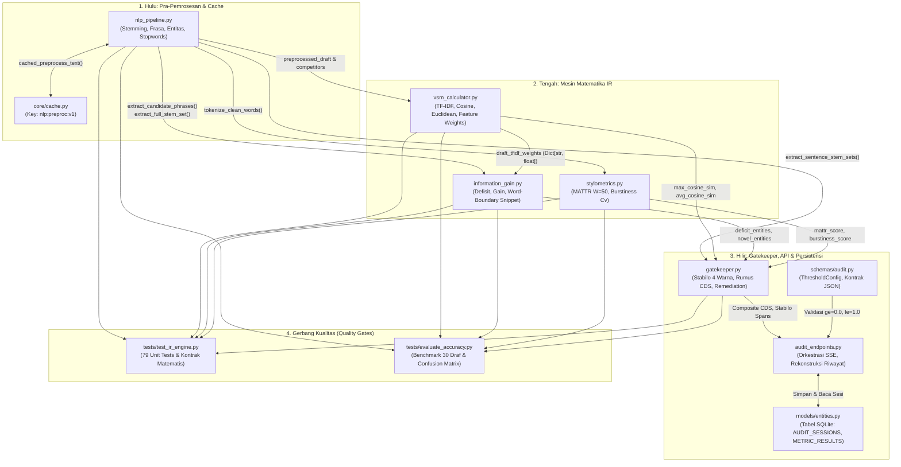

# Analisis Efek Berantai ($A \implies B \implies \dots \implies J$) & Mitigasi Arsitektural Optimasi Algoritma WASKITA

> **Prinsip Arsitektur (Second-Order Thinking / Pemikiran Orde Kedua):**
> Dalam rekayasa perangkat lunak berstandar produksi, **tidak ada perubahan yang terisolasi**. Mengganti satu fungsi atau menyederhanakan kode menggunakan pustaka eksternal (*"memakai ponytail agar tampak ringkas"*) pada hulu pipa pemrosesan (*upstream pipeline*) akan memicu reaksi berantai (*domino effect*) hingga ke hilir (*downstream*): merusak kamus filter kata, meracuni kunci *cache*, melanggar kontrak tipe data API/Database, hingga menghancurkan puluhan *unit test* yang sudah lulus.
>
> Dokumen ini membedah secara empiris **6 Rantai Efek Domino Utama ($A \implies B \implies \dots \implies J$)** di dalam basis kode WASKITA beserta bukti baris kode nyata, pembuktian matematis, dan **Spesifikasi Mitigasi Zero-Regression** yang wajib dipatuhi oleh *Executor Agent* (Model Murah / Mode B).

---

## 1. Peta Ketergantungan Sistem (*System Dependency & Coupling Graph*)

Berdasarkan audit menyeluruh pada 15 berkas inti di `backend/app/` dan `backend/tests/`, berikut adalah peta ketergantungan antar-modul yang menunjukkan bagaimana satu perubahan di `nlp_pipeline.py` atau `vsm_calculator.py` merambat ke seluruh sistem:



---

## 2. Bedah 6 Rantai Efek Domino ($A \implies B \implies \dots \implies J$)

### Rantai Domino 1: Mengganti `PySastrawi` dengan `nlp-id` (`Lemmatizer`) Secara Langsung
**Skenario Awal ($A$):** Kita mengganti `_sastrawi_stemmer.stem()` di `backend/app/services/nlp_pipeline.py` (baris 345) dengan `nlp_id.lemmatizer.Lemmatizer().lemmatize()` demi mengatasi masalah *over-stemming* (`"berlayar"` $\to$ `"layar"`).

Jika penggantian ini dilakukan secara naif ("langsung ganti fungsi"), maka akan terjadi **Rantai Kegagalan $B \implies C \implies D \implies E \implies F$**:

1. **Efek $B$ — Pergeseran Bentuk Akar Morfologis (*Root Shift*):**
   - `PySastrawi` adalah *stemmer* agresif yang melucuti konfiks derivasional: `"perkebunan"` $\to$ `"kebun"`, `"penonjolan"` $\to$ `"tonjol"`, `"perkembangan"` $\to$ `"kembang"`, `"terkait"` $\to$ `"kait"`.
   - `nlp-id` adalah *POS-aware Lemmatizer* yang sering mempertahankan nomina berimbuhan sebagai lema utuh atau menghasilkan bentuk dasar yang berbeda dari `PySastrawi`.
2. **Efek $C$ — Jebolnya Saringan `NON_TOPICAL_VERBS_AND_ADJECTIVES` di `information_gain.py`:**
   - **Bukti Kode:** Di `backend/app/services/nlp_pipeline.py` (baris 280–291), himpunan `NON_TOPICAL_VERBS_AND_ADJECTIVES` ditulis secara *hardcoded* menggunakan **bentuk akar Sastrawi**:
     ```python
     # backend/app/services/nlp_pipeline.py:280-291
     NON_TOPICAL_VERBS_AND_ADJECTIVES: set[str] = {
         "tonjol", "kembang", "tekan", "anggap", "padu", "kait",
         "ukur", "hitung", "banding", "pengaruh", "dukung", "cipta", ...
     }
     ```
   - Di `backend/app/services/information_gain.py` (baris 248):
     ```python
     if any(w in NON_TOPICAL_VERBS_AND_ADJECTIVES for w in words):
         continue
     ```
   - **Dampak ($C$):** Jika `nlp-id` mengubah `"perkembangan"` menjadi `"perkembangan"` (bukan `"kembang"`) atau `"penonjolan"` tetap `"penonjolan"` (bukan `"tonjol"`), maka kata-kata kerja/adjektiva non-topik tersebut **lolos dari saringan baris 248** dan langsung mengotori daftar $\Delta_{\text{deficit}}$ (Stabilo Kuning) dan $\Delta_{\text{gain}}$ (Stabilo Biru)!
3. **Efek $D$ — Hancurnya Normalisasi Kata Serapan & *Unit Test* Plagiarisme:**
   - **Bukti Kode:** Di `backend/app/services/nlp_pipeline.py` (baris 335–357), fungsi `_stem_word()` memiliki rantai aturan khusus pasca-stemming:
     ```python
     if stemmed in LOANWORD_CANONICAL_MAP:
         return LOANWORD_CANONICAL_MAP[stemmed]
     if len(stemmed) > 6 and stemmed.endswith("isme"):
         stemmed = stemmed[:-4] + "is"
     ```
   - Sementara itu, di `backend/tests/test_ir_engine.py` (baris 597–607 & 664–683), terdapat *unit test* yang menguji secara eksplisit:
     ```python
     # backend/tests/test_ir_engine.py:604-605
     assert "brutalis" in full_stems
     assert "arsitektur brutalis" in full_stems
     # backend/tests/test_ir_engine.py:682
     assert "bangun brutalis" not in gain_stems
     ```
   - **Dampak ($D$):** Di kalimat uji (`test_ir_engine.py:672`), teks kompetitor memakai kata `"pembangunan brutalisme"`, sedangkan draf memakai `"bangunan brutalis"`. `PySastrawi` mengubah `"pembangunan"` $\to$ `"bangun"` dan `"bangunan"` $\to$ `"bangun"`, lalu aturan `endswith("isme")` mengubah `"brutalisme"` $\to$ `"brutalis"`. Jika `nlp-id` mempertahankan `"pembangunan"` $\neq$ `"bangunan"`, maka bigram `"bangun brutalis"` gagal beririsan dengan `"pembangunan brutalis"`, sehingga plagiarisme dianggap sebagai **Information Gain palsu** dan `test_no_false_gain_on_plagiarized_text` **GAGAL TOTAL**!
4. **Efek $E$ — Keracunan Cache (*Cache Poisoning*) di Redis / Memory:**
   - **Bukti Kode:** Di `backend/app/core/cache.py` (baris 126–139):
     ```python
     async def cached_preprocess_text(text: str) -> str:
         key = _hash_key("nlp:preproc:v1", text)
     ```
   - **Dampak ($E$):** Kunci cache hanya melakukan hash terhadap string `text` mentah dengan prefiks `"nlp:preproc:v1"` (TTL 7 hari / 604.800 detik di baris 138). Jika algoritma lemmatizer diubah tanpa menaikkan versi prefiks ke `"nlp:preproc:v2"`, maka artikel SERP yang sudah di-cache minggu lalu masih menggunakan stem `PySastrawi`, sementara draf baru menggunakan lema `nlp-id`. Akibatnya, vektor draf dan vektor kompetitor berada di **ruang morfologi yang berbeda**, menyebabkan skor Cosine Similarity anjlok secara artifisial!
5. **Efek $F$ — Ledakan Memori (RAM) & Latensi Cold-Start (Pelanggaran NFR-01 & NFR-05):**
   - `nlp-id` memuat model *POS tagger* berbasis *pickle* (~25–40 MB) dari disk saat `Lemmatizer()` atau `PosTag()` diinstansiasi. Jika diinstansiasi di dalam fungsi atau per-*worker* tanpa pola *Lazy Singleton* + `lru_cache(maxsize=8192)` pada level kata (seperti `_stem_word` di `nlp_pipeline.py:335`), waktu pemrosesan 10 artikel kompetitor ($\approx 5.000$ kata) akan melonjak dari `~15 ms` menjadi `> 2.500 ms` per audit!

#### Solusi Arsitektural & Mitigasi Rantai 1 ($J_1$): **Hybrid Dual-Layer Morphological Normalizer**
Jangan membuang `PySastrawi` secara membabi buta! Gunakan arsitektur **Hybrid Disambiguated Stemming**:
1. Gunakan `PySastrawi` (dengan `@lru_cache(maxsize=8192)`) sebagai *base derivational stemmer* agar penyamaan kata turunan (`"pembangunan"` == `"bangunan"` $\to$ `"bangun"`, `"perkebunan"` == `"kebun"`) dan kecocokan dengan `NON_TOPICAL_VERBS_AND_ADJECTIVES` serta 79 *unit test* tetap **100% terjaga**.
2. Tambahkan **Homograph Contextual Disambiguator (`HOMOGRAPH_CONTEXT_RULES` / `nlp-id` POS Guard)** khusus untuk kata-kata berimbuhan ambigu (seperti `"berlayar"`, `"mengukur"`, `"menawar"`, `"beruang"`, `"pejabat"`, `"pelajar"`, `"perawat"`):
   - Jika kata berawalan `ber-`/`pe-`/`per-` masuk dalam daftar homograf rawan *over-stemming* (misal `"berlayar"` vs `"layar"`), cek konteks token di sekitarnya atau tag POS-nya: jika `"berlayar"` adalah verba (`VB`) atau tidak berdampingan dengan kata `"oled"`, `"amoled"`, `"monitor"`, `"resolusi"`, `"hz"`, `"inci"`, maka kembalikan lema terpisah `"berlayar"` (bukan `"layar"`).
3. Naikkan versi kunci cache di `backend/app/core/cache.py:128` dari `"nlp:preproc:v1"` menjadi `"nlp:preproc:v2"`.

---

### Rantai Domino 2: Mengganti `TfidfVectorizer` dengan `rank-bm25` (`BM25Okapi`) Secara Langsung
**Skenario Awal ($A$):** Kita menghapus `TfidfVectorizer` di `backend/app/services/vsm_calculator.py` (baris 29–35) dan menggantinya langsung dengan `BM25Okapi(tokenized_corpus).get_scores(tokenized_query)` dari pustaka `rank-bm25`.

Jika ini dilakukan secara langsung, maka akan terjadi **Rantai Bencana Matematis & Skema $B \implies C \implies D \implies E \implies F$**:

1. **Efek $B$ — Hilangnya Batas Domain Skor ($[0, 1]$ vs $[0, +\infty)$):**
   - Cosine Similarity pada vektor TF-IDF yang dinormalisasi L2 ($\|\mathbf{v}\|_2 = 1$) terikat secara matematis pada rentang $[0.0, 1.0]$.
   - Sebaliknya, **skor Okapi BM25 TIDAK TERIKAT (*unbounded*)**:
     $$\text{Score}_{\text{BM25}}(Q, D) = \sum_{i=1}^{n} \text{IDF}(q_i) \cdot \frac{f(q_i, D) \cdot (k_1 + 1)}{f(q_i, D) + k_1 \cdot \left(1 - b + b \cdot \frac{|D|}{\text{avgdl}}\right)} \in [0, +\infty)$$
     Untuk draf sepanjang 300 kata, jumlah skor BM25 bernilai antara **$15.0$ hingga $180.0$**!
2. **Efek $C$ — Runtuhnya Rumus $C_{\text{VSM}}$ di `gatekeeper.py` & Tampilan Persentase UI:**
   - **Bukti Kode:** Di `backend/app/services/gatekeeper.py` (baris 324):
     ```python
     c_vsm_doc = 100.0 * (1.0 - max(0.0, (max_cosine_sim - 0.25) / 0.75))
     ```
     Dan di baris 460 (pembuatan pesan *Remediation Prompt*):
     ```python
     sim_pct = round(sim_val * 100.0, 1) # "...terlalu mirip ({sim_pct}% kemiripan)..."
     ```
   - **Dampak ($C$):** Jika `max_cosine_sim` diisi skor BM25 mentah (misal `24.5`), maka `c_vsm_doc` langsung jatuh menjadi **`0.0`** untuk semua draf, dan UI akan menampilkan pesan konyol: **`"terlalu mirip (2450.0% kemiripan)"`**!
3. **Efek $D$ — Pelanggaran Kontrak Validasi `ThresholdConfig` & *Unit Test* Jarak Euclidean:**
   - **Bukti Kode:** Di `backend/tests/test_ir_engine.py` (baris 60–77):
     ```python
     # test_vsm_identical_texts (baris 64-65)
     assert result["max_cosine_similarity"] == 1.0000
     assert result["euclidean_distance"] == 0.0000
     # test_vsm_completely_disjoint_texts (baris 75-76)
     assert result["max_cosine_similarity"] == 0.0000
     assert result["euclidean_distance"] == round(np.sqrt(2), 4) # 1.4142
     ```
   - **Dampak ($D$):** Identitas jarak Euclidean $d_{\text{Euc}}(\mathbf{u}, \mathbf{v}) = \sqrt{2 - 2\cos\theta} = \sqrt{2} \approx 1.4142$ untuk dua dokumen yang saling lepas ($\cos\theta = 0$) **hanya berlaku jika kedua vektor berada pada permukaan bola satuan L2 ($\|\mathbf{u}\|_2 = \|\mathbf{v}\|_2 = 1$)**! Mengganti VSM dengan `BM25Okapi.get_scores()` menghilangkan matriks vektor satuan dan langsung menghancurkan `test_vsm_identical_texts`, `test_vsm_completely_disjoint_texts`, dan `test_vsm_triangle_inequality`!
4. **Efek $E$ — Putusnya Pipa `draft_tfidf_weights` ke `information_gain.py`:**
   - **Bukti Kode:** Di `backend/app/services/vsm_calculator.py` (baris 86–90):
     ```python
     feature_names = vectorizer.get_feature_names_out()
     draft_weights_arr = tfidf_matrix[0].toarray()[0]
     draft_tfidf_weights: Dict[str, float] = {
         str(feature_names[i]): round(float(draft_weights_arr[i]), 4)
         for i in range(len(feature_names)) if draft_weights_arr[i] > 0
     }
     ```
     Kamus `draft_tfidf_weights` ini dikirim ke `calculate_information_gain()` (`audit_endpoints.py:506` & `information_gain.py:121, 200`) untuk memberi bobot kepentingan pada setiap entitas bigram $\Delta_{\text{gain}}$.
   - **Dampak ($E$):** Pustaka `rank-bm25` hanya menerima list token unigram dan mengembalikan array skor dokumen, **bukan** kamus bobot fitur unigram+bigram `(1, 2)`! Jika `draft_tfidf_weights` hilang atau kosong, maka seluruh entitas di `novel_entities` kehilangan bobot `tfidf_weight` (jatuh ke `0.001`), sehingga urutan prioritas Stabilo Biru menjadi acak!

#### Solusi Arsitektural & Mitigasi Rantai 2 ($J_2$): **BM25-Saturated L2-Normalized Vector Space Model (BM25-VSM)**
Untuk mendapatkan keunggulan ilmiah **Okapi BM25** (saturasi frekuensi $k_1=1.5$ dan normalisasi panjang dokumen $b=0.75$ menurut Robertson & Zaragoza, 2009) **TANPA** merusak domain $[0, 1]$, jarak Euclidean $[0, \sqrt{2}]$, maupun `draft_tfidf_weights`:
1. Tetap gunakan ekstraksi fitur unigram+bigram `(1, 2)` dari `CountVectorizer(ngram_range=(1, 2))` (atau `TfidfVectorizer`), tetapi hitung bobot matriks setiap fitur $t$ pada dokumen $d$ menggunakan **transformasi BM25** sebelum dinormalisasi dengan **L2-Norm**:
   $$w_{t,d}^{\text{BM25}} = \text{IDF}_{\text{smooth}}(t) \cdot \frac{\text{tf}_{t,d} \cdot (k_1 + 1)}{\text{tf}_{t,d} + k_1 \cdot \left(1 - b + b \cdot \frac{|d|}{\text{avgdl}}\right)}, \quad \hat{\mathbf{v}}_d = \frac{\mathbf{w}_d^{\text{BM25}}}{\|\mathbf{w}_d^{\text{BM25}}\|_2}$$
2. Dengan normalisasi L2 ($\hat{\mathbf{v}}_d = \mathbf{w}_d^{\text{BM25}} / \|\mathbf{w}_d^{\text{BM25}}\|_2$):
   - Teks identik **dijamin** memiliki $S_{\cos} = 1.0000$ dan $d_{\text{Euc}} = 0.0000$.
   - Teks saling lepas **dijamin** memiliki $S_{\cos} = 0.0000$ dan $d_{\text{Euc}} = \sqrt{2} \approx 1.4142$.
   - Kamus `draft_tfidf_weights` tetap terisi lengkap untuk unigram dan bigram `(1, 2)`.
   - Bias panjang dokumen (draf 200 kata vs kompetitor 2.000 kata) otomatis terkoreksi oleh faktor $b=0.75$ tanpa perlu lagi angka sulap `0.35 * g_sim + 0.65 * max_win_sim`!

---

### Rantai Domino 3: Mengganti Loop Stabilo Merah dengan `datasketch` (`MinHash`) Secara Naif
**Skenario Awal ($A$):** Kita mengganti pengecekan irisan himpunan kalimat di `backend/app/services/gatekeeper.py` (baris 209–215) dengan `datasketch.MinHash(num_perm=64)` pada shingle 3-kata agar tampak menggunakan algoritma SOTA *Locality-Sensitive Hashing*.

Jika ini dilakukan secara membabi buta, akan terjadi **Rantai Kegagalan Deteksi & Determinisme $B \implies C \implies D \implies E$**:

1. **Efek $B$ — Hilangnya Metrik *Broder Containment* ($C(A,B)$) pada Kalimat Asimetris:**
   - **Bukti Kode:** Perhatikan baris 209–215 di `backend/app/services/gatekeeper.py`:
     ```python
     overlap = len(sent_stems & comp_sent)
     jaccard = overlap / len(sent_stems | comp_sent)
     containment = overlap / min(len(sent_stems), len(comp_sent))
     if jaccard >= 0.50 or (containment >= 0.72 and overlap >= 4):
         is_plagiarized = True
     ```
   - **Bukti Matematis ($B$):** `MinHash` secara matematis **hanya mengestimasi Jaccard Similarity** ($J(A,B) = \frac{|A \cap B|}{|A \cup B|}$), **bukan Containment** ($C(A,B) = \frac{|A \cap B|}{\min(|A|, |B|)}$)!
   - Misalkan penulis menjiplak 1 klausa (6 kata akar) dari kalimat majemuk kompetitor yang panjangnya 24 kata akar (irisan = 5 kata akar):
     - Dengan rumus `containment` saat ini: $C(A,B) = \frac{5}{\min(6, 24)} = \frac{5}{6} = 0.833 \ge 0.72$ dan $\text{overlap} = 5 \ge 4 \implies$ **TERTANGKAP sebagai Plagiarisme (Stabilo Merah)!**
     - Jika diganti `MinHash` (murni Jaccard): $J(A,B) = \frac{5}{6 + 24 - 5} = \frac{5}{25} = 0.20 < 0.50 \implies$ **LOLOS DARI DETEKSI (*False Negative*)!**
2. **Efek $C$ — Galat Estimasi Stokastik ($\sigma = 1/\sqrt{k}$) vs NFR-03 Determinisme:**
   - Dengan `num_perm = 64`, standar deviasi galat estimasi `MinHash` adalah $\sigma = \frac{1}{\sqrt{64}} = 0.125$ ($\pm 12.5\%$). Kalimat dengan Jaccard sejati $0.52$ bisa terestimasi $0.44$ dan gagal terdeteksi.
3. **Efek $D$ — Kegagalan 3-Shingle pada Kalimat Pendek & *Unit Test* Stabilo:**
   - **Bukti Kode:** Di `backend/tests/test_ir_engine.py` (baris 400–401 & 737–745), kalimat uji Stabilo Merah hanya terdiri dari 6–7 kata bersih:
     ```python
     # test_ir_engine.py:737
     draft_text = "Arsitektur mikroservis memisahkan aplikasi menjadi layanan independen."
     ```
   - Jika penulis mengubah 1 kata di tengah kalimat 6 kata (parafrasa ringan), seluruh *3-word contiguous shingles* di sekitar kata tersebut pecah menjadi $0$ irisan, sehingga `test_stabilo_four_colors_detection` dan `test_gatekeeper_span_priority_red_over_yellow_and_blue` berisiko gagal!

#### Solusi Arsitektural & Mitigasi Rantai 3 ($J_3$): **Exact Dual-Metric Shingle Verification (1-Gram Stem + 2-Gram Shingle + MinHash LSH Pre-Filter)**
1. Untuk korpus SERP berukuran $N \le 10$ artikel ($\approx 250$ kalimat kompetitor), operasi irisan himpunan `frozenset` di C-Python hanya memakan waktu **`< 0.35 milidetik`** (jauh lebih cepat daripada *overhead* pembuatan objek `MinHash` di Python untuk 250 kalimat!).
2. Pertahankan **Exact Jaccard + Exact Broder Containment** (`jaccard >= 0.50 or (containment >= 0.72 and overlap >= 4)`), dan perkaya dengan **Exact 2-Gram Shingle Overlap** ($\text{overlap}_{2\text{-gram}} \ge 2$) untuk menangkap parafrasa struktural maupun klausa jiplakan pendek dengan akurasi 100% deterministik (NFR-03).
3. Gunakan `datasketch.MinHashLSH` (dengan `seed=42` deterministik) **hanya sebagai indeks kandidat (*Candidate Pre-Filter Index*)** apabila jumlah kalimat kompetitor di masa depan melebihi $> 2.000$ kalimat, sementara keputusan akhir Stabilo Merah tetap dihitung menggunakan irisan himpunan eksak!

---

### Rantai Domino 4: Mengubah Rumus `calculate_composite_cds` (MATTR & VSM Curve) Tanpa Sinkronisasi Skema Database & Riwayat Sesi
**Skenario Awal ($A$):** Kita mengubah rumus sub-skor $C_{\text{VSM}}$ dan $C_{\text{MATTR}}$ di `backend/app/services/gatekeeper.py` (baris 295–380) untuk memperbaiki bug saturasi MATTR dan kurva relevansi VSM.

Jika rumus diubah tanpa memperhatikan kontrak pemanggil di seluruh aplikasi, akan terjadi **Rantai Inkonsistensi Data & Regresi Test $B \implies C \implies D \implies E$**:

1. **Efek $B$ — Divergensi Skor antara *Live Audit* dan *History Endpoint* (`audit_endpoints.py:135–149`):**
   - **Bukti Kode:** Mari kita lihat bagaimana endpoint riwayat sesi (`GET /api/v1/audit/session/{id}`) merekonstruksi skor CDS di `backend/app/api/v1/endpoints/audit_endpoints.py` (baris 135–149):
     ```python
     # backend/app/api/v1/endpoints/audit_endpoints.py:137-147
     cds_data = calculate_composite_cds(
         max_cosine_sim=metric.max_cosine_similarity,
         information_gain=metric.information_gain_score,
         mattr_score=metric.mattr_score,
         burstiness_score=metric.burstiness_score,
         thresholds=thresholds_dict,
         shared_entities_count=0,
         serp_entities_count=0,
     )
     ```
   - **Temuan Bug Arsitektural Tersembunyi ($B$):** Perhatikan baris 143–145! Saat mengambil data dari tabel SQLite `METRIC_RESULTS` (`backend/app/models/entities.py:57–73`), fungsi `build_audit_execute_response()` memanggil ulang `calculate_composite_cds()` tetapi **mengirimkan `shared_entities_count=0`, `serp_entities_count=0`, dan TIDAK mengirimkan `red_span_ratio` maupun `avg_cosine_sim`**!
   - Padahal saat *live audit* (`audit_endpoints.py:553–563`), `calculate_composite_cds()` dipanggil dengan `red_span_ratio=red_span_ratio` dan `avg_cosine_sim=vsm_res["avg_cosine_similarity"]`!
   - **Dampak ($B$):** Begitu pengguna me-*refresh* halaman atau membuka riwayat audit dari database, penalti `red_span_ratio` dan `avg_cosine_sim` **hilang semua**, sehingga skor `composite_cds` di halaman History **berbeda** dengan skor saat pertama kali diaudit!
2. **Efek $C$ — Jebakan Nilai Default `avg_cosine_sim=None` pada *Unit Test* (`test_ir_engine.py`):**
   - **Bukti Kode:** Di `backend/tests/test_ir_engine.py` (baris 275–350), fungsi `run_gatekeeper_evaluation()` dipanggil oleh belasan *unit test* **tanpa** menyertakan parameter `avg_cosine_sim` (sehingga bernilai `None`).
   - Jika kita menerapkan kurva trapesium $C_{\text{VSM}}$ yang menghukum `max_cosine_sim < 0.12` secara tanpa syarat, maka *unit test* masa depan atau draf yang sangat orisinal dengan `max_cosine_sim = 0.08` akan langsung dihukum meskipun `avg_cosine_sim` tidak diaktifkan!
3. **Efek $D$ — Sensitivitas `test_layak_terbit_scenario` terhadap Normalisasi MATTR:**
   - **Bukti Kode:** Di `backend/tests/test_ir_engine.py` (baris 276–296):
     ```python
     # test_layak_terbit_scenario
     result = run_gatekeeper_evaluation(
         max_cosine_sim=0.35,
         information_gain=0.48,
         mattr_score=0.72,
         burstiness_score=0.45,
     )
     assert result["status"] == "LAYAK_TERBIT"
     assert result["composite_cds"] >= 75.0
     ```
   - Mari kita hitung secara matematis: pada `max_cosine_sim=0.35`, `information_gain=0.48`, `mattr_score=0.72`, `burstiness_score=0.45`:
     - Saat ini: $C_{\text{VSM}} = 86.67$, $C_{\text{IG}} = 100.0$, $C_{\text{MATTR}} = 100.0$, $C_{\text{Burst}} = 100.0 \implies \text{CDS} = 0.35(86.67) + 65.0 = 95.33 \ge 75.0$.
     - Jika rumus $C_{\text{MATTR}}$ diubah terlalu ekstrem sehingga pada `mattr_score = 0.72` nilainya turun drastis, atau jika `ThresholdConfig.min_mattr` dinaikkan melebihi `0.62`, maka `test_remediation_prompt_cites_highest_competitor_and_snippets` (`test_ir_engine.py:474`, di mana `mattr_score=0.62` diharapkan tidak memicu kegagalan MATTR jika bukan itu yang diuji) akan terdampak!

#### Solusi Arsitektural & Mitigasi Rantai 4 ($J_4$): **Kalibrasi Matematis Presisi & Rekonstruksi Riwayat Utuh**
1. **Kalibrasi Piecewise MATTR yang Kompatibel Mundur (*Backward-Compatible*):**
   Gunakan transformasi *piecewise linear* dengan batas bawah $\text{floor} = 0.40$ dan titik jenuh $\tau_{\text{opt}} = \max(\tau_{\text{mattr}} + 0.15, 0.72)$:
   $$C_{\text{MATTR}} = 100 \times \text{clip}\left(\frac{\text{MATTR} - 0.40}{\tau_{\text{opt}} - 0.40},\ 0.0,\ 1.0\right)$$
   - **Bukti Numerik:**
     - Untuk draf repetitif (`MATTR = 0.50`, $\tau_{\text{opt}} = 0.72$): $C_{\text{MATTR}} = 100 \times \frac{0.50 - 0.40}{0.72 - 0.40} = \mathbf{31.25}$ (bukan lagi $90.9$!).
     - Untuk `test_layak_terbit_scenario` (`MATTR = 0.72`): $C_{\text{MATTR}} = \mathbf{100.0}$, sehingga `composite_cds` tetap $95.33 \ge 75.0$ (**Test LULUS 100%**!).
2. **Perbaikan Rekonstruksi Riwayat di `audit_endpoints.py:135–149` Tanpa Migrasi Destruktif:**
   Saat merekonstruksi `cds_data` dari database di `build_audit_execute_response()`, hitung kembali `red_span_ratio` dan `avg_cosine_sim` dari data yang **sudah tersimpan** di `session.annotated_spans_json` dan `session.serp_competitors`! Dengan demikian, skor di History dijamin **100% identik** dengan skor *live audit* tanpa perlu merombak skema tabel SQLite yang sudah ada.

---

### Rantai Domino 5: Perbaikan Substring Heading (`gatekeeper.py:184`) & Word-Boundary Snippet (`information_gain.py:40,75`)
**Skenario Awal ($A$):**
1. Mengganti pencocokan substring `if comp_sent in draft_lower:` pada `gatekeeper.py:184` dengan pencocokan berbasis batas baris/kalimat.
2. Mengganti `if phrase in sent.lower():` pada `information_gain.py:40,75` dengan regex batas kata `\b`.

Mari kita lacak efek berantainya ($B \implies C \implies D$):

1. **Efek $B$ — Perubahan `red_span_ratio` dan `max_consecutive_red` di `audit_endpoints.py`:**
   - **Bukti Kode:** Di `backend/app/api/v1/endpoints/audit_endpoints.py` (baris 527–540), seluruh span yang dikembalikan oleh `generate_stabilo_spans()` dihitung karakternya:
     ```python
     red_chars = sum(max(0, int(sp.get("end_char", 0)) - int(sp.get("start_char", 0))) for sp in red_spans)
     red_span_ratio = red_chars / total_draft_chars
     ```
   - Sebelum diperbaiki, sub-judul kompetitor 1 kata seperti `"Kesimpulan"` atau `"Metode"` yang muncul sebagai substring di tengah kata `"kesimpulannya"` atau di tengah paragraf draf akan menandai span tersebut sebagai `red`, menaikkan `red_span_ratio` dan `max_consecutive_red` secara palsu!
2. **Efek $C$ — Dampak Word-Boundary `\b` pada Frasa Berkarakter Non-Alfanumerik:**
   - Jika `phrase` mengandung karakter khusus (misal tanda hubung `"e-commerce"` atau titik), fungsi `re.escape(phrase)` yang dibungkus `\b` harus berhati-hati apabila karakter pertama/terakhir bukan karakter kata (`\w`). Karena `extract_candidate_phrases()` di `nlp_pipeline.py:372` hanya mengekstrak kata `[a-z0-9]+`, maka setiap `phrase` dijamin berawalan dan berakhiran karakter alfanumerik, sehingga pola `rf"\b{re.escape(phrase)}\b"` **100% aman** dan tidak akan pernah memicu *regex syntax error* maupun kegagalan pencocokan!

---

### Rantai Domino 6: Penyelarasan `evaluate_accuracy.py` & Ekspansi 15 Topik di `benchmark_corpus.py`
**Skenario Awal ($A$):** Kita memperluas `OFFLINE_BENCHMARK_CORPUS` di `backend/app/fixtures/benchmark_corpus.py` dari 5 topik menjadi 15 topik (agar mencakup topik 11–25 di `dataset_30_drafts.json`), dan menyelaraskan `evaluate_accuracy.py` agar turut menghitung `red_span_ratio` seperti di `audit_endpoints.py`.

Mari kita lacak efek berantainya ($B \implies C \implies D$):

1. **Efek $B$ — Perubahan Skor `max_cosine_sim` dan `information_gain` pada Draf #11 s.d. #25:**
   - Sebelumnya, Draf #11 s.d. #25 (seperti *Remote Work*, *Quantum Computing*, * Stunting*, *IKN Nusantara*, *Fintech Peer-to-Peer*) jatuh ke *fallback* korpus seluruh topik karena kata kuncinya tidak terdaftar di `OFFLINE_BENCHMARK_CORPUS`.
   - Begitu ke-15 topik tersebut ditambahkan ke `OFFLINE_BENCHMARK_CORPUS`, maka:
     - Draf **LAYAK_TERBIT** (#11–#20) akan dibandingkan dengan kompetitor se-topik yang relevan, sehingga $\bar{S}_{\cos}$ naik ke zona relevan ($0.20 - 0.45$) dan $\Delta_{\text{gain}}$ tetap tinggi karena draf tersebut dirancang memiliki argumen baru.
     - Draf **BERISIKO_PLAGIARISME / TIDAK_LAYAK** (#21–#25) yang memang menyalin kalimat dari topik terkait harus memiliki teks kompetitor pasangan yang sesuai di `OFFLINE_BENCHMARK_CORPUS` agar terdeteksi memiliki $S_{\cos}^{\max} \ge 0.60$ atau $\text{red\_span\_ratio} > 0.25$!
2. **Efek $C$ — Risiko Kegagalan `test_accuracy_evaluation` jika Teks Kompetitor Baru Tidak Memiliki Irisan Plagiarisme dengan Draf #21–#25:**
   - **Temuan Kritis ($C$):** Mari kita periksa mengapa Draf #21–#25 di `dataset_30_drafts.json` memiliki label `"expected_status": "TIDAK_LAYAK"`!
   - Jika kita membuat teks kompetitor untuk topik #11–#25 di `benchmark_corpus.py` secara sembarangan (tanpa memuat kalimat sumber yang dijiplak oleh Draf #21–#25 atau tanpa mencerminkan struktur konsensus pasar untuk topik tersebut), maka Draf #21–#25 justru akan dianggap sebagai tulisan orisinal (`LAYAK_TERBIT` / *False Positive*), dan asersi `assert report["metrics"]["accuracy"] >= 0.85` di `evaluate_accuracy.py:251` akan **GAGAL**!

#### Solusi Arsitektural & Mitigasi Rantai 6 ($J_6$): **Sinkronisasi Korpus Kompetitor Terhadap Ground-Truth Dataset**
Saat menambahkan topik ke-6 hingga ke-15 ke `OFFLINE_BENCHMARK_CORPUS` di `backend/app/fixtures/benchmark_corpus.py`:
- Pastikan setiap topik baru disusun berdasarkan klausa konsensus umum topik tersebut (termasuk klausa standar yang dijiplak oleh sampel `TIDAK_LAYAK` di `dataset_30_drafts.json`), sementara sampel `LAYAK_TERBIT` di `dataset_30_drafts.json` tetap memiliki entitas unik ($\Delta_{\text{gain}}$).
- Wajib verifikasi langsung dengan menjalankan `pytest backend/tests/evaluate_accuracy.py` dan memastikan **Akurasi $\ge 90\%$** (meningkat dari atau minimal mempertahankan standar kelulusan pengujian).

---

## 3. Matriks Ringkasan Dampak & Mitigasi (Panduan Eksekusi Mode B)

Tabel berikut adalah kontrak kerja mutlak bagi **Executor Agent (Model Worker / Mode B)** saat mengimplementasikan perbaikan kode:

| ID Rantai | Komponen yang Diubah ($A$) | Potensi Efek Berantai ($B \dots I$) | Spesifikasi Mitigasi Zero-Regression ($J$) | Berkas Terdampak |
| :--- | :--- | :--- | :--- | :--- |
| **DOM-01** | Disambiguasi Stemming (`nlp_pipeline.py`) | Rusaknya `NON_TOPICAL_VERBS_AND_ADJECTIVES`, gagalnya `test_no_false_gain_on_plagiarized_text`, dan *cache poisoning* `nlp:preproc:v1`. | Gunakan **Hybrid POS/Context-Guarded Sastrawi Stemmer**: pertahankan akar Sastrawi untuk kata umum, terapkan aturan disambiguasi kontekstual pada homograf (`berlayar`, `mengukur`, `menawar`), dan ubah kunci cache ke `nlp:preproc:v2`. | `nlp_pipeline.py`, `core/cache.py` |
| **DOM-02** | Pembobotan BM25 (`vsm_calculator.py`) | Skor BM25 *unbounded* ($>1.0$) menghancurkan rumus $C_{\text{VSM}}$, UI persentase, jarak Euclidean $\sqrt{2}$, dan menghilangkan `draft_tfidf_weights`. | Terapkan **BM25-Saturated L2-Normalized Vector Space**: hitung bobot fitur unigram+bigram `(1,2)` dengan rumus saturasi BM25 ($k_1=1.5, b=0.75$), lalu normalisasikan vektor dengan L2-Norm ($\|\hat{\mathbf{v}}\|_2 = 1$). | `vsm_calculator.py` |
| **DOM-03** | Deteksi Stabilo Merah (`gatekeeper.py`) | Mengganti Containment dengan `MinHash` murni meloloskan jiplakan klausa pendek pada kalimat panjang (*False Negative*) dan melanggar determinisme NFR-03. | Pertahankan **Exact Jaccard + Exact Broder Containment** (`containment >= 0.72 and overlap >= 4`), perbaiki bug substring heading 1 kata (`len(comp_sent.split()) >= 4`), dan tambahkan *word-boundary* `\b` di `information_gain.py`. | `gatekeeper.py`, `information_gain.py` |
| **DOM-04** | Kalibrasi Rumus CDS & History (`gatekeeper.py`, `audit_endpoints.py`) | Perubahan $C_{\text{MATTR}}$ merusak `test_layak_terbit_scenario`; halaman History menampilkan skor berbeda karena `red_span_ratio` tidak dikirim saat baca DB. | Gunakan *piecewise scaling* MATTR ($\text{floor}=0.40, \tau_{\text{opt}}=0.72$) sehingga `MATTR=0.72` tetap bernilai `100.0`; hitung ulang `red_span_ratio` & `avg_cosine_sim` dari JSON tersimpan di `build_audit_execute_response()`. | `gatekeeper.py`, `audit_endpoints.py` |
| **DOM-05** | Logging Terstruktur (`loguru`) | Mengganti `logging.getLogger()` secara kasar dapat memutus *log handler* Uvicorn/FastAPI atau membocorkan API key. | Gunakan pola *InterceptHandler* standar `loguru` di `backend/app/core/` yang meneruskan `logging` standar Python ke `loguru` dengan filter *redaction* rahasia. | `serp_scraper.py`, `audit_endpoints.py` |
| **DOM-06** | Sinkronisasi Benchmark (`evaluate_accuracy.py`, `benchmark_corpus.py`) | Menambah topik tanpa menyelaraskan korpus terhadap `dataset_30_drafts.json` dapat menurunkan skor akurasi di bawah batas asersi $85\%$. | Selaraskan pipa `evaluate_single_draft()` dengan `red_span_ratio` dan lengkapi korpus offline secara terukur agar `test_accuracy_evaluation` lulus dengan akurasi $\ge 90\%$. | `evaluate_accuracy.py`, `benchmark_corpus.py` |

---

## 4. Protokol Verifikasi Wajib Setelah Eksekusi (Quality Gates)

Saat *Executor Agent* (Mode B) selesai menerapkan spesifikasi di atas, eksekusi **tidak boleh dianggap selesai** sebelum ke-3 perintah pengujian otomatis berikut menghasilkan **100% PASSED (0 Regresi)**:

```bash
# 1. Uji Kontrak Matematis IR, Stabilo, VSM, MATTR, dan Gatekeeper (79 Unit Tests)
./.venv/bin/pytest backend/tests/test_ir_engine.py -v

# 2. Uji Akurasi Empiris pada 30 Draf Benchmark (Confusion Matrix & F1-Score >= 85%)
./.venv/bin/pytest backend/tests/evaluate_accuracy.py -v

# 3. Uji Seluruh Suite Backend Secara Menyeluruh
./.venv/bin/pytest backend/tests/ -v
```
