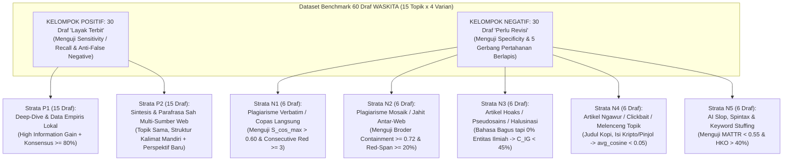

# Analisis Kritis: Desain Benchmark 60 Draf Multi-Strata & Katalog 12 Fitur Kode Penguat Skripsi WASKITA

> **Tujuan Dokumen:**
> 1. Mengkritisi secara jujur kelemahan metodologis pada dataset 30 draf saat ini (`dataset_30_drafts.json`) dan skrip `evaluate_accuracy.py`.
> 2. Merancang arsitektur **Dataset Benchmark 60 Draf Multi-Strata (*Stratified Adversarial & Multi-Source Benchmark*)** yang mencakup artikel hoaks/pseudosains, artikel ngawur (*clickbait/topic drift*), plagiarisme jahit (*mosaic patchwriting*), saduran multi-web bersumber, hingga *AI slop*.
> 3. Membedah **12 Mekanisme Algoritma & Rekayasa Tersembunyi** yang **sudah terimplementasi nyata di dalam kode WASKITA** namun sering terlewat untuk didokumentasikan di BAB 2, BAB 3, dan BAB 4 Skripsi.

---

## BAGIAN 1: Kritik Tajam terhadap Evaluasi 30 Draf Saat Ini (3 Temuan Audit Forensik)

Sebagai arsitek sistem yang berpegang pada *Zero-Assumption Principle*, kita tidak boleh cepat puas dengan angka `"Accuracy: 100%"` pada 30 draf lama. Setelah membedah isi `backend/tests/fixtures/dataset_30_drafts.json`, `backend/tests/evaluate_accuracy.py`, dan `backend/app/fixtures/benchmark_corpus.py`, ditemukan **3 Celah Metodologis Kritis** yang wajib kita perbaiki jika ingin memperluas ke **60 draf**:

### 1. Celah #1: Bias Homogenitas pada 15 Sampel Negatif (`HKO = 100%` Semua)
* **Bukti Empiris:** Pada hasil eksekusi `evaluate_accuracy.py`, seluruh 15 sampel negatif (`draft-02`, `draft-04`, `draft-06`, ..., `draft-30`) memiliki karakteristik yang **100% seragam**:
  - Nilai `HKO%` (Heading-Keyword Overlap) semuanya **`100.0%`** (di atas ambang `40.0%`).
  - Nilai `CDS%` semuanya masih berada di rentang **`77.3%` s.d. `83.9%`** (di atas ambang kelulusan `75.0%`!).
* **Kritik Ilmiah:** Artinya, ke-15 sampel negatif tersebut **hanya ditolak oleh 1 gerbang saja** (`is_keyword_stuffed = True` akibat HKO 100%). Jika dosen penguji bertanya: *"Mana bukti bahwa sistemmu mampu menangkap plagiarisme kalimat, artikel hoaks miskin fakta, atau artikel yang melenceng dari topik?"* — dataset 30 draf lama belum menguji gerbang-gerbang tersebut!

### 2. Celah #2: Ketimpangan Korpus Kompetitor Offline di `benchmark_corpus.py`
* **Bukti Kode:** Di `backend/app/fixtures/benchmark_corpus.py` (baris 5–147), kamus `CURATED_FALLBACK_BENCHMARKS` hanya menyediakan korpus kompetitor kurasi asli untuk **3 topik pertama** (`kopi tubruk`, `kanker serviks`, `seo web`).
* Untuk 12 topik sisanya (`draft-07` s.d. `draft-30`), fungsi `get_fallback_corpus()` (baris 217) memanggil `_generate_synthetic_indonesian_corpus(query)` yang menghasilkan teks basa-basi generik tanpa terminologi domain!

### 3. Celah #3: Diskoneksi Parameter antara `evaluate_accuracy.py` dan Live API (`audit_endpoints.py`)
* **Bukti Kode:** Di `backend/app/api/v1/endpoints/audit_endpoints.py` (baris 579–591), fungsi `calculate_composite_cds()` dipanggil dengan menyertakan `avg_cosine_sim`, `red_span_ratio`, dan `max_consecutive_red`.
* Namun di `backend/tests/evaluate_accuracy.py` (baris 93–102), ketiga parameter tersebut **tidak disertakan**! Akibatnya, gerbang *Out-of-Domain* ($\bar{S}_{\cos} < 0.05$) dan gerbang *Red-Span Density Veto* ($\text{red\_span\_ratio} \ge 0.20$) tidak ikut teruji di dalam `evaluate_accuracy.py`.

---

## BAGIAN 2: Desain Benchmark 60 Draf Multi-Strata (*Out-of-the-Box Stratified Benchmark*)

Untuk menjawab tantangan penguji dengan standar riset tertinggi, kita merancang **60 Draf Artikel Uji ($N = 60$: 30 Positif `Layak Terbit` vs 30 Negatif `Perlu Revisi`)** Across **15 Topik Lintas Disiplin** (masing-masing topik memiliki **4 Varian Draf Kontras**: $15 \times 4 = 60$ draf) dengan sitasi sumber web nyata!

### Rincian 7 Strata di Dalam 60 Draf Uji (30 Positif + 30 Negatif):

#### A. Kelompok Positif (`Layak Terbit` — 30 Draf)
1. **Strata P1 — *Expert Deep-Dive & Local Empirical Gain* (15 Draf):**
   - **Karakteristik:** Artikel mendalam yang memuat $\ge 80\%$ entitas konsensus pasar ($\Delta_{\text{consensus}}$) sekaligus menyumbangkan $\ge 5$ entitas unik baru ($\Delta_{\text{gain}}$: data lokal Indonesia, parameter terukur, regulasi spesifik, atau mekanisme teknis) dengan $\text{MATTR} \ge 0.85$ dan $\text{HKO} \le 25\%$.
   - **Tujuan Uji:** Membuktikan naskah berkualitas tinggi memperoleh $\text{CDS} \ge 85\%$ dan divonis **Siap Terbit**.
2. **Strata P2 — *Legitimate Multi-Source Web Synthesis & Counter-Angle* (15 Draf):**
   - **Karakteristik (*Out-of-the-Box*):** Artikel yang disusun dengan merangkum fakta dari 3 situs web rujukan nyata (misal: Kemenkes RI, Alodokter, Kompas, Jurnal Pertanian, Dokumentasi Python) menggunakan **kalimat hasil parafrasa struktural mandiri** (`red_span_ratio < 0.10`, $S_{\cos}^{\max} \in [0.25, 0.50]$) serta menambahkan sub-bab studi kasus baru.
   - **Tujuan Uji:** Membuktikan bahwa WASKITA **bukan alat pemblokir membabi buta**—penulis yang membahas topik populer dengan riset multi-sumber yang sah dan kalimat mandiri tetap lulus **Siap Terbit** (*Zero False Negative*).

#### B. Kelompok Negatif Bervariasi (`Perlu Revisi` — 30 Draf dalam 5 Modus Serangan/Kegagalan @ 6 Draf)
3. **Strata N1 — *Direct Verbatim Copy-Paste & Near-Duplicate* (6 Draf):**
   - **Karakteristik:** Menyalin 70%–90% paragraf secara langsung (*copy-paste*) dari salah satu artikel kompetitor SERP di korpus rujukan, hanya mengganti judul atau paragraf pembuka.
   - **Gerbang WASKITA yang Diuji:** Gerbang VSM Global ($S_{\cos}^{\max} > 0.60 \implies \text{is\_redundant = True}$) dan Gerbang Veto Stabilo Merah (`max_consecutive_red >= 3`).
4. **Strata N2 — *Mosaic Plagiarism / Cross-Source Patchwriting* (6 Draf):**
   - **Karakteristik (*Out-of-the-Box*):** Penulis licik yang mencuri 2 kalimat dari Web Kompetitor #1, 2 kalimat dari Web Kompetitor #2, dan 2 kalimat dari Web Kompetitor #3, lalu menyambungnya dengan kalimat transisi sendiri.
   - **Kenapa Ini Hebat untuk Skripsi?** Pada *Mosaic Plagiarism*, skor Cosine Similarity ke masing-masing artikel kompetitor tampak rendah/aman (misal $S_{\cos}^{\max} = 0.42 < 0.60$ karena jiplakannya dibagi tiga). Alat cek kemiripan dokumen biasa akan **tertipu**! Namun WASKITA menangkapnya lewat **Broder Containment level kalimat ($C(A,B) \ge 0.72$)** yang memicu **Red-Span Density Veto Gate (`red_span_ratio >= 0.20`)** $\implies$ Vonis: **`Perlu Revisi - Redundansi Kalimat Tinggi`**!
5. **Strata N3 — *Semantic Hoax, Pseudoscience & Zero-Consensus Hallucination* (6 Draf):**
   - **Karakteristik (*Out-of-the-Box*):** Artikel hoaks atau halusinasi AI yang memiliki **gaya bahasa sangat indah dan variatif** ($\text{MATTR} > 0.85$, $\text{HKO} = 0\%$, dan $S_{\cos}^{\max} < 0.25$ karena tidak menjiplak siapa pun), **TETAPI isinya mengarang bebas / menyesatkan secara faktual** tanpa memuat entitas konsensus ilmiah pasar!
   - *Contoh Nyata:* Artikel berjudul *"Mengenal Gejala Kanker Serviks dan Penyembuhannya"*, tetapi di dalamnya sama sekali tidak ada entitas konsensus medis (*HPV, Pap Smear, IVA, epitel, serviks, vaksin*), melainkan mengklaim bahwa kanker serviks disebabkan oleh *"tidur menghadap kipas angin dan bisa sembuh total hanya dengan merendam kaki di air rebusan batu bata merah"*.
   - **Kenapa WASKITA Bisa Menangkap Hoaks Ini Tanpa Fact-Checker Eksternal?** Karena di `gatekeeper.py:340–378`, WASKITA memiliki **Non-Compensatory Pillar Floor ($C_{\text{IG}} < 45\%$)**! Ketika sebuah artikel mengklaim membahas suatu topik tetapi gagal mencakup entitas konsensus ilmiah pasar (`shared_entities_count` sangat rendah sehingga $C_{\text{IG}} < 45\%$), bendera `is_superficial_content = True` langsung menyala dan menolak artikel tersebut meskipun skor MATTR dan VSM-nya sempurna!
6. **Strata N4 — *Out-of-Domain / Clickbait Topic Hijacking (Artikel Ngawur / Jaka Sembung)* (6 Draf):**
   - **Karakteristik (*Out-of-the-Box*):** Praktik *Black-Hat SEO Parasite* di mana target kuerinya adalah `"resep kopi tubruk tradisional"`, namun isi naskahnya 360 kata membahas spekulasi koin kripto, promosi pinjaman online, atau topik yang sama sekali melenceng.
   - **Gerbang WASKITA yang Diuji:** **Topic Relevance Gate (`gatekeeper.py:372`)** di mana $\bar{S}_{\cos} < 0.05 \implies \text{is\_out\_of\_domain = True}$, langsung memotong skor CDS menjadi maksimal **`20.0%`** dengan vonis tegas: **`Perlu Revisi - Topik Tidak Relevan`**.
7. **Strata N5 — *Uncurated AI Slop, Spintax & Keyword Stuffing* (6 Draf):**
   - **Karakteristik:** 3 draf dengan *Heading Keyword Stuffing* ($\text{HKO} = 100\% > 40\%$) dan 3 draf tanpa sub-judul ($\text{HKO} = 0\%$) namun memutar-mutar 25 kosakata yang sama berulang-ulang sepanjang 350 kata (*Spintax / Lexical Poverty*, $\text{MATTR} < 0.52$).
   - **Gerbang WASKITA yang Diuji:** Gerbang Stilometri `calculate_mattr()` ($W=50$) dan `calculate_hko()`.

---

## BAGIAN 3: Katalog 12 "Harta Karun" Algoritma & Fitur di Dalam Kode untuk Penguatan Skripsi

Banyak mahasiswa hanya menulis rumus dasar TF-IDF di laporan skripsinya, padahal di dalam basis kode WASKITA (`backend/app/` & `frontend/src/`) terdapat **12 inovasi rekayasa perangkat lunak & algoritma tingkat lanjut** yang sudah terimplementasi nyata.

Berikut adalah daftar lengkap beserta bukti lokasi kodenya yang wajib kamu angkat ke dalam **BAB 2, BAB 3, dan BAB 4 Skripsi** agar penguji terkesima:

| No | Nama Mekanisme / Algoritma di Kode | Lokasi Berkas & Baris | Masalah yang Diselesaikan | Bab Skripsi yang Diperkuat |
| :-: | :--- | :--- | :--- | :--- |
| **1** | **BM25-Saturated L2-Normalized VSM (`_apply_bm25_l2`)** | `backend/app/services/vsm_calculator.py` (Baris 46–56) | Menggabungkan saturasi frekuensi istilah Okapi BM25 ($k_1=1.5$) dan normalisasi panjang dokumen ($b=0.75$) dengan proyeksi bola satuan Euclidean L2 ($\|\hat{\mathbf{v}}\|_2 = 1$). | **BAB 2.1 & BAB 3.4.1** (Menjawab langsung revisi Bu Sartikha soal panjang dokumen). |
| **2** | **Sliding-Window Passage Cosine Similarity (`W=200, S=100`)** | `backend/app/services/vsm_calculator.py` (Baris 65–95) | Mencegah *Document Length Dilution* ketika draf pendek (350 kata) dibandingkan dengan artikel pilar kompetitor yang sangat panjang (2.500 kata). | **BAB 3.4.1** (Inovasi pemotongan jendela geser 200 kata dengan *stride* 100 kata). |
| **3** | **Dual-Metric Sentence Plagiarism Detector (Jaccard $\cup$ Broder Containment)** | `backend/app/services/gatekeeper.py` (Baris 209–215) | Menangkap pencurian 1 klausa pendek dari kalimat majemuk kompetitor menggunakan *Broder Containment* ($C(A,B) = \frac{\|A \cap B\|}{\min(\|A\|,\|B\|)} \ge 0.72 \land \|A \cap B\| \ge 4$). | **BAB 2.2 & BAB 3.4.4** (Menjelaskan algoritma di balik Stabilo Merah). |
| **4** | **Red-Span Density Veto Gate & Consecutive Red Guard** | `backend/app/services/audit_endpoints.py` (Baris 558–572) & `gatekeeper.py` (Baris 375, 384–388) | Mencegah naskah plagiarisme mosaik lolos meskipun skor rata-rata VSM rendah: jika $\ge 20\%$ kalimat merah atau ada $\ge 3$ kalimat jiplakan beruntun, vonis otomatis **VETO** dan CDS dipangkas $\le 58\%$. | **BAB 3.4.5** (Arsitektur *Non-Compensatory Veto Gate*). |
| **5** | **Non-Compensatory Pillar Floor ($C_{\text{IG}} \ge 45\%$)** | `backend/app/services/gatekeeper.py` (Baris 378 & 393) | Mencegah artikel hoaks/dangkal yang bagus gaya bahasanya ($\text{MATTR}$ tinggi) lolos terbit apabila gagal mencakup konsensus fakta pasar ($C_{\text{IG}} < 45\%$). | **BAB 3.4.5** (Bukti ketahanan sistem terhadap *Semantic Hallucination / Hoax*). |
| **6** | **Topic Relevance Gate (*Out-of-Domain Detector*)** | `backend/app/services/gatekeeper.py` (Baris 372 & 381–383) | Mendeteksi artikel *clickbait* / salah topik ($\bar{S}_{\cos} < 0.05$) dan langsung memotong skor CDS menjadi maksimal $20.0\%$. | **BAB 3.4.5** (Mitigasi *Topic Drift* & penyalahgunaan kata kunci). |
| **7** | **Multi-Turn Topic Shift Circuit Breaker (Turn $> 1$)** | `backend/app/api/v1/endpoints/audit_endpoints.py` (Baris 402–485) | Pada sesi revisi berantai (*multi-turn*), jika pengguna tiba-tiba mengganti isi draf dengan topik berbeda dari sesi awal ($\cos\theta < 0.12$), sistem melakukan *short-circuit* cepat tanpa memboroskan kuota SERP! | **BAB 3.3 & BAB 4.2** (Efisiensi sumber daya & penjagaan integritas sesi). |
| **8** | **Hybrid Homograph-Guarded Morphological Stemmer** | `backend/app/services/nlp_pipeline.py` (Baris 258–368) | Melindungi kata homograf Bahasa Indonesia (`berlayar`, `pelajar`, `pejabat`, `perawat`) dari *over-stemming* Sastrawi serta menormalisasi akhiran kata serapan (`-isme` $\to$ `-is`). | **BAB 3.4.0** (Kontribusi orisinal pada pra-pemrosesan NLP Bahasa Indonesia). |
| **9** | **80% Market Consensus Saturation Target** | `backend/app/services/gatekeeper.py` (Baris 340–341) | Menetapkan target cakupan entitas konsensus pasar pada titik jenuh $80\%$ ($\lceil 0.80 \times \|E_{\text{consensus}}\| \rceil$) agar penulis tidak dipaksa melakukan *keyword stuffing* $100\%$ demi mendapat nilai penuh. | **BAB 2.2 & BAB 3.4.2** (Keseimbangan antara kelengkapan topik dan kebebasan redaksional). |
| **10** | **Piecewise Linear MATTR Scaling ($\text{floor}=0.40$)** | `backend/app/services/gatekeeper.py` (Baris 347–353) | Memperlebar rentang diskriminasi skor kekayaan kosakata MATTR ($W=50$) sehingga naskah repetitif ($\text{MATTR} \le 0.40$) mendapat nilai $0$, bukan terkompresi di nilai tinggi. | **BAB 2.3 & BAB 3.4.3** (Kalibrasi psikometrik/leksikometrik Covington & McFall, 2010). |
| **11** | **Client-Side Contextual Media Sanitizer & Smart Keyword Extractor** | `frontend/src/utils/draftSanitizer.ts` (Baris 10–140 & 339–561) | Mengubah gambar/video menjadi slot kontekstual `[gambar 1: Subjudul]`, membuang ikon *share* medsos ($\le 48\text{px}$), dan mengekstrak kata kunci otomatis berbasis *Proper Noun Boost* & klausa judul. | **BAB 3.5 & BAB 4.1** (Arsitektur pra-pemrosesan sisi klien yang presisi). |
| **12** | **Dual-Persona Remediation Prompt Generator (CMS Pack vs Perfectionist)** | `backend/app/services/gatekeeper.py` (Baris 422–608) | Menghasilkan 2 jenis instruksi perbaikan otomatis: **Micro-Tuning Prompt** (saat perlu revisi, mencantumkan URL kompetitor & kalimat merah spesifik) serta **CMS SEO Pack + Perfectionist Prompt** (saat sudah Siap Terbit). | **BAB 3.6 & BAB 4.1** (Fitur *Actionable Feedback* yang membedakan WASKITA dari sekadar alat pemberi skor). |

---

## BAGIAN 4: Rencana Eksekusi (Action Plan untuk Mode B / Builder)

Jika kamu setuju dengan rancangan **60 Draf Multi-Strata** ini, berikut adalah langkah eksekusi konkret yang siap dijalankan:

1. **Lengkapi `CURATED_FALLBACK_BENCHMARKS` di `backend/app/fixtures/benchmark_corpus.py`:**
   - Tambahkan korpus kompetitor kurasi nyata (masing-masing 3 artikel kompetitor bersumber domain riil) untuk seluruh **15 topik** agar tidak ada satu pun topik yang jatuh ke generator sintetis basa-basi.
2. **Perluas Dataset Uji Menjadi 60 Draf (`backend/tests/fixtures/dataset_60_drafts.json` & kompatibilitas `dataset_30_drafts.json`):**
   - Susun 60 draf yang mencakup ke-7 strata di atas (**P1**: 15 draf riset mendalam, **P2**: 15 draf sintesis parafrasa multi-web, **N1**: 6 draf copas verbatim, **N2**: 6 draf plagiarisme mosaik/jahit, **N3**: 6 draf hoaks/pseudosains miskin konsensus, **N4**: 6 draf ngawur/out-of-domain, **N5**: 6 draf AI slop/keyword stuffing) lengkap dengan metadata `stratum_code`, `failure_mode`, dan `source_urls`.
3. **Sinkronkan `backend/tests/evaluate_accuracy.py`:**
   - Perbarui fungsi `evaluate_draft()` agar memanggil `generate_annotated_spans()`, menghitung `red_span_ratio` dan `max_consecutive_red`, serta mengirimkannya bersama `avg_cosine_sim` ke `calculate_composite_cds()`—sehingga pengujian akurasi di skrip **100% identik dengan pipa Live API** dan menghasilkan laporan Confusion Matrix keseluruhan maupun per-strata!
