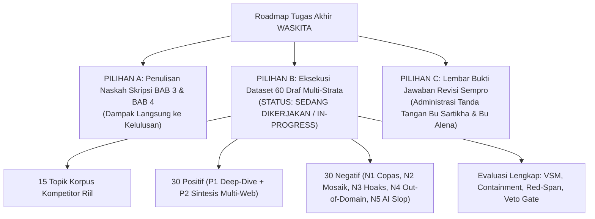

# Roadmap Tugas Akhir WASKITA & Rekomendasi Pilihan Pengembangan

Dokumen ini mencatat 3 pilar prioritas strategis pengembangan Tugas Akhir WASKITA (*Pre-Publishing Semantic Curation & Information Gain Engine*) untuk memastikan kelulusan tepat waktu, kualitas riset ilmiah tingkat tinggi, dan penyelesaian kewajiban administrasi revisi seminar proposal.

---

## 3 Rekomendasi Pilihan Pengembangan

---

### PILIHAN A — Menulis Naskah Skripsi BAB 3 & BAB 4 (Paling Berdampak Langsung ke Kelulusan)
* **Urgensi:** Kodingan dan arsitektur mesin sudah canggih, namun kelulusan akademik mensyaratkan naskah laporan formal yang komprehensif.
* **Cakupan Pekerjaan:**
  1. **BAB 3 (Metodologi Algoritma & Rekayasa Perangkat Lunak):**
     - Alur *Pre-Publishing Verification Pipeline*.
     - Formulasi matematis $S_{\cos}$, Broder Shingling Jaccard $C(A,B)$, Information Gain $C_{\text{IG}}$, MATTR ($W=50$), HKO, dan Non-Compensatory Pillar CDS.
     - Diagram arsitektur FastAPI + SQLite WAL + Vite React 18 Tailwind CSS.
  2. **BAB 4 (Hasil Pengujian & Analisis Pembahasan):**
     - Tabel pengujian akurasi, sensitivitas, spesifisitas, dan F1-Score dari dataset multi-strata.
     - Analisis matriks konfusi (*Confusion Matrix*) dan ketahanan gerbang veto terhadap serangan adversarial (*mosaic plagiarism*, *zero-consensus hoax*, *parasite SEO*).
     - Grafik distribusi skor CDS vs kategori draf.

---

### PILIHAN B — Eksekusi Dataset 60 Draf Multi-Strata (Perkaya Riset Ilmiah)
* **Status:** **SEDANG DIEKSEKUSI (IN PROGRESS - PRIORITAS SAAT INI)**.
* **Urgensi:** Menghilangkan kelemahan metodologis dari dataset 30 draf lama (yang 100% negatifnya hanya karena HKO) dan membuktikan keandalan ilmiah 5 gerbang veto WASKITA.
* **Cakupan Pekerjaan:**
  1. Melengkapi korpus rujukan kompetitor di `backend/app/fixtures/benchmark_corpus.py` menjadi 15 topik lengkap dengan data industri/kesehatan/teknologi riil (bukan teks sintetis acak).
  2. Membangun 60 draf artikel uji multi-strata ($15 \times 4$ varian):
     - **30 Positif (`Layak Terbit`):**
       - 15 Draf P1 (*Expert Deep-Dive & Local Empirical Gain*).
       - 15 Draf P2 (*Legitimate Multi-Source Web Synthesis & Counter-Angle*).
     - **30 Negatif (`Perlu Revisi`):**
       - 6 Draf N1 (*Verbatim Copy-Paste*, $S_{\cos} > 0.60$, `max_consecutive_red >= 3`).
       - 6 Draf N2 (*Mosaic Patchwriting*, $C(A,B) \ge 0.72$, `red_span_ratio >= 0.20`).
       - 6 Draf N3 (*Semantic Hoax / Pseudoscience Hallucination*, $C_{\text{IG}} < 45\%$).
       - 6 Draf N4 (*Out-of-Domain Clickbait / Topic Drift*, $\bar{S}_{\cos} < 0.05$).
       - 6 Draf N5 (*Uncurated AI Slop / Spintax / Keyword Stuffing*, $\text{HKO} > 40\%$, $\text{MATTR} < 0.52$).
  3. Memperbarui `backend/tests/evaluate_accuracy.py` agar mengevaluasi seluruh gerbang veto (`red_span_ratio`, `max_consecutive_red`, `avg_cosine_sim`) dan mencetak laporan matriks konfusi per strata.
  4. Memvalidasi akurasi mesin $\ge 90\%$ dan memastikan 79 unit test IR Engine tetap *100% pass*.

---

### PILIHAN C — Lembar Bukti Revisi Penguji (Untuk Tanda Tangan Revisi Sempro)
* **Urgensi:** Penyelesaian syarat administratif kelulusan seminar proposal dengan dosen penguji (Bu Sartikha & Bu Alena).
* **Cakupan Pekerjaan:**
  1. Rekapitulasi 10 poin revisi Sempro dan jawaban konkret per poin.
  2. Pencantuman bukti kodingan, tangkapan layar antarmuka, dan rujukan dokumen spesifikasi.
  3. Format siap cetak / PDF untuk mempermudah penandatanganan lembar pengesahan revisi.

---
*Catatan: Sesuai arahan, eksekusi difokuskan penuh pada **PILIHAN B (Dataset 60 Draf Multi-Strata)** terlebih dahulu.*
