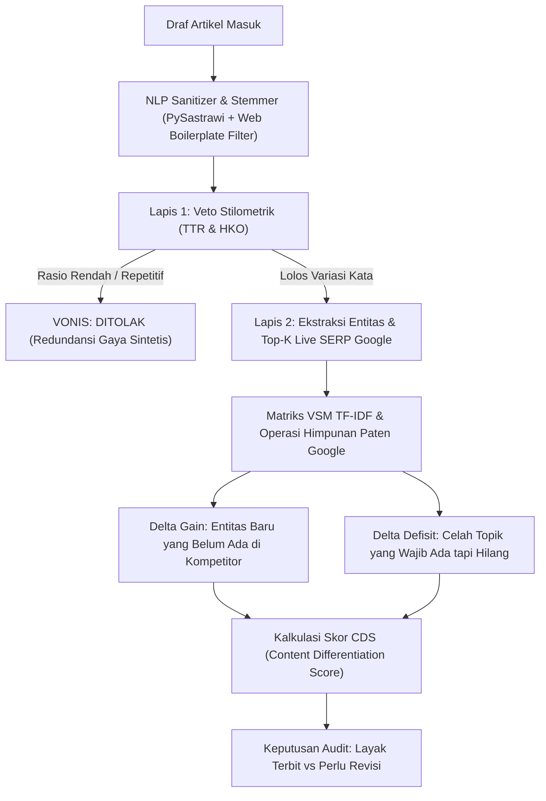

# Evolusi Algoritma Audit Konten: Dari Yoast SEO ke Waskita Information Gain

> **Konteks Riset TA D4 TRPL**: Ahmad Saif Almuflihin (4342301053)  
> **Fokus**: Justifikasi Keunggulan Arsitektur Waskita Dibandingkan Tool Audit Konvensional (Yoast SEO, RankMath, SurferSEO, Clearscope).

---

## 1. Kilas Balik: Tool Generasi 1 (Era Keyword Matching / Yoast SEO)

Tool yang kamu maksud yang *"awalnya dulu cuma ngecek apakah keyword-nya ada di artikel"* adalah **Yoast SEO** (dan plugin sejenis seperti RankMath, All-in-One SEO).

### Bagaimana Cara Kerja Yoast SEO?
Yoast SEO dirilis pada tahun 2010 dan hingga sekarang logika intinya masih berbasis **Rule-Based Heuristic Sederhana (Regex & String Matching)**:
1. **Focus Keyword Matching**: Mengecek apakah *string* kata kunci persis muncul di:
   - Judul H1
   - Paragraf pertama (100 kata pertama)
   - Slug / URL
   - Meta description
   - Subheading H2 / H3
2. **Keyword Density**: Menghitung rasio kemunculan kata kunci target terhadap total kata (aturan baku lama: 1% – 2.5%).
3. **Flesch Reading Ease**: Menghitung panjang kalimat dan jumlah suku kata untuk keterbacaan.

```
[Input Artikel] ---> [Regex Search: "Kata Kunci"] ---> [Lampu Hijau / Merah]
                                                          (Tanpa peduli isi kompetitor!)
```

### Kelemahan Fatal Generasi 1 di Era AI Search:
* **Buta Konteks Kompetitor (*Zero Competitive Context*)**: Yoast tidak tahu apa yang sedang ranking di halaman 1 Google detik ini. Artikel bisa dapat "Lampu Hijau" penuh dari Yoast, tapi saat diterbitkan tetap tenggelam di peringkat 80 Google karena isinya cuma mengulang hal usang.
* **Mendorong *Keyword Stuffing***: Penulis dipaksa menyelipkan kata kunci yang kaku agar lampu menjadi hijau.
* **Rentan Spam AI**: Naskah sampah hasil generate AI dengan mudah mendapatkan skor 100% di Yoast asalkan kata kuncinya disebar rapi.

---

## 2. Generasi 2: Era TF-IDF & N-Gram (SurferSEO / Clearscope Awal)

Pada periode 2018–2022, muncullah tool modern seperti SurferSEO, MarketMuse, dan Clearscope.

### Cara Kerja:
* Mengambil Top-10 / Top-20 SERP Google.
* Menghitung frekuensi kata menggunakan **TF-IDF klasik** atau co-occurrence.
* Memberikan rekomendasi: *"Kompetitor menyebut kata 'efisiensi' sebanyak 5–8 kali, kamu baru menyebut 1 kali. Tambahkan lagi 4 kali!"*

### Kelemahan Generasi 2:
* **Hanya Mendorong Peniruan (*Copycat Content*)**: Penulis diarahkan untuk menjiplak daftar kata kunci kompetitor. Hasilnya: seluruh artikel di Google menjadi seragam (homogen).
* Fenomena inilah yang dibuktikan oleh paper **Bevendorff et al. (2024)**: mesin pencari dipenuhi konten SEO spam yang saling parafrase.

---

## 3. Generasi 3: Terobosan Waskita (Semantic Information Gain & Stilometri)

Waskita melompati kedua generasi di atas dengan memposisikan diri bukan sebagai alat peniru kata kunci, melainkan sebagai **Pre-Publishing Gatekeeper (Auditor Nilai Tambah)** berbasis **Paten Google Information Gain (Cărbune & Anders, 2022)** dan **Vector Space Model (Manning et al., 2008)**.



---

## 4. Matriks Perbandingan Komparatif: Kenapa Waskita Lebih Unggul?

| Dimensi Evaluasi | Generasi 1 (Yoast SEO / Plugin Tradisional) | Generasi 2 (SurferSEO / MarketMuse) | **Generasi 3 (Waskita)** |
| :--- | :--- | :--- | :--- |
| **Prinsip Utama** | *Keyword Matching* statis di naskah sendiri | *Co-occurrence* & peniruan frekuensi kata kompetitor | **Diferensiasi Semantik & Nilai Tambah (Information Gain)** |
| **Konteks Pembanding** | **Tidak ada** (hanya membaca draf lokal) | Statis / Top-20 rata-rata | **Waktu-Nyata (Live Top-K Google SERP via Serper API)** |
| **Vonis Kelayakan** | Checklist lampu (Merah/Kuning/Hijau) | Skor angka 0–100 berdasarkan kepadatan kata | **Dual-Tier Gatekeeper Obyektif (Veto Stilometrik + Nilai Kebaruan CDS)** |
| **Deteksi Pola AI Mentah** | Tidak mampu mendeteksi repetisi | Sering meloloskan teks AI generik | **Mendeteksi via TTR (Type-Token Ratio) & HKO (Hapax Legomena)** |
| **Penanganan Celah Konten** | Nol rekomendasi entitas | Rekomendasi kata tunggal acak | **Identifikasi eksplisit $\Delta_{\text{deficit}}$ (celah topik) & $\Delta_{\text{gain}}$ (nilai orisinal)** |
| **Kecepatan & Privasi** | Cepat (lokal regex) | Lambat & Mahal (Cloud SaaS berbayar mahal) | **Cepat (< 15 detik), Efisien (< 2 GB RAM), Lokal/On-Premise** |

---

## 5. Algoritma Terbaik untuk Menyempurnakan Waskita (Roadmap Peningkatan)

Untuk membuat Waskita semakin kokoh di hadapan penguji dan industri, berikut 3 algoritma yang bisa dipadukan:

### A. Information Gain via Set Difference (Sudah Diimplementasikan)
* **Rumus**:
  $$\Delta_{\text{gain}} = E_{\text{draft}} \setminus E_{\text{SERP}}$$
  $$\Delta_{\text{deficit}} = E_{\text{SERP}} \setminus E_{\text{draft}}$$
* **Keunggulan**: Transparan (*white-box*), deterministik, tidak ada halusinasi AI.

### B. BM25 (Best Matching 25) sebagai Pengganti TF-IDF Standar (Potensi Upgrade)
* **Mengapa BM25?** TF-IDF klasik memiliki kelemahan: artikel yang sangat panjang bisa mendapatkan bobot berlebih. Algoritma **Okapi BM25** menambahkan komponen *document length normalization* sehingga naskah panjang tidak menggelembungkan skor kebaruan secara palsu.

### C. Contextual NER (Named Entity Recognition)
* Menggantikan *hardcoded keyword removal* untuk memisahkan nama organisasi (seperti media *Kompas* atau *Detik*) dari kata benda umum/navigasi secara akurat.

---

## 6. Catatan untuk Obsidian
- File ini terhubung dengan arsitektur Waskita: [[arsitektur-5-lapisan]]
- Hubungan dengan Paten Google: [[paten-information-gain-carbune-2022]]
- Hubungan dengan Fenomena Web Spam: [[bevendorff-ecir-2024]]
